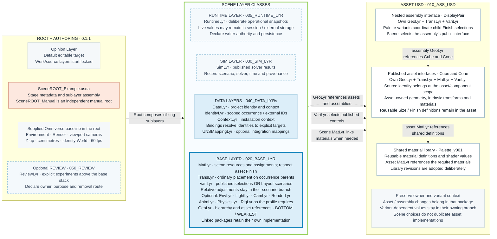

# Scene composition contracts

**Status:** version 0.1.1, independent work-in-progress proposal, 2026-10-10. This is the author's working baseline for collaborative review, not an AOUSD standard or group-approved specification. A local [reference example](examples/01_LayeredScene/README.md) and [project layout](PROJECT_STRUCTURE.md) now exist; full conformance and application acceptance remain pending. Automated enforcement is not implemented. Moved from TutorialBuilder on 2026-10-10; this project now owns the contract. It supersedes conflicting conventions in the earlier VariantSetups exploration; those A–H folders remain experimental evidence in TutorialBuilder. See [provenance and source routes](harness/SOURCES.md).

## 1. Purpose and scope

Our approach is **layered USD scene assembly with published asset interfaces**. A scene root assembles layers with explicit responsibilities. Geometry enters through references to reusable assets. Asset-specific alternatives remain defined within those assets; the scene stores selections and scene-specific adjustments.

### Composition memory chart

Read **left to right: root → scene layer stack → reusable source packages**. Inside the middle column, layers are stacked vertically, with **GeoLyr at the bottom** and the other scene contributions above it. The diagram includes the asset, assembly, material and authoring responsibilities so the composition boundaries remain visible.



**Reading the chart:** four boxes group layer types by class; they are not four additional USD aggregate layers. Runtime and simulation are optional, with their actual strength declared by the profile. The baseline sibling sublayers remain **DataLyr → TransLyr → VariLyr → GeoLyr**, strongest first. GeoLyr is at the bottom of BASE and the scene stack. Optional ReviewLyr sits above the baseline work layers.

The labeled arrows between columns identify the responsible layer: GeoLyr references asset/assembly entrypoints, VariLyr selects their public controls, and a scene MatLyr can link materials for scene-owned assignments. These connections attach to the column boundaries so the middle stack remains vertical. The source packages have their own internal layer stacks and owners.

- **Scene placement:** TransLyr places occurrence parents. VariLyr stores manual selections or scene scenarios, including relative adjustments inside the scenario branch. It preserves the reusable asset's implementation.
- **Assembly decisions:** DisplayPair owns its child placement and Palette variants. Its GeoLyr references Cube and Cone; its VariLyr coordinates their Finish selections. The scene selects Palette on the public assembly interface.
- **Asset decisions:** Cube and Cone own their geometry, intrinsic transforms, material bindings and reusable Size/Finish definitions. A value that depends on a variant stays in its owning variant branch (CC-21).
- **Shared materials:** the material library owns reusable shader definitions; each asset's MatLyr imports the materials it needs. Scene material overrides require an explicit responsibility and must respect asset-controlled Finish choices.
- **Authoring and persistence:** Opinion is the default editable target; persistent work/source layers are locked. Promote accepted edits to the rightful owner and variant branch, then retire superseded experimental opinions.

The supplied Omniverse environment, render and viewport-camera specs remain in the root under the CC-01 template exception. The dashed scene roles remain available for additional work without duplicating that startup content.

These are project authoring conventions built on OpenUSD, not additional USD composition rules or a universal Pixar/NVIDIA standard. Requirements below define the intended harness; documentation alone does not enforce them.

### Minimal teaching profile

The [USD Essentials example](examples/01_LayeredScene/USDEssentials_Minimal/README.md)
is an introductory profile for reading composition: one cube, one cone, two
materials, and three scene roles (MatLyr, TransLyr, GeoLyr). It preserves geometry,
placement and material ownership while deliberately omitting Opinion authoring,
DATA/SIM/RUNTIME roles, variants and the full folder taxonomy. Its Y-up, centimetre,
24 fps root is opened independently from the larger Z-up examples. Authors select
the role layer manually; automatic locking is not supplied. This is a documented
teaching subset, not a full conformance example or a replacement for the starter.

## 2. Why local opinions do not prevent this design

Distinguish three different authored contributions:

| Contribution | Example | Intended result |
|---|---|---|
| Variant selection metadata | Scene chooses `Finish = "Red"` on an asset instance | Overrides the asset's default selection and activates its Red branch. |
| Attribute or relationship opinion | Scene authors a colour or binding on a prim controlled by Finish | May mask the selected branch; prohibited unless it is an explicit override. |
| Transform on a separate scene parent | Scene places an instance at `(100, 200, 0)` | Contributes through transform hierarchy without competing with asset-internal properties. |

“Local wins” concerns competing opinions for particular data. It does not mean a local variant selection suppresses all content of that variant. Selection chooses a branch; the branch's properties then participate in composition. [OpenUSD variant selection API](https://openusd.org/release/api/class_usd_variant_set.html)

For example, VariLyr can contain this selection without copying the asset's variant implementation:

```usda
#usda 1.0
over "World"
{
    over "Cube01"
    {
        over "Adjustment"
        {
            over "Asset" (
                variants = { string Finish = "Red" }
            )
            {
            }
        }
    }
}
```

If another scene opinion directly forces the controlled material or colour, the selection can still read Red while the visible result differs. The harness must inspect both selection and resolved effect. The same issue can arise inside an asset if its own unconditional opinions mask its variants. [Authoring Variants](https://openusd.org/release/tut_authoring_variants.html)

## 3. File ownership contract

**CC-01 — Root assembly and default Opinion authoring.** The root establishes stage metadata and includes scene sublayers. Select the declared `OpinLYR_default.usda` as the default editable authoring target; protect the other persistent work layers and referenced assets. Opinion is the strongest scene work sublayer for explicit experiments and starts empty. Saving persists those experiments. Declare its owner, sharing scope and promotion/removal route. Promote accepted fields to their rightful layer and variant context, then retire only superseded opinions. Keep routine edits out of the root. Session remains available for transient previews and can mask Opinion; it is no longer the default target.

**Kit root exception:** the active root remains API-writable because this Kit build saves camera settings and the authoring-layer identifier in root metadata. Hard-locking it prevents these host operations. USD layer edit permission does not restrict individual metadata fields, so this exception also leaves the root technically editable; selecting Opinion and disabling automatic authoring protects the normal workflow, not every possible root edit. Referenced asset roots remain protected. The helper never saves USD files, but Kit's explicit save operations may persist its root settings. Other applications must declare their own host requirements rather than assume this exception is universal.

This default is an application behavior. Roots declare `cc:defaultAuthoring = "opinion"` and a relative `cc:opinionLayer` path. Kit also receives the relative path in `omni_layer.authoring_layer` for restoration on direct open. The helper selects that target through the Kit API and protects persistent work/source layers; use the launcher for the full protection policy. Older session-policy roots remain supported. No automatic promotion or saving is implemented. A shared Opinion file affects every scene composing it; independent projects need their own copy.

**Application-template baseline exception.** Jan's supplied `SceneROOT_Example.usda` is the standard starting scene for this project's Omniverse profile. Preserve its stage metrics, identity `/World`, top-level `/Environment` and `/Render`, and `OmniverseKit_*` viewport camera opinions. Those supplied application startup specs may remain in the root, including their transforms and material/light settings. New asset occurrences and project edits still follow the layer ownership rules. Record this exception and the template revision in the profile; do not duplicate the startup environment in new scene layers or insert coordinate corrections without evidence. This selects a concrete project baseline, not one universal startup scene for every Omniverse application/version.

| Owner | Allowed responsibility | Excluded from normal authoring |
|---|---|---|
| `GeoLyr.usda` | Define instance hierarchy and reference published asset entrypoints; asset-internal geometry layers may own native geometry | All authored transform operations/order; variant definitions/selections; copied asset geometry in scene layers |
| `TransLyr.usda` at the owning scope | Ordinary transforms: scene placement, assembly placement or asset-internal transforms according to ownership | Transforms owned by another package; variant definitions; conditional transform values extracted from variants |
| `VariLyr.usda` | Scene selections of asset variants; scene scenario definitions; relative scene adjustments inside those scenarios | Duplicated asset variant implementations; arbitrary edits to private asset properties |
| `MatLyr.usda`, when needed | Scene material resources and explicitly assigned scene material responsibilities | Unconditional binding or shader overrides that silently defeat asset finish variants |
| Asset package | Geometry, intrinsic transforms, materials, reusable variants and their public interface, generally loaded as Payload/Reference                | Placement of a particular instance in a particular scene |

**CC-02 — Mandatory transform separation.** GeoLyr contains no variant definitions, selections, or authored transform operations. Ordinary transforms belong in the rightful owner's TransLyr. If a transform needs authoring and that owner has no TransLyr, create it and include it in that owner's layer stack. Missing TransLyr is never permission to put transforms in GeoLyr. This includes operation values, time samples, pivots, `xformOpOrder` and reset-stack tokens. Defining an Xform prim or storing mesh points is not itself authoring transform operations. Variant-dependent transform contributions remain inside the rightful owner's variant context in VariLyr, as defined by CC-07/09; never extract them into unconditional TransLyr opinions. File names are conventions; future checks must inspect authored content.

## 4. Asset interface and lofting contract

**CC-03 — Asset-owned alternatives.** A choice meaningful independently of a particular scene belongs in the asset: finish, detail, configuration or intrinsic articulation. Define it once in the asset package's variant layer at the hierarchy level that owns the choice. Assemblies are assets too: a robot-wide finish can belong to the robot assembly, while its hand or screw has separate intrinsic defaults. The scene selects a published choice rather than copying its implementation. Apply the role separation recursively within authored asset and assembly packages.

**CC-04 — Public interface.** Publish stable entrypoint paths, variant-set names, available choices, defaults, supported parameters, units, up-axis and origin/pivot conventions. Identify private implementation paths. An asset's default values must not accidentally mask its own variants. Interface changes require an explicit compatibility decision.

**CC-05 — Lofting location.** Keep lofted information in the asset interface, above a payload when a payload is used. This can advertise lightweight variant information while heavy implementation remains behind the payload. A separate asset-owned interface/loft layer is optional. No scene LoftLyr is required merely to discover referenced variants.

Lofting is a publishing pattern, not a new composition arc and not automatic promotion to `/World`. A scene-parent control driving several asset choices must be authored explicitly as a scene scenario. Lofted declarations must stay synchronized with the published asset. Small assets may expose their interface directly without a payload. [NVIDIA asset interfaces and lofting](https://docs.omniverse.nvidia.com/usd/latest/learn-openusd/independent/asset-structure-principles.html#reference-payload-pattern)

**CC-05a — Loading boundary and evidence.** Publish the names/defaults needed for discovery outside the payload; keep variant-dependent values in their implementation branches. Empty variant declarations may advertise the interface without duplicating geometry or bindings. An optional `ContentsLyr` aggregates the asset's role files behind the payload and owns no ordinary transforms. Define what remains discoverable under LoadNone, after loading an assembly only, and after loading its children. An unloaded assembly need not expose its private child hierarchy. Check interface/implementation agreement across supported choices after changes. Cached bounds, thumbnails and other lightweight metadata are optional and require their own update policy. Seeing variants in a UI alone does not demonstrate lofting.

**CC-05b — Native instancing boundary.** Declare which prims may be instanceable and which descendants consumers must edit independently. Put ordinary occurrence placement outside the shared shape, retain public selections at the asset root, and leave required control hierarchies editable. GeoLyr may declare `instanceable` at reference sites; it must still leave transforms and selections to their owning roles. Compatible compositions can share prototypes; different variants or composition inputs may produce additional prototypes. Do not assume one prototype per source asset or equate references with native instancing. A descendant of an instance must not be independently overridden through an instance proxy: change the source, select a supported configuration, or deliberately remove instanceability for that occurrence. Robot physics, joints and sensors require a consumer-specific boundary and acceptance; visual sharing does not certify simulation support.

**CC-05c — Input-driven instance arrangement.** A profile declares input identity/schema, normalization, occurrence mapping, permitted outputs and writer authority. Generated ordinary placement goes to TransLyr; generated public variant selections go to VariLyr. Source geometry and variant implementations remain shared. Reject ambiguous or invalid input rather than infer ownership; show the intended destinations before applying and retain input provenance and recoverable prior outputs. Offline snapshots are distinct from live telemetry or animation. Sustained live operation additionally requires time, freshness, conflict and persistence rules under CC-21/28. More varied configurations may reduce prototype sharing; evaluate performance separately from correctness.

**CC-05d — Animated point instancing and live controls.** A PointInstancer profile may replace individual occurrence prims with stable IDs and prototype-indexed arrays. Declare prototype order, ID scope/topology, units and time basis; IDs are not automatically physical-instance identities. GeoLyr owns topology, IDs and prototype references; VariLyr selects published controls on prototype sites. Ordinary whole-cloner placement remains in TransLyr. Authored time-varying point transforms and prototype indices belong in AnimLyr under CC-21, including their derived bounds. A point's prototype index is not a variant selection or an independently editable prim.

DATA declares the input and allowed target. An explicitly activated runtime adapter validates input and writes only its declared outputs into an owned temporary contribution. Define its strength against the baked animation, rejection/staleness behavior, lifecycle cleanup and persistence route. Keep the user's authoring target independent of the runtime writer. Disable/removal must expose the saved animation without changing asset sources or unrelated Session content; saving a new clip is an explicit bake with input provenance and prior-output recovery. Profiles must distinguish source variant choices from point-level scale/motion so conditional asset behavior is not moved or masked accidentally.

`SceneROOT_MotionGraphics.usda` implements a bounded visual profile: 1,024 fixed IDs, six Cube/Cone colour prototypes, DATA-routed JSON, an eight-second AnimLyr clip and optional anonymous RUNTIME sublayer under Session. Invalid edits retain the last valid controls; no valid input leaves the bake visible. Runtime arrays deliberately override the bake and Opinion on those fields; direct Session opinions can still mask the preview. This is an example adapter for CC-28, not a general composable-binding engine, physical simulation or performance certification. See `_contracts/motion_graphics.json` and the scene README for operation and pending acceptance.

The local Lofted and Instanced examples combine the Kitchen Set's interface/payload and optional instancing patterns with our work-layer ownership. They use this project's Cube/Cone/DisplayPair and Palette sources. Instanced_Wave, Instanced_Spiral and Instanced_Rings demonstrate static JSON-driven snapshots; physics readiness, performance and host acceptance remain unestablished. Their bounded profile is `_contracts/scalability.json` in the example package.

## 5. Transform contract

**CC-06 — Separate base placement, scene adjustment and asset internals.** Use this baseline hierarchy for each independently placed instance:

```text
/World/Cube01                 TransLyr: base placement values
    /Adjustment              VariLyr: relative scene adjustments
        /Asset               GeoLyr: reference to the asset interface
            ...              Asset-owned implementation
```

GeoLyr defines the placement/adjustment structure; the indicated layers supply its values. Intrinsic asset transforms remain in the asset. This is a proposed baseline for new samples, not a description of every existing A–H scene.

**CC-07 — Relative adjustment semantics.** Scene adjustments combine with placement. Translation is an offset in the placement parent's coordinate frame, rotation is relative, and scale is multiplicative. Define the adjustment pivot at the agreed instance origin, rotation order XYZ, and the operation list `[translate, rotateXYZ, scale]`. Neutral values are translation zero, rotation zero and scale one. Do not use a reset transform stack in this baseline profile.

A placement translation `(100, 200, 0)` and adjustment `(0, 0, 10)` yield `(100, 200, 10)` when placement rotation and scale are identity. A rotated or scaled placement also rotates or scales that offset. A world-space offset is a different profile and must be labelled explicitly.

Normal and other scene adjustment presets must supply their intended adjustment operations, values and order inside the scenario context. Do not create an unconditional competing adjustment value elsewhere in the scene stack. When no scenario contributes an adjustment, an empty adjustment transform is neutral. [OpenUSD transform operations](https://openusd.org/release/api/class_usd_geom_xformable.html)

## 6. Selection and scenario contract

**CC-08 — Two explicit authoring modes.**

- **Manual configuration:** VariLyr stores direct selection metadata on referenced asset instances. Selecting Finish=Red writes that selection, not a copy of Red's material values.
- **Scene scenario:** VariLyr defines a scene-level variant whose contents select asset configurations and supply relative adjustments. The child selections belong inside that scenario's edit context.

Do not leave a direct local selection on a child while expecting a scene scenario to control the same selection. Such a selection can mask the scenario's nested choice. Clear the competing selection opinion from its actual owning layer; do not equate clearing with writing an empty-string selection, which can block weaker selections. [UsdVariantSet selection and blocking](https://openusd.org/release/api/class_usd_variant_set.html)

**CC-08a — Promote placement into scenarios deliberately.** When an interactively authored layout in `TransLyr` becomes scenario-controlled, preserve the original layer as provenance, then author the complete initial layout in the default scenario variant and each alternative layout in its own variant context. Exclude the superseded unconditional placement opinions from the active composition; do not leave them active beneath the scenario opinions, where they can mask or constrain the result. Preserve unrelated `TransLyr` contributions. Record the source layer, destination variant(s), affected prims/properties and exclusion mechanism in a note or report. Evaluate every promoted variant after reopening the stage, including the original layout.

This rule is property- and prim-specific. For example, a scene `MatLyr` may keep `/World/Cube` bound to Blue while `/World/Cone` becomes scenario-controlled:

```text
MatLyr                         Cone VariLyr
  Cube  -> Blue                  Blue  -> Blue material
  Cone  -> retained provenance    Red   -> Red material
                                 Green -> Green material
```

The active unconditional Cone binding must be cleared, excluded or split out of `MatLyr`; the Cube binding remains. The same pattern applies when only the Cone's transform becomes scenario-controlled: migrate or isolate that transform while leaving unrelated transforms in `TransLyr`. Disabling a complete layer is appropriate only when all of its relevant opinions have been superseded. A retained source or note is evidence of provenance, not an active competing opinion.

**CC-09 — Ownership of deltas.** A variant dropdown change normally creates selection metadata. Editing the contents of a variant is a different operation. Asset-specific variant-content changes require an asset-authoring workflow and versioned publication. A scene-specific extension must be explicitly classified and authored under scene ownership, rather than silently rewriting or duplicating an asset alternative.

Independent scene variant sets should control disjoint properties. Coordinating overlapping choices requires an explicit scenario owner and precedence rule.

## 7. Material contract

**CC-10 — Asset finish ownership.** Asset finish variants own their documented material changes or bindings at the hierarchy level with rightful ownership. That level's MatLyr owns fixed material assignments, material resources and non-variant material work. Variant-dependent bindings, selections or shader opinions belong inside that level's VariLyr context. Scene MatLyr may supply unrelated scene materials and resources. It must not write competing values on finish-controlled targets as a routine default.

A deliberate scene material override is a separate, labelled mode. State which finish behavior it supersedes and how to remove it. Material binding has its own resolution rules, including hierarchy and binding strength; evaluate the resolved material, not only the layer list. A material change may select a binding or change shader inputs, depending on the asset interface. Neither is automatically an additive blend. [Material binding API](https://openusd.org/release/api/class_usd_shade_material_binding_a_p_i.html)

## 8. Presenter and persistence contract

**CC-11 — Discovery is separate from authoring destination.** Variant Presenter can list sets on referenced prims, display selections and provide controls. It does not enforce our role-based file ownership merely because a file is called VariLyr. [Variant Presenter](https://docs.omniverse.nvidia.com/extensions/latest/ext_variant-presenter.html)

Required tool behavior:

1. Identify whether the user is changing a direct asset selection, a scenario selection, or scenario contents.
2. Route the change to VariLyr and the appropriate authoring context.
3. Preserve asset files and unrelated scene layers.
4. Save VariLyr deliberately and report unsaved/session-only state.
5. Flag a stronger opinion that masks the intended configuration.

CC-01 retains Session for optional transient previews; Opinion is the default experiment target. The destinations above apply when deliberately persisting a configuration. Tools must distinguish preview from persistence and must not silently merge the whole session into VariLyr.

USD's selection API writes to the stage's current edit target. For a manual workflow, select the intended scene authoring layer and confirm the actual authored destination in the installed application. Guaranteed automatic routing requires a configured tool or adapter and acceptance evidence. The stock Presenter's precise write behavior in this installed Kit build has not been inspected here. No automatic routing or autosave is claimed as implemented.

## 9. Harness and sample acceptance

**CC-12 — Evidence before best-practice status.** Each approved sample must identify its contract/profile, supported controls, expected results, source versions and application observations. Keep API composition checks separate from viewport/UI observations.

Maintain a compact requirement-to-evidence record: requirement → CC rule/profile revision → fixture/configuration → expected result → observed result or pending status. Promotion from experiment to approved scene contribution or asset publication requires the declared evidence and an impact review of affected consumers; a successful default-stage open alone is insufficient.

Planned acceptance criteria:

- Layer responsibilities match CC-01/02; geometry remains referenced.
- Asset variants and public interface conform to CC-03/04/05.
- Two references to the same asset support different scene selections without changing the source asset.
- Placement changes preserve the intended asset configuration; relative offsets obey CC-06/07.
- Manual selection and scenario mode behave as CC-08 specifies, including the conflict case.
- Material selections resolve as CC-10 specifies.
- Presenter changes persist to the intended scene layer and survive reopening; source assets remain unchanged.
- Relative dependencies resolve after relocating a complete sample folder.
- For a payload profile, published controls remain discoverable while the payload is unloaded.

### Asset and assembly acceptance

For publication or adoption under CC-25, evaluate the [asset-interface checklist](#asset-interface-checklist) against the declared use. Record the following outcomes separately:

1. **Asset boundary:** the published entrypoint resolves the declared prim and dependencies at the recorded revision. Units, axis and placement frame match the declaration. Any conversion is explicit and owned.
2. **Independent reuse:** two occurrences can be placed and configured through supported controls without changing the source or each other. Intrinsic transforms, material bindings and variant-dependent behavior remain intact.
3. **Configuration readiness:** each claimed simulation/backend configuration meets its applicable, versioned requirements in the declared consumer. Record selected variants, payload coverage, time range and validator/runtime versions. Unsupported combinations are rejected or use an explicitly permitted fallback.
4. **Assembly readiness:** evaluate placement, attachment frames, collisions, articulation boundaries and interfaces relevant to the intended workcell use. Passing constituent assets alone cannot satisfy this criterion; record application observations where static checks are insufficient.
5. **Change impact:** after an override, dependency revision, attachment or configuration change, repeat affected checks and identify evidence that remains applicable. Keep source results and composed-instance results distinct.

Use pass, fail, permitted not-applicable (with reason), or not evaluated for each requirement. Missing evidence cannot count as a pass. Non-simulation profiles explicitly mark simulation criteria not applicable; no empty physics layers or artificial backend alternatives are required.

These are requirements for future checks, not tests added or run by this document.

## 10. First local example and acceptance progression

The [LayeredScene example](examples/01_LayeredScene/README.md), profile CC-EXAMPLE-01/0.1.1, supplies a cube with Finish and Size controls, two independently configured references, a cone, a reusable DisplayPair assembly and shared materials. Scene GeoLyr references packages, TransLyr places occurrences, and mutually exclusive manual/scenario VariLyr contributions configure them. Separate review entrypoints reproduce a masked scale and a masked nested selection. Its read-back evidence covers default entrypoints; the broader CC-12 acceptance criteria remain pending.

Evaluate selection, persistence and the declared load/instancing behavior for each profile in its target application. The scalability samples are authored extensions with acceptance pending. Extend to animation and simulation with explicit profiles rather than treating the visual examples as universal.

The old A–H examples remain useful mechanism experiments. G is closest to asset-owned variant selection; C illustrates transform separation. B and F place scene variant definitions in GeoLyr and therefore violate CC-02. None is automatically certified against this new contract. Future revisions should preserve those experiments and clearly identify new conforming samples.

## 11. Rightful ownership across nested assets

**CC-13 — Determine owner before destination layer.** Every adjustment has two independent classifications: its semantic owner (library, part, subassembly, product, or scene occurrence) and its technical role (geometry, transform, material, variant, or another explicit domain). Project requirements and the responsible team define ownership. Prim depth, file name, current selection, and current edit target are not sufficient evidence of ownership.

The routing question is first “whose decision is this?” and then “which layer and authoring context does that owner use?” A product-level material choice belongs to the product's MatLyr or VariLyr, not automatically the scene's similarly named file.

| Decision | Candidate rightful owner, subject to project requirements | Destination |
|---|---|---|
| Shared definition of stainless steel appearance | Material-library maintainer | Versioned library material definition |
| A screw's standard material/grade | Screw part definition | Screw asset's material configuration and product metadata |
| Screw options: black steel, stainless steel, copper | Screw family if reusable; otherwise the assembly configuration selecting the screw | Owning asset's variants or assembly selections |
| White glossy finish across robot body panels | Humanoid product assembly | Assembly MatLyr if fixed; assembly VariLyr if selectable |
| A reusable anodized finish on an aluminium component | Component family or product assembly, according to the finish specification | Owning level's material/variant configuration |
| Placement of the left hand within an arm assembly | Arm assembly | Arm assembly TransLyr |
| Placement of robot instance 17 in a factory | Factory scene occurrence | Scene TransLyr |

**CC-14 — Assemblies coordinate through declared interfaces.** A humanoid may reference torso, hips, legs, arms and hands, each containing further assets. Its product finish should target declared finish controls or named surface groups, rather than arbitrary private mesh paths. Options include selecting published child finish variants, driving a documented material parameter, or applying a governed binding to an advertised collection. Record which mechanism is chosen and why.

For example, a BodyFinish choice may apply to the white exterior panels while leaving stainless fasteners and copper conductors unchanged. Do not infer membership from current colour. Declare stable roles or collections such as body panels and fasteners. A parent binding does not automatically defeat every child binding; account for binding inheritance, collection membership, purpose and strength, and inspect the resolved result. [USD material binding](https://openusd.org/release/api/class_usd_shade_material_binding_a_p_i.html)

An assembly selection does not rewrite the referenced component's source defaults. Persistent component changes are published by the component owner. A documented assembly override is not automatically a misplaced opinion merely because it affects a descendant.

## 12. Shared material libraries and controlled propagation

**CC-15 — Share definitions, record dependencies.** Reuse governed material definitions through compositional links or an agreed library interface. Do not duplicate shader values merely to distribute a common appearance. A derived finish should preserve its relationship to the base material and identify its intentional differences. USD references and, where appropriate, material specialization can support this; the chosen profile must define the actual pattern. [OpenUSD specializes example](https://openusd.org/release/glossary.html#usdglossary-specializes)

A library change reaches consumers only when they resolve to the changed dependency and do not mask the changed properties with stronger opinions. A copied material, a pinned older version or a local override can retain an older result. “Change steel once and everything updates” is therefore a dependency/version policy, not an unconditional USD guarantee.

Choose and record whether a project follows an approved evolving library revision or pins a released revision. Publish library updates with affected-consumer information and a controlled adoption process. Do not overwrite all historical products to force a new appearance.

Distinguish engineering material identity, surface treatment and render appearance. Changing a shader to look like copper does not update a part's engineering specification, mass properties or bill of materials. Those mappings require explicit authoritative data.

## 13. Project, team and PLM authority

**CC-16 — Record the ownership decision.** Maintain an ownership register with at least:

- Stable asset/product/material identifier and revision; occurrence identifier when instance-specific.
- Semantic owner, responsible team and scope of the decision.
- Source requirement, specification, BOM/PLM record or team decision establishing that ownership.
- Public prim/parameter/variant interface and affected property or surface group.
- Destination package, layer role and conditional authoring context.
- Permitted downstream overrides and their precedence; material/dependency version policy.

PLM, manufacturing and order/configuration systems may provide the authoritative product structure, permitted finishes and defaults. USD is their mapped scene representation, not automatically their replacement. Connector/resolver mappings, stable IDs and synchronization behavior must be specified. Changes with missing or conflicting authority are reported for resolution rather than assigned an owner from visual appearance or an LLM guess.

## 14. Inspect authored opinions, not only visual delta markers

**CC-17 — Structured opinion inventory.** The future harness must report actual authored fields and their composition context. A generic UI delta marker is not enough. Inspect both layer specifications and the composed stage; include inactive variant branches and report unavailable or unloaded dependencies explicitly.

Each record should show source layer, authored spec path, composed prim path where available, variant context, field/property, default/time-sample/relationship/list-edit type, owning package, intended owner, strength/contributing opinions, and proposed disposition. Surface material bindings, shader inputs, asset links, selection metadata and transform operations as distinct categories.

“Variant” and “transform” are not mutually exclusive delta types: a scale opinion can be authored inside a variant. Likewise, selecting a variant and editing its contents are different records. Preserve both the property's role and its conditional context.

This requirement addresses the user's reported difficulty understanding deltas in the Omniverse UI. It is not a claim that every Kit version lacks property inspection or movement tools.

## 15. Deterministic repair with AI assistance

**CC-18 — Separate discovery, decision and execution.** Use a deterministic USD-aware inspector and policy engine for classification and moves where ownership is explicit. An LLM may explain conflicts, interpret project requirements and propose mappings. It must not silently invent an owner, infer material identity from colour, or promote a scene-specific change into a shared asset or library. MCP can expose these capabilities; it is a tool interface, not the ownership policy itself.

An automatic mode may execute a specifically authorized policy for unambiguous repairs. Ambiguous ownership, destination conflicts and intentional behavior changes require a reviewable decision. Prevent wrong-layer writes through edit routing where possible; cleanup is the recovery path.

**CC-19 — Preserve authored meaning during repair.** A layer move can change strength, asset-path anchoring, variant context and resulting behavior. Distinguish a behavior-preserving relocation from a correction intended to change the result; record the expected difference for the latter.

Required repair sequence:

1. Snapshot the source revision, relevant layer content and in-memory/session state. Detect concurrent edits before applying a patch.
2. Produce a field-level move plan: contract rule, rightful owner, source/destination/context, dependency changes, conflicts and expected behavior.
3. Create the rightful owner's TransLyr if needed, and explicitly register its sublayer position. Do not choose the scene package when the assembly or asset owns the change.
4. Use USD-aware edits, preserving defaults, time samples, variant paths, connections, relationships, list operations, metadata, relative asset paths and required ancestor specs. Move related transform operations and their order coherently.
5. Evaluate the proposed destination changes and removal of source opinions together on an isolated candidate. A copied destination opinion alone can appear ineffective while the stronger source still exists.
6. Compare the declared behavior across affected variants, instances, time samples and load contexts. Check transforms, resolved materials and dependencies as applicable; incomplete coverage is reported, not called equivalent.
7. Apply the planned change transactionally with revision/conflict checks and rollback information. Remove only the source fields covered by the accepted plan; do not delete unrelated prim content or overwrite existing destination opinions silently.
8. Record an audit report containing changes, ownership authority, before/after results and unresolved issues. Repeating a completed cleanup should propose no additional changes unless inputs changed.

Do not flatten the stage as a cleanup shortcut: the authoring structure and its ownership must survive. Do not save an asset-source edit merely because its reference is visible in a scene. [USD edit-target mapping](https://openusd.org/release/api/class_usd_edit_target.html)

## 16. Next harness increments

1. Establish the ownership register and recursive layer-role rules, including the mandatory TransLyr rule.
2. Build a read-only opinion report that explains category, owner and context.
3. Add dry-run repair proposals for misplaced ordinary transforms; include missing TransLyr creation.
4. Add candidate comparison, audit and rollback before enabling automatic repair.
5. Extend to material bindings, asset selections, nested assembly ownership and PLM-driven defaults.
6. Add LLM/MCP assistance for interpreting and reviewing difficult cases, with the same deterministic execution and evidence requirements.

These inspection and repair capabilities remain planned. The local example authoring script creates a new package using USD APIs; it does not implement generic inspection, cleanup or PLM integration. Historical examples have not been migrated.

## 17. Layer-role catalogue

**CC-20 — Define roles, instantiate only required contributions.** The following catalogue extends our agreed paradigm. Roles apply recursively to scenes, assemblies and assets at their rightful ownership level. A role is not necessarily one file: a team may split a contribution into bounded sublayers with named owners. Create files when content requires them, rather than generating every possible empty layer. The mandatory TransLyr rule still applies when ordinary transforms are needed.

This table defines responsibilities, **not strongest-to-weakest order**. Proposed filenames are project conventions, not registered USD layer types.

| Role / proposed filename | Owns | Boundary |
|---|---|---|
| Root / package interface | Stage/package metadata, composition entrypoints and sublayer assembly; published asset interface | Routine authoring stays in the relevant contribution; lightweight lofted declarations are allowed at the asset interface. |
| Geometry — `GeoLyr.usda` | Scene hierarchy and references to public asset interfaces; native geometry inside its owning asset | No transform operations, variant definitions or selections. |
| Transforms — `TransLyr.usda` | Ordinary base placement, alignment, pivots and transform operation order at the rightful scope | Conditional, animated and simulation-controlled contributions follow CC-21. |
| Materials — `MatLyr.usda` | Shading networks/resources and bindings owned at this scope | Shared definitions come from material libraries; variant-dependent bindings stay in their variant context. Physical friction/restitution belong to physics, even when represented through a material prim. |
| Variants — `VariLyr.usda` | Owned alternatives, scene scenarios and selections of published asset choices | Asset-specific definitions remain asset-owned; scene selections do not copy their contents. |
| Rig — `RigLyr.usda` | Skeleton structure, rest/bind data and skinning bindings; declared rig interfaces | No assumption that USD contains an executable DCC control rig. Robot physics joints and articulations follow Physics. |
| Animation — `AnimLyr.usda` | Authored motion, animation bindings/clips and intended time-varying property animation | Separate from rig structure, solver predictions and live measured state. |
| Environment — `EnvLyr.usda` | Environment assembly, backdrop/ground resources and environment-specific settings | Reference reusable environment assets; separate light definitions, material work and ordinary placement into their roles. |
| Cameras — `CamLyr.usda` | Camera prim definitions, optics and camera-specific settings | Base pose uses TransLyr; authored camera motion uses AnimLyr. Render-camera selection belongs to Render. |
| Lighting — `LightLyr.usda` | Light prim definitions, intensity, colour, light linking and light-specific resources | Base pose uses TransLyr; animated values use AnimLyr. A dome light, including its environment texture, belongs here. |
| Physics — `PhysicsLyr.usda` | Bodies, collision, mass/inertia, joints, limits, drives, physics materials and simulation setup | Intrinsic setup stays in the asset; scene integration stays in the scene. Solver outputs are separate. Backend-specific contributions need explicit profiles. |
| Behavior — `BehaviorLyr.usda` | Declared controller/behavior connections and application graph configuration | Action graphs are one implementation. Execution needs a compatible runtime; layer composition alone does not execute logic. |
| Simulation results — `SimLyr.usda` | Deliberately published solver results and result overlays | Record scenario, solver/configuration, time and provenance. Large/transient results may remain external. |
| Project data — `DataLyr.usda` | Project/occurrence IDs, integration mappings and stable or slowly changing contextual facts | No second owner for intrinsic product facts; no telemetry history by default. May aggregate project-specific sublayers. |
| Runtime snapshot — `RuntimeLyr.usda` | Explicitly persisted operational snapshots | Live state may stay in external/runtime/session storage. Never silently save it into asset source or base transforms. |
| Properties / semantics — `PropertiesLyr.usda` | Intrinsic product facts, classifications and supported capabilities at their owning package | Project mappings belong in Data. Schema and source authority must be declared. |
| Connection interfaces — `PortsLyr.usda` | Reusable asset-owned ports, attachment interfaces and their semantic definitions | Ordinary port placement follows TransLyr; schema-specific frame data follows its declared semantic owner. |
| Assembly topology — `ConnectionsLyr.usda` | Connections between public ports of composed instances | Does not duplicate ports; physics constraints belong to Physics. Declare which representation owns each relationship. |
| Render / presentation — `RenderLyr.usda` | Render settings, products/outputs and active camera relationships | Renderer/application-specific settings need a supported profile. Does not own light or camera pose. |
| Sensors — `SensorLyr.usda`, optional | Sensor definitions, calibration parameters and sensor-specific configuration | Useful for commissioning/robotics; camera optics can remain Cam-owned. Explicitly assign overlapping fields; live readings belong to runtime/data services. |
| Review overrides — `ReviewLyr.usda`, optional | Explicit, temporary review exceptions with owner, reason and disposition | Never a permanent catch-all or a hidden replacement for VariLyr/TransLyr/MatLyr. |

The additional roles most relevant beyond the user's initial list are **physics, behavior, simulation results, runtime snapshots, intrinsic properties, connection interfaces/topology and render settings**. Sensors and review overrides are optional project capabilities.

## 18. Rig, animation and transform ownership

**CC-21 — Route by meaning and context, not property spelling alone.** The expanded catalogue refines CC-02: GeoLyr still contains no authored transform operations, but not every matrix or time sample belongs in TransLyr.

| Contribution | Destination |
|---|---|
| Ordinary asset/assembly/scene placement | Rightful owner's TransLyr; create it if absent. |
| Variant-dependent transform alternative | Rightful owner's VariLyr, inside its branch. |
| Authored moving-camera path or object motion | AnimLyr, with declared operation and time ownership. |
| Skeleton rest/bind transforms and skinning data | RigLyr. |
| Physics joint frames, mass-frame data and constraints | PhysicsLyr. |
| Published solver pose/result | SimLyr. |
| Current measured pose | Declared runtime mechanism; RuntimeLyr only for deliberate persistence. |

**Differentiate rig and animation.** Rig describes the structure and binding that can be animated; animation supplies motion. OpenUSD distinguishes skeleton/binding data and skeletal animation. It does not make every DCC rig portable as executable controls. A mechanical robot may instead use rigid-body articulation and controller configuration, so do not require a skeletal RigLyr for every robot. See [UsdSkel](https://openusd.org/release/api/usd_skel_page_front.html) and [UsdPhysics](https://openusd.org/release/api/usd_physics_page_front.html).

For ordinary placement plus animation, prefer separately owned parent/child transforms or explicitly named operations with one declared owner for the complete operation order. If animation replaces a base pose on the same property, declare that competition and its intended strength. A stronger default can mask weaker animation; splitting values into differently named files does not solve it.

Conditional content remains conditional: a variant choosing an animation, physics backend or rig configuration lives in VariLyr and can reference the appropriate contribution. Cleanup must preserve that context rather than making the selected contribution unconditional.

## 19. Project data and runtime integration

**CC-22 — Data aggregation with bounded responsibilities.** Use DataLyr as a thin project-data aggregate when several sources or owners justify subdivision. A possible commissioning profile is:

```text
DataLyr.usda                 # composes project-data contributions
  Data/IdentityLyr.usda      # occurrence IDs and system-to-USD mappings
  Data/UNSMappingLyr.usda    # namespace/tag -> target property contract
  Data/ContextLyr.usda       # approved installation/project context
```

These are sublayers, not child prims or external message queues. Nested sublayers remain in the same local layer stack. Their order resolves conflicts only where authored fields overlap; ideally their contracted ownership is disjoint. Relative paths are anchored to the layer containing them.

OPC UA and MQTT are integration mechanisms, not ownership levels. A project may split mappings by connector or domain when different teams maintain them, but each target property still needs one authority. UNS mappings should identify source identity, target prim/property, units/conversion, coordinate frame, timestamps/time basis, quality/staleness handling, update policy, permitted writer and persistence policy. Keep credentials and transport execution outside authored scene data.

Separate three lifecycles:

1. **Configuration:** which source supplies which property — DataLyr and external connector configuration.
2. **Live state:** incoming measurements — runtime/session/external storage as the application requires.
3. **Published evidence:** a deliberate snapshot or solver result — RuntimeLyr or SimLyr with provenance and time semantics.

Variants express discrete supported configurations; they are not a high-frequency telemetry mechanism. Selecting a commissioning scenario may choose mappings/controllers, but does not subscribe to MQTT or run a controller by itself.

The user's “Fabric Azure” integration needs its project-specific service contract recorded before implementation. Microsoft Fabric/Azure services and NVIDIA Omniverse Fabric must not be treated as interchangeable. This catalogue does not select or implement either integration.

## 20. Strength, operating modes and contract profiles

**CC-23 — Explicit conflict and writer policy per profile.** In this project's scene paradigm, GeoLyr is the bottom (weakest) scene sublayer; the other scene contributions are stacked above it. Each scene/package profile must state its actual sublayer order, including the relative order of the layers above GeoLyr, allowed overlapping fields and reasons for those overlaps. This is a project convention; layer names do not impose strength in USD. Ordinary local property opinions can still mask variants; moving them to TransLyr or MatLyr does not weaken them automatically.

The promotion rule in CC-08a is a lifecycle transition, not a requirement to mute every `TransLyr`. A profile may use layer exclusion, a declared persistent muting mechanism, or a split layer, but it must make the inactive state explicit and recoverable. Muting or disabling a layer is not evidence that all relevant opinions were migrated; the evaluation must check completeness and preserve unrelated placement work.

For competing animation, simulation and live updates, define a mode such as authored playback, simulation or live commissioning. Specify which writer owns each controlled property in that mode, how other writers are disabled and how state is restored when leaving it. Do not allow three independent writers to race and rely on whichever layer happens to be strongest. Runtime data outside USD composition requires runtime authority controls as well.

Each role declaration needs: owning scope/team; source authority; allowed prims/fields; unconditional or variant context; edit target; persistence and update frequency; dependencies; allowed overrides; conflict policy; lifecycle; and planned acceptance evidence. Contracts/validation reports belong alongside the package, not in a fictional validation layer expected to enforce itself.

## 21. Reference basis and future interface

### Comparison with NVIDIA asset and scene approaches

NVIDIA's [Isaac Sim Asset Structure 3.0](https://docs.isaacsim.omniverse.nvidia.com/6.0.0/openusd_tuning_tutorials/tutorial_02_asset_structure.html) is an incoming asset packaging approach: a complete robot can be referenced through its published entrypoint by our scene GeoLyr and composed into a workcell, production line or facility. Preserve its internal geometry, materials, transforms and physics-backend layers/payloads/variants under CC-25. Scene TransLyr places the occurrence parent; scene VariLyr selects supported public controls. Importing the robot does not require rewriting its internals into our role filenames. Its base file and our BASE class have different scopes.

The [DSX SimReady asset workflow](https://docs.omniverse.nvidia.com/dsx/latest/simready-assets.html) describes separate properties and connection-point layers alongside geometry payloads and final validation. This informs our PropertiesLyr/PortsLyr roles and domain-specific acceptance. Asset capabilities and interface semantics must be declared before claiming simulation readiness. Those package roles are not a prescribed scene sublayer order.

Our intended contribution is explicit ownership, conflict handling and evidence across these profiles. Preserve imported packages and evaluate their public interfaces under CC-25; our naming and mandatory transform separation are project conventions, not requirements imposed by NVIDIA. A simulation-optimized derivative may reorganize source hierarchy under a separately authorized transformation with provenance; that is distinct from flattening away composition as a cleanup shortcut. This documentation-level comparison does not establish DSX dataset conformance or interoperability; inspecting a pinned scene/asset sample remains future work.

The requested [GoodStart layer-order research](https://github.com/jph2/USD_GoodStart/blob/main/WIP_Docs/LAYER_ORDER_REFERENCES_RESEARCH.md) was consulted on 2026-10-10, particularly sections 8 and 18. It compares alternative pipelines and treats GoodStart's order as a proposal, not a universal OpenUSD rule. Its separation of stable project data, runtime state, simulation and reusable asset publication informs this catalogue. Our explicit TransLyr and separate lighting roles refine its broader asset/environment lanes.

Related local GoodStart references consulted: `docs/best-practices/layer-stacking-workstreams.md`, `docs/learning-path/07-layer-profiles-project-structure/layer-lanes-write-targets.md`, and `docs/learning-path/05-layering-asset-structure/layer-order-research-breakout.md`. These are reference evidence; OpenUSD_Composition_Contracts now owns the conventions defined here. TutorialBuilder retains the earlier experimental scenes.

An Omniverse extension with an ownership-aware interface is a possible later delivery surface. First define the contracts and a read-only inspector, then repair planning and routing. Keep the policy/inspection core independent of UI and MCP adapters so several tools can use the same rules. Extension implementation and technology selection remain deferred. The new local example is authored against this catalogue with acceptance pending; earlier scenes have not been migrated or certified.

### Simulation readiness and upstream adoption

For a simulation-facing profile, record the selected [SimReady Foundation](https://github.com/NVIDIA/simready-foundation) profile/version, required features, target runtime and source revision alongside our CC requirements. Keep upstream requirement IDs and results traceable; distinguish failures, permitted not-applicable cases and checks not executed. Re-evaluate affected requirements after scene overrides or assembly changes. A valid individual robot does not prove valid combined collision, articulation, placement or operational behavior. This extends CC-12/24/25; no SimReady certification is claimed for the current example.

Upstream adoption must specify the supported USD/Kit/consumer versions and evaluation scope. Namespace changes preserve identity and account for dependent paths (CC-27/28); LOD changes declare visual versus physics fidelity and fallback; authored spline animation follows AnimLyr ownership while simulation results and live values remain SIM/RUNTIME (CC-21). Preserve variant context in all cases. The [roadmap](ROADMAP.md#upstream-integration-priorities) records candidate mechanisms and the evidence needed before enabling them.

## 22. Project storage and source boundaries

### Naming and classification

**CC-26 — Scene and reusable-package root naming.** All maintained scene entrypoint files in this repository use exactly `SceneROOT_<Purpose>.usda`, with a descriptive purpose such as Example, Manual, Scenarios, MaskedSize or MaskedSelection. The prefix and casing are fixed. Each entrypoint directly assembles its scene work layers; naming must not introduce a wrapper root. This applies to new examples, generators, launchers, profiles and documentation. Locally authored reusable asset and assembly entrypoints use `AssetROOT_<Name>.usda`, for example AssetROOT_Cube.usda or AssetROOT_DisplayPair.usda. Internal role layers retain names such as GeoLyr.usda. Imported package entrypoints and standalone resource libraries may retain their published names under CC-25. The `/World` prim name is independent of the filename. Retained external templates and historical evidence keep their original names and provenance. A scene is the composed result opened through its SceneROOT entrypoint.

Classify contributions by lifecycle/container and by technical role separately. Keep the established uppercase folder conventions (including the existing `040_DATA_LYRs` spelling) and mixed-case role names such as `GeoLyr`, `TransLyr` and `VariLyr`.

| Class | Storage | Meaning / example roles |
|---|---|---|
| ASSET USD | `010_ASS_USD` | Reusable asset, assembly and material packages; each retains its own internal roles. This is the source-package class, not an extra scene layer. |
| BASE | `020_BASE_LYR` | Authored scene setup: GeoLyr, TransLyr, VariLyr, and needed material, lighting, camera, animation or physics-setup roles. |
| SIM | `030_SIM_LYR` | Published simulation results, such as SimLyr; distinguish results from BASE physics configuration. |
| RUNTIME | `035_RUNTIME_LYR` | Live/runtime contributions and deliberately retained snapshots, under declared writer authority. |
| DATA | `040_DATA_LYRs` | Identity and context contributions: DataLyr, IdentityLyr, ContextLyr. |
| REVIEW | `050_REVIEW` | Explicit temporary experiments and conflict demonstrations: ReviewLyr. |

The diagrams group layer types inside four class boxes while retaining the root–stack–sources layout. Class boxes do not add aggregate layers. Classification does not determine composition strength: GeoLyr remains the weakest scene sublayer; profiles declare the order and overlap of all other contributions. Retained `000_SOURCE` inputs and `_contracts`, `_pipeline_reports`, `_workflows` are supporting storage, not additional composed layer classes. Ownership and variant context remain separate from both class and role.

**CC-24 — Declare the portable package and storage lifecycles.** A project profile identifies the directory that can travel with its dependencies, its scene entrypoints, authored asset/assembly packages, retained source inputs, material resources, scene work layers, project data, published results, runtime snapshots, review exceptions, contracts and evidence. Use relative dependencies inside a portable example. Production resolver or external library dependencies must have an explicit resolution and revision policy.

For external data, declare whether it is a live link, pinned revision, cache or retained snapshot, including authority, freshness, refresh policy and behavior when unavailable. Preserve snapshot provenance and history. Before interface or mapping changes, identify affected consumers and the compatibility/migration policy. These bounded lifecycle requirements adapt the v14 research's links-versus-snapshots and controlled-change guidance.

Folder names and numeric prefixes organize storage; only composition arcs and authored opinions determine USD composition. A reserved directory does not require an empty USD layer. Contracts, reports and workflow definitions stay outside the composed layer stack. Record actual sublayer lists and their strongest-to-weakest order per profile. Keep manual-selection and scenario contributions mutually exclusive where they would control the same selections. Temporary review entrypoints must identify the exception's owner, purpose, affected fields and removal route.

The [project layout](PROJECT_STRUCTURE.md) retains the generated GoodStart example's 000_SOURCE, 010_ASS_USD, 020_BASE_LYR, 030_SIM_LYR, 035_RUNTIME_LYR and 040_DATA_LYRs storage lanes, adds 050_REVIEW, and generalizes workflow storage. These are this project's adopted conventions; a folder prefix is not a registered USD role or universal stack order.

**CC-25 — Preserve imported evidence and publish an owned interface.** Retain external CAD/DCC originals and imported USD as source evidence with provenance and revision. Publish an asset entrypoint or, when adaptation is needed, an owned wrapper that declares the intended public interface, units, up-axis, origin, dependencies and supported controls. New layers authored under this contract follow its ownership and role rules recursively. An imported package may retain its documented internal organization behind the declared boundary; importing it does not require an extra wrapper or certify its internals against our role conventions.

### Recursive package layout

Locally authored asset and assembly packages repeat the scene class folders: `000_SOURCE`, `010_ASS_USD`, `020_BASE_LYR`, `030_SIM_LYR`, `035_RUNTIME_LYR`, `040_DATA_LYRs`, `050_REVIEW`, with `_contracts` for their interface. Active role layers live inside the appropriate class; GeoLyr is the weakest work sublayer. Unused classes may remain reserved directories with explanatory notes; they do not require empty USD layers. A package-owned `050_REVIEW/OpinLYR_default.usda` is the default editable target when opening that package itself. When referenced into a scene, it is a protected dependency; edits there affect every consumer, while scene-specific experiments belong to the scene Opinion.

Names describe composition roles, not object taxonomy: a robot, building, workcell or city published for reuse uses AssetROOT_<Name>.usda. A working scene assembling them uses SceneROOT_<Purpose>.usda. A building does not require a new BuildingROOT convention. Publishing a working scene as an asset requires an explicit public interface, dependency boundary and review; changing the filename alone does not make it reusable. No extra root-within-root wrapper is implied.

Imported USD is retained in the source/import lane or an explicitly declared external package. An owned adapter can use this recursive layout around its public interface; CC-25 still permits the original internal organization. Do not rewrite third-party robot packaging merely to match our folders. Shared material/resource libraries retain their own declared format and entrypoint.

### Asset-interface checklist

Every asset or assembly published or adopted under CC-25 records the following in its accompanying contract/profile. This checklist adapts the asset-boundary ideas of [Asset Structure 3.0](https://docs.isaacsim.omniverse.nvidia.com/6.0.0/openusd_tuning_tutorials/tutorial_02_asset_structure.html) and the purpose-specific evaluation of [SimReady Foundation](https://github.com/NVIDIA/simready-foundation); it is our requirement, not a claim of upstream conformance.

| Declare | Required information |
|---|---|
| Purpose and readiness | Intended uses, excluded uses and target consumers. For simulation claims, identify the applicable SimReady profile/version and required features, or explicitly record that no upstream profile has yet been selected and readiness remains unassessed. |
| Entry and provenance | Published file/resolver identifier, default prim or explicit reference prim path, source revision, package owner and imported versus locally authored scope. Preserve source/type identity separately from occurrence and physical-instance identity (CC-27). |
| Coordinates and placement | Units, up-axis, origin and public placement/attachment frames. Identify the occurrence parent for scene placement and any explicit conversion. Preserve asset-owned intrinsic transforms. |
| Dependencies | Required resources, resolution/revision policy, payload boundaries and which public controls remain available without loading heavy content (CC-24). |
| Public controls | Supported variant sets/selections, defaults, legal combinations, attachment interfaces and permitted overrides. Record which owner and variant branch implement each control; consumers must not duplicate internal implementations. |
| Loading and sharing | Public metadata available unloaded, supported payload load combinations, instanceable sites, required editable descendants, and any consumer-specific restrictions (CC-05a/b). Performance benefits require measured evidence. |
| Simulation alternatives, when needed | Supported physics/backend configurations, their dependencies and consumer versions, selection mechanism and unsupported combinations. Backend-specific values stay in the asset's owning configuration; scene VariLyr selects the published interface. No universal variant-set name is prescribed. |
| Writer and lifecycle | Ordinary placement belongs to the rightful TransLyr; physics setup to the owning asset or scene BASE role; authored animation to AnimLyr; published simulation results to SIM; live state to RUNTIME. Declare overlapping writer authority, retained snapshots and branch context under CC-21. |
| Evidence and limitations | Link CC-12 asset and assembly acceptance results to the exact configuration/revision. Record exceptions, missing checks and consumer limitations; describe the impact of interface changes. |

This adds no mandatory folders or layers. Keep the checklist beside the package/profile using existing contract storage; its machine-readable schema remains to be defined. Apply the same boundary recursively when a workcell is published as an asset for a larger scene.

### Imported implementation boundary

Imported content can already contain transforms, materials or variants. Referencing it does not certify that content against this contract, strip those opinions or automatically convert units and axes. Record it as imported content with an explicit inspection boundary and known conflicts. Do not relabel an opaque import as a conforming GeoLyr. Normalization is a separately scoped, USD-aware transformation with retained source evidence and expected behavior. When imports mask an intended wrapper variant, resolve that conflict explicitly rather than assuming a wrapper name changes composition strength.

Procedurally authored examples may place native geometry directly in their owned asset GeoLyr and leave the import slots unused. The local Cube and Cone use this route. Payload publication, conversion, source normalization and generic import validation are not implemented by the example generator.

## 23. Identity and composable bindings


**CC-27 — Separate namespace, source identity and occurrence identity.** IdentityLyr is our contribution for identity records at the rightful owning scope. It can author IDs on existing prims through `over` specs; it need not define geometry or stamp every mesh. A prim path is a composition address. A source ID identifies an external entity; an occurrence ID identifies a particular placement, and a physical-instance ID identifies a particular real object. These can differ even when they initially look similar. A display label is not an identity key.

This separation follows the problem statement in Aaron Luk's [OpenUSD proposal #105](https://github.com/PixarAnimationStudios/OpenUSD-proposals/pull/105). The inspected draft considers structured `assetInfo` and applied-schema approaches. We adopt the separation principle as a project rule, without declaring either candidate an accepted OpenUSD standard or implemented dependency.

| Identity / mapping | Authoring owner and level | Guidance |
|---|---|---|
| Source part/type identity and source revision | Asset-owned identity contribution on the public asset root, or the identified component prim | Repeated references may share a source ID. Preserve the external value and authority; store revision separately. |
| Child occurrence within a reusable assembly | Assembly-owned identity contribution on its child occurrence parent | Scope the occurrence to that assembly. Repeating the assembly does not make this ID globally unique. |
| Installed occurrence or physical serial identity | Scene/installation DATA IdentityLyr on the occurrence parent | Allocate or import identity under the declared authority. Do not bake one installation's serial number into a reusable type asset. |
| CAD feature / geometry-element identity | Source-owned component or geometry mapping, only when required | Define remeshing, topology-change and one-to-many mapping behavior. No blanket per-face/vertex ID requirement. |
| External-system connection or telemetry target | Declarative binding configuration, with DATA mappings where useful | Identity locates the entity; the binding defines which property/context may be read or written. |

For this example, `040_DATA_LYRs/Data/IdentityLyr.usda` currently authors `cc:occurrenceId` on `/World/Cube01`, `/World/Cube02`, `/World/Cone01` and `/World/Pair01`. These are illustrative project fields, not a standard identifier schema. The IDs happen to resemble their original paths: a rename must not regenerate them from the new path. Both cube occurrences could share one asset source ID while retaining distinct occurrence IDs. Source identity fields have not yet been added to the asset packages.

An identity profile must define system/authority, identifier kind, verbatim value, scope, optional revision and provenance; uniqueness is checked within the declared scope. Preserve identity through rename/reparent when it is still the same entity. Define duplication, replacement and versioning separately: a new placement needs a new occurrence identity, while a renamed placement retains its identity. Namespace edits must also update affected identity specs and binding targets; external IDs alone do not make USD retarget opinions automatically. Missing or ambiguous matches become findings, not invented IDs or guessed targets. Do not identify a physical instance solely by a shared type ID.

**CC-28 — Composable bindings declare integration and controlled authoring.** Following Jan's v14 research, a composable binding is a versioned, declarative mapping connecting source data to target data under specified conditions, transformations and conflict rules. It can serve AAS, PLM, OPC UA or other systems. It is distinct from a USD material binding and from a composition arc. An external binding engine resolves and executes it; merely composing a layer does not subscribe to telemetry or run integration logic.

Each binding must declare source authority and identifier scope; target owner, prim/property and layer role; time and variant context; units/types and conversions; update mode; allowed writers and conflict policy; missing/duplicate-target behavior; persistence and recovery. Resolve IDs to paths for a declared stage/profile revision. Record the resolved mapping and invalidate it when relevant composition or identity changes. A shared source ID may resolve to several occurrences; require explicit fan-out or occurrence selection.

Keep the research's execution artifacts distinct: **BindingSpec** declares intent; **BindingPlan** records resolved operations and dependencies; **BindingChangeSet** describes proposed changes; a **provenance receipt** records execution inputs, plan identity and outcomes. Store these alongside the package, for example under `_contracts/bindings`, `_workflows` and `_pipeline_reports`; these are proposed destinations, not new composed USD layers or implemented schemas. AI may propose mappings, while deterministic inspection/execution and decision checkpoints govern application (CC-18/19).

Route output by meaning: stable identity/context to DATA, deliberate solver results to SIM, live state or snapshots to the declared RUNTIME mechanism, and approved ordinary authoring to its rightful BASE/asset role. Conditional values stay in their owning variant branch. Never use IdentityLyr as a telemetry history or a universal destination for generated opinions. Multiple writers of the same property require the profile's mode/precedence policy.

Layer-level binding provenance uses `customLayerData`; prim-level data uses the selected prim metadata/schema mechanism. This corrects the research's illustrative use of `customData` for layer metadata. A quarantine label is descriptive: tooling must actually exclude invalid output from active composition. Recovery must restore both authored content and the declared active configuration; do not assume session muting persists or cancels external-system writes. Reverse writes require a separate direction/authority contract.

**Planned evaluation:** rename/reparent an occurrence without losing identity; duplicate an asset with shared source ID and distinct occurrence IDs; repeat a nested assembly without accidental identity collisions; reject unresolved/ambiguous bindings; preview and apply a bounded binding change to the correct layer/variant; preserve unrelated opinions; evaluate units, time, competing writers, reopen and rollback. Identifier storage format, engine and cross-system round trips remain unimplemented. See the [source review](harness/SOURCES.md#identity-and-composable-bindings-review).
