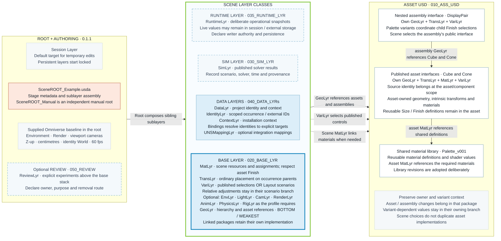

# Project structure and the revised scene paradigm

**Draft 0.1.1 · 2026-10-10.** This design develops Jan's scene-layer schematic, TutorialBuilder's VariantSetups exploration and the inspected `USD_GoodStart/_Generated_Test` folder. [CompositionContracts.md](CompositionContracts.md) owns the rules. The [local example](examples/01_LayeredScene/README.md) implements a bounded static profile; acceptance remains pending.

## The authoring model

Open `SceneROOT_Example.usda`, the supplied Omniverse starting scene, with all persistent layers locked and the session layer selected for temporary edits. The supplied environment, viewport camera and render specs remain its declared application baseline. When persisting a project change, deliberately unlock and edit the contribution that owns it. GeoLyr links published assets; TransLyr places occurrences; VariLyr selects configurations and owns scene scenarios. Material roles remain available when the scene has additional material responsibilities. Each referenced assembly or asset repeats this separation for its own decisions.



Read the diagram **left to right**: the root assembles the scene layer stack, which uses reusable assets, assemblies and materials. Inside the middle column, **GeoLyr is at the bottom**, beneath the other scene contributions. Numbered solid rows give the active standard-scene order: DataLyr → TransLyr → VariLyr → GeoLyr. Dashed rows retain the optional work roles and the explicit Review role; the profile declares their order when included.

The root's sublayers are siblings. GeoLyr references Cube, Cone and DisplayPair; TransLyr places occurrences; VariLyr selects published controls and keeps scenario-relative adjustments in their branches. DisplayPair's own GeoLyr references Cube and Cone, and its Palette variants coordinate child Finish choices. Cube/Cone keep their geometry, intrinsic transforms, materials and Size/Finish implementations in their own package. Their MatLyr contributions reference Palette_v001. The supplied environment/render/camera content stays in the root under CC-01. See the [composition contract](CompositionContracts.md#composition-memory-chart) for the corresponding ownership and persistence guidance.

## Changes from the two predecessors

| Observed predecessor | New project decision | Reason / rule |
|---|---|---|
| Screenshot: GeoLayer links assets and places them | GeoLyr owns links/hierarchy; TransLyr owns ordinary placement | Preserve independent transform ownership, CC-02/06 |
| Screenshot: Opinion_Jan holds experiments | Named ReviewLyr exceptions, composed only by review entrypoints | Record owner, reason, affected fields and disposition, CC-20/23 |
| Screenshot: MatLayer links shared material libraries | Asset MatLyr imports its required materials; supplied root retains its OmniPBR grid material | Asset Finish retains its binding authority, CC-10/15; CC-01 template exception |
| Screenshot: additional physics/environment/light/animation lanes | Explicit role catalogue, instantiated when there is content | Avoid placeholder layers implying active capabilities, CC-20/21 |
| VariantSetups C and G: parent placement and referenced variants | Placement → Adjustment → Asset; recursively owned asset layers | Separate ordinary, scene-conditional and intrinsic transforms, CC-03/06/07 |
| VariantSetups H: additional assembly reference boundary | Reusable DisplayPair assembly with its own placement and Palette interface | Demonstrate genuine assembly ownership, CC-13/14 |
| Generated `ASS_LYR` currently contains native mesh and transforms | Scene GeoLyr references authored packages | Native geometry belongs to the asset; transforms to its TransLyr |
| Generated numbered storage lanes | Keep 000, 010, 020, 030, 035, 040; add 050 review | Preserve familiar storage while making lifecycle explicit, CC-24 |
| Generated `USD_Startpoint` and `USD_Wrappers` slots | Keep import evidence separate from owned package layers | Explicit source boundary, CC-25 |
| Generated root is Y-up, `/world`, centimetres | Preserve the supplied ROOT_example: Z-up, `/World`, centimetres, 60 fps, 0–100 | The user-selected Omniverse scene now establishes startup conventions |
| Earlier example had a custom Overview camera, ground and lights | Keep the supplied top-level Environment/Render and OmniverseKit viewport cameras | Remove alternate starting conditions; preserve identity world coordinates |
| Generated root carries Kit locks and a root edit target | Persistent layer locks plus a scoped Kit helper selecting Session Layer | Session is the default working target; durable destinations still follow ownership |
| `_comfyui_workflows` | `_workflows`, with optional application subfolders | Keep the base package usable without a selected pipeline runtime |

The inspected setup script and its generated output are separate evidence. Script comments about locking or default asset locations do not establish what is in the saved scene. This example is newly authored; predecessor files remain historical evidence.

## Storage layout

Use Root for entrypoint naming (`SceneROOT_<Purpose>.usda`) and scene for the composed result. All active scene entrypoints follow CC-26. Diagram class labels map to the [contract classification table](CompositionContracts.md#naming-and-classification): ASSET USD, BASE, SIM, RUNTIME, DATA and REVIEW. These classify package/layer purpose; mixed-case names inside them identify technical roles. No additional aggregate layers are implied.

The example folder is the portable unit. The complete folder includes all USD dependencies; moving an individual root does not preserve its relative dependencies. Numeric prefixes organize storage and carry **no USD strength semantics**.

```text
examples/01_LayeredScene/
  SceneROOT_Example.usda                 standard Omniverse root + direct scene selections
  SceneROOT_Manual.usda                 independent manual root matching ROOT_example
  SceneROOT_Scenarios.usda              scene Layout variant
  SceneROOT_MaskedSize.usda             deliberate property conflict
  SceneROOT_MaskedSelection.usda        deliberate selection conflict
  Open_In_Kit.ps1                   launch with locked layers and session authoring
  000_SOURCE/                      retained CAD/DCC originals; unused here
  010_ASS_USD/
    USD_Startpoint/                retained imported USD; unused here
    USD_Wrappers/
      Cube/Cube.usda               published asset entrypoint
        layers/{Geo,Trans,Mat,Vari}Lyr.usda
      Cone/Cone.usda
        layers/{Geo,Trans,Mat,Vari}Lyr.usda
    Assemblies/
      DisplayPair/DisplayPair.usda
        layers/{Geo,Trans,Vari}Lyr.usda
    MatLib/Palette_v001.usda        shared material definitions
    Envs/OmniverseStandard/Resources/ supplied sky HDR and ground texture
    tex/                           shared texture slot; unused here
  020_BASE_LYR/
    GeoLyr.usda                    occurrence hierarchy and references
    TransLyr.usda                  occurrence placement only
    VariLyr.usda                   direct selections, manual mode only
    Scenarios/VariLyr.usda          Layout definitions/selections, scenario mode only
  030_SIM_LYR/                     reserved; no result layer composed
  035_RUNTIME_LYR/                 reserved; no live state or snapshot composed
  040_DATA_LYRs/
    DataLyr.usda                   thin data aggregate
    Data/IdentityLyr.usda
    Data/ContextLyr.usda
  050_REVIEW/
    MaskedSize/ReviewLyr.usda
    MaskedSelection/ReviewLyr.usda
  _contracts/                     profile, ownership and expected outcomes
  _pipeline_reports/              build evidence
  _workflows/                     automation definitions when needed
```

Reserved directories contain a short README explaining their use. Empty USD contributions are not added to the stage. Physics, animation, rigging, ports, behaviors and sensors can be added under their owning package when a profile needs them. The catalogue does not require every project to contain every role.

## Package and occurrence boundaries

```text
/World/Cube02                         scene TransLyr: base placement
  /Adjustment                        scene Layout branch: relative offset
    /Asset                           scene GeoLyr: reference to Cube.usda
      [Size, Finish public controls] asset VariLyr: intrinsic alternatives
      /Geometry                      asset GeoLyr: cube; TransLyr: center at z=50
      /Looks                         asset MatLyr: references to shared materials
```

The cube's Size branch owns scale and its complete operation order on Asset. Its fixed geometry-centering transform belongs to the cube's TransLyr. Scene placement and adjustment affect different prims, so they combine through hierarchy. A direct scale on Asset would compete with Size even if placed in a differently named scene layer.

The DisplayPair assembly follows the same arrangement for CubePart and ConePart. Its Palette variant selects child Finish controls. The scene selects Palette on the assembly interface; it does not reach through the assembly to recolor private meshes. The example uses regular references, not native USD instancing or payloads.

The material library is pinned by a versioned bundled filename. Each consumer references a material subtree. No scene or asset layer repeats the library's shader inputs. A new material revision requires an explicit adoption decision; these paths are not a production asset resolver or publishing service.

## Strength and edit destinations

Both baseline scene roots list, strongest first:

1. DataLyr (IdentityLyr before ContextLyr).
2. TransLyr.
3. Exactly one VariLyr: direct selections or scene scenarios.
4. GeoLyr.

The supplied root's environment/render/viewport specs remain local root content by the explicit CC-01 application-template exception. They do not author transforms on `/World` or the example occurrences. The earlier presentation layers and Ground package were archived outside the active example. Every scene entrypoint owns its startup content and directly lists its work layers. Manual and review entrypoints never sublayer another scene root; review layers sit directly above the baseline work layers.

Most contributions own different fields. GeoLyr at the bottom is this project's scene convention; the profile declares the order above it. Asset roots likewise list VariLyr, MatLyr where needed, TransLyr where needed, then GeoLyr. Review entrypoints compose their exception above the corresponding baseline work layers.

| Intended edit | Destination | Context |
|---|---|---|
| Move Cube02 in the scene | Scene TransLyr, `/World/Cube02` | Unconditional base placement |
| Choose Cube02 Finish in manual mode | Scene VariLyr, `/World/Cube02/Adjustment/Asset` | Direct selection metadata |
| Choose a scene Layout | Scenarios/VariLyr, `/World` | Layout selection metadata |
| Change the Exploded offset | Scenarios/VariLyr, Cube02/Adjustment | Inside Layout=Exploded |
| Change what Tall means for every cube | Cube package VariLyr | Inside Size=Tall; asset revision decision |
| Change distance between pair components | DisplayPair TransLyr | Assembly-owned placement |
| Change the shared Blue shader | Material-library revision | Library-owned definition |
| Add a temporary masked-scale experiment | Dedicated ReviewLyr | Declared exception with removal route |

The table gives persistent destinations. By default, temporary edits go into the session while all persistent layers are protected. The supplied launcher runs a scoped Kit startup helper because a fresh anonymous session layer has no portable saved identifier. Deliberate persistence requires unlocking the rightful layer and choosing its edit target. Scene scenario contents also require the correct variant edit context. This helper sets the opening state; it does not classify or route individual edits.

## Reproduction and evidence

The repository includes a bounded [USD-aware authoring script](tools/build_example.py). It creates this fixture in a new or empty folder, refuses to overwrite existing content, and records a default-entrypoint read-back. It does not inspect arbitrary projects or repair existing opinions. See the [example guide](examples/01_LayeredScene/README.md) for the actual command and recorded results.

The JSON contracts are example-specific drafts. They make owner, role, context, dependency, order and expected result reviewable; no generic validator enforces them yet. Full variant coverage, relocation and host UI acceptance remain follow-up work.
