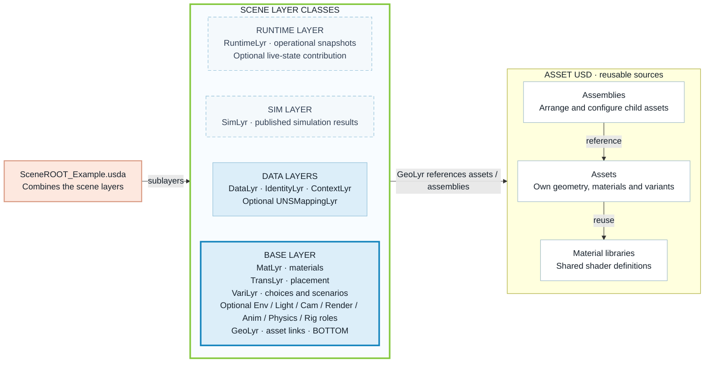

# OpenUSD GoodStart Composition Contract

> **Principle: use only the structure you need.** Keep leaf assets self-contained. Add composition boundaries where ownership, reuse, editing or loading requires them. Start composed scenes and assets with the full scaffold, then keep only what serves the purpose.

For the one-minute employee handout, start with the [ROOTS quick-start manifest](ROOTS_QuickStart_Manifest.md).

**Primary platform: NVIDIA Omniverse.** This proposal targets Omniverse and Kit, including their RTX, viewport, environment and authoring features. It distinguishes OpenUSD mechanics, project conventions and Kit behavior; other targets need separate assessment. This is an independent proposal, not an NVIDIA or AOUSD standard.

**Version 0.2.14 — independent work-in-progress proposal and local example · 2026-10-15**

This project grew out of my journey into OpenUSD. I have spent a lot of time thinking about asset structures, how they compose, and what makes them useful. That led me to a more precise starting point: **a structure needs a purpose, requirements and an evaluation standard before we can judge how well it works.**

The questions guiding this work are: **What is the structure for? What must it support? How will we know it still works as complexity grows?**

The goal is a scalable, ascending USD composition structure: assets form assemblies, assemblies nest inside larger assemblies, and scenes combine them. Each level keeps control close to the owner of the decision and exposes the controls its consumers need. We want to represent complex systems, reuse them across a wide range of scenarios, and preserve their intended behavior as they grow and change.

**Stable, unique identifiers are a foundation of a dependable digital twin. Introduce them at the earliest import or authoring step, before assets are assembled and integrations depend on them.** Reuse existing identifiers from the governing ERP, PLM, asset-management or comparable system, preserving their values, authority and scope. A source part/type identifier can be shared by many occurrences; each occurrence and each actual physical instance needs its own appropriate identity. Prim paths and display names may change while those identities remain stable.

Aaron Luk's [Separation of Concerns for Identifiers in USD](https://github.com/PixarAnimationStudios/OpenUSD-proposals/pull/105) proposal provides the source-versus-namespace distinction. The Microsoft/NVIDIA [Composable Bindings](https://aka.ms/ComposableBindings) whitepaper, with contributors Christoph Berlin and Aaron Luk, supplies the integration pattern. Our [CC-27/28 requirements](CompositionContract.md#23-identity-and-composable-bindings) connect these ideas: preserve authoritative identity from the start, then resolve versioned bindings to the correct entity, property and authoring context as structures evolve. The proposal remains a draft; our early-identity policy is adopted here, while the identifier schema and binding engine remain to be implemented.

### Industry requirements and reusable assets

Recursive assets and assemblies, clear ownership, stable public interfaces, separate contributions and preserved reusable packages align closely with NVIDIA's published factory structuring recommendations. The **robot → workcell → production line → facility** progression is explicitly supported there. This supports our architectural direction; readiness for a particular simulation or consumer depends on its profile and acceptance evidence. See [NVIDIA VFI guidance](https://docs.omniverse.nvidia.com/vfi/latest/guide/factory-level-structuring.html).

**Nesting is a normal part of this architecture.** Performance depends on layer count, dependency resolution, loading boundaries, instancing and configuration diversity. The maintained authoring structure can remain modular while a generated deployment package reduces runtime overhead. NVIDIA describes this separation between modular authoring and measured deployment packaging in its [deployment tradeoffs](https://docs.omniverse.nvidia.com/vfi/latest/guide/asset-structure-optimizations-and-tradeoffs.html). Our deployment generation and factory-scale benchmarks remain planned.

A robot packaged using NVIDIA's [Asset Structure 3.0](https://docs.isaacsim.omniverse.nvidia.com/6.0.0/openusd_tuning_tutorials/tutorial_02_asset_structure.html) enters our composition **as a reusable asset**. Its internal geometry, materials and physics configuration stay with that package. Our focus is the larger digital twin: robot → workcell → production line → facility, with clear interfaces and control at each level.

[SimReady Foundation](https://github.com/NVIDIA/simready-foundation) supplies use-case requirements for incoming simulation assets. Our [asset-interface checklist](CompositionContract.md#asset-interface-checklist) now requires purpose, entrypoint, coordinates, dependencies, public controls and evidence, including selected simulation profiles where applicable. [Asset and assembly acceptance](CompositionContract.md#asset-and-assembly-acceptance) evaluates both incoming packages and their composed use. Asset readiness alone does not establish readiness for larger structures such as a workcell; automated integration remains planned.

The supplied teaching profile is Y-up. SimReady asset guidance and some named simulation requirements specify Z-up, so this example setting is not a SimReady conformance claim; use the declared target profile's axis and validate any conversion.

We define broad applicability through **common ownership and interface rules across explicitly supported domain profiles**. The contract's [NVIDIA alignment and readiness requirements](CompositionContract.md#21-nvidia-alignment-and-readiness-requirements) explain the remaining work: target publication formats, units and geometry preparation, robotics and sensor acceptance, identity continuity, executable validation and measured deployment. The contract draft is now 0.2.14; example profiles retain their own acceptance status until re-evaluated.

We also track [OpenUSD proposals](https://github.com/PixarAnimationStudios/OpenUSD-proposals/tree/main/proposals), especially validation, profiles/capabilities, namespace editing, LOD and spline animation. Their practical implications and adoption gates are in the [roadmap](ROADMAP.md#upstream-integration-priorities).

For broader context, see our [layer-order and composition research paper](https://github.com/jph2/USD_GoodStart/blob/main/WIP_Docs/LAYER_ORDER_REFERENCES_RESEARCH.md#openusd-learning--ecosystem-resources), which examines and compares layer and composition paradigms across different industries. It is research background for this proposal, not a universal ordering rule.

This work is informed by discussions around the **AOUSD Industrial and Engineering Digital Twin (IEDT) workcell effort**, which Jan expects to develop into a guideline project. The public [AOUSD interest-group remit](https://aousd.org/community/interest-groups/) supports industrial requirements and recommendations; the workcell's formal status and this project's participation remain to be confirmed. This repository is an independent proposal.

For a concrete comparison, see Nandu Vellal's [Workcell Digital Twin](https://github.com/nAurava-Technologies/Workcell-DigitalTwin) project and [Naurava Technologies](https://www.naurava.com/). We propose evaluating the current workcell against this composition contract: what its structure could look like under the proposed paradigm, how its current approach differs, and which requirements should be adapted. The workcell project is likely to move to AOUSD's GitHub in the near future; this is an anticipated move, not a confirmed transfer or endorsement of this proposal.

## The contract is the eval

Composition contracts define **what we want, why we want it, and how the result must behave**. They connect requirements to ownership, public interfaces, authoring rules and expected outcomes.

**The contract is the shared evaluation standard for agents and humans.** We compare the result against the applicable contract and project profile, identify mismatches, and revise the work until it fits, or works. A profile states which scenarios, operating modes and requirements apply to that project.

**Purpose → requirements → contract → compose or change → evaluate → revise until the contract is met.**

When the purpose or requirements change, revise the contract explicitly and evaluate the affected results again. A change to the evaluation standard should be traceable, just like a change to the scene.

## The paradigm

**The root combines the layers. Scene layers place and configure linked assets. Assets own their reusable content.**

Read **left to right**. Four class boxes list their layer types; they do not introduce aggregate USD layers. SIM and RUNTIME are optional, with strength set by the profile. The baseline remains DataLyr → TransLyr → VariLyr → GeoLyr, with **GeoLyr at the bottom**. An optional REVIEW / ReviewLyr contribution holds explicit experiments above that baseline.

**Work in Opinion by default**, with persistent work/source layers locked, using the [Kit launcher](examples/01_LayeredScene/Open_In_Kit.ps1). Saving Opinion retains experiments; promote accepted fields to their rightful owner and variant branch, then retire superseded opinions.

The active root remains writable for Kit's camera and authoring-target metadata;
it is not the default editing destination. See the [CC-01 host exception](CompositionContract.md#3-file-ownership-contract).

See the [detailed ownership diagram](CompositionContract.md#composition-memory-chart) and [project structure](PROJECT_STRUCTURE.md) for the full responsibilities and example setup.

## Practical authoring conventions

- **Opinion and choices:** use `OpinLYR_Scene<SceneName>.usda` per scene, or `OpinLYR_<Purpose>.usda` when a documented purpose is intentionally shared. Save selections in Opinion; add a ConfigLyr only when independent reuse, ownership, versioning or switching warrants it. VariLyr holds variant definitions and scenario contents.
- **Folders and resources:** group independent assets as the team needs; add folders or shared material/texture libraries when reuse or ownership benefits. Keep editable sources.
- **Preview and delivery:** direct-open assets that claim preview readiness include basic lighting outside the default prim, inline by default. Use a shared environment when reuse justifies it. Do not modify imported originals just to add previews; use an owned adapter or record the limitation. USDZ is a single-file delivery only after dependencies and target compatibility are confirmed; the extension alone proves neither.

## Requirements and evaluation

Our entrypoint term is **Root** (`SceneROOT_<Purpose>.usda`); **scene** means its composed result. All active scene entrypoints now follow this convention (CC-26). The diagrams use the same classes as storage: **ASSET USD** for reusable packages, **BASE** for authored setup, **SIM** for simulation results, **RUNTIME** for live state/snapshots, **DATA** for identity/context, and **REVIEW** for experiments. Inside those classes, role names remain `GeoLyr`, `TransLyr`, `VariLyr`, etc. Class labels add no layers and impose no strength order. See the [classification table](CompositionContract.md#naming-and-classification). Use the exact directory names `040_DATA_LYR` for DATA and `050_OPINION_LYR` for REVIEW. All layer-class folders use singular `_LYR`; this convention repeats inside locally authored assets and assemblies and in starter packages.

The current concept supports this direction through recursive ownership, published interfaces, explicit layer responsibilities and recorded expected behavior. These are the connections we need to evaluate:

| Requirement | Existing contract basis | Evidence needed |
|---|---|---|
| Represent nested, reusable structures | CC-03/04/13/14: asset interfaces and assembly ownership | Repeated assets and nested assemblies keep their controls working at the intended scope. |
| Keep control close to its rightful owner | CC-02/06–11/16/21: role, owner and variant context | Placement, configuration and material changes reach the intended owner; independent occurrences and variant behavior remain intact. |
| Reuse the approach across scenarios | CC-20/23–25: required roles, profiles and dependency boundaries | Each supported scenario declares its writers, overlaps and dependencies, and produces its specified result. |
| Preserve intended behavior through edits | CC-01/12/19: persistence, acceptance and controlled changes | Edits reach the intended layer/context, survive deliberate save/reopen, and produce the declared before/after behavior. |
| Preserve digital-twin identity from the start | CC-16/27/28: governing-system IDs, scoped occurrence identity and composable bindings | IDs survive import, repeated assembly, rename/reparent and deployment; bindings resolve the intended entity without collisions or stale targets. |
| Make work repeatable across agents and people | CC-17–19 and DT-01–09: deterministic inspection, execution and evidence | The same declared inputs yield consistent findings; changes and their evaluation results can be traced to a contract revision. |

Each evaluation case needs named inputs, the applicable contract/profile revision, the expected outcome and a clear pass/fail criterion. Scalability also needs agreed nesting depths, asset counts, load states and performance limits for the intended applications. These criteria turn the shared contract into something people can review and tools can check repeatedly.

**The design fits this purpose; broad validation remains open.** The current example supplies a small nested assembly, independent asset occurrences, expected outcomes and deliberate conflicts. Its recorded observations cover saved defaults. Complete variant and persistence evaluation, larger nesting/scale cases, other operating profiles and repeatable automated evaluation remain to be established. See [sample acceptance](CompositionContract.md#9-harness-and-sample-acceptance) and the [expected outcomes](examples/01_LayeredScene/_contracts/expected.json).

## Working with agents

Use **`$openusd-composition-contract`** to apply this proposal when designing, reviewing or changing USD assets, assemblies and digital twins. The maintained [skill](skills/openusd-composition-contract/SKILL.md) includes operational guidance and a generated contract reference with the paper's version and source hash. Its version matches contract **0.2.14**; the skill supplies guidance, while general enforcement and runtime acceptance remain planned.

After reviewing the skill for affected rule/workflow changes, refresh it from the repository root with `python tools/sync_composition_skill.py --install`. Use `python tools/sync_composition_skill.py --check --install` to compare the generated files and personal installation without writing. The default personal location follows this host's `$CODEX_HOME/skills` (or `~/.codex/skills`); `--skills-root` supports another configured location. [AGENTS.md](AGENTS.md#keep-the-contract-skill-synchronized) requires this maintenance whenever the repository changes, with the main paper remaining the rule owner.

**Identity and integration:** IdentityLyr records who an occurrence represents, usually on its placement prim rather than every mesh. Asset source IDs, assembly/scene occurrence IDs and physical-instance IDs have different owners and scopes. Composable bindings use those identities to map external data to explicit USD properties and authoring contexts. See [CC-27/28](CompositionContract.md#23-identity-and-composable-bindings) for placement guidance, examples and planned evaluation; no binding engine or standardized identifier schema is implemented here.

The same contract gives different agents and human contributors a common basis for work across tasks, projects and repositories. Each task can identify its purpose, applicable profile, permitted scope, required outputs and evaluation criteria. The result carries evidence that another agent or person can review, and work continues until the applicable criteria are satisfied.

The intended workflow combines model interpretation with deterministic USD-aware operations and recorded evaluation results. General inspection, repair and workflow automation remain planned capabilities; the [tooling requirements](harness/TOOLING_REQUIREMENTS.md) describe the execution and reporting needed to maintain quality as this expands.

## Start here

- [Composition contracts](CompositionContract.md): the evolving proposal and stable CC rule IDs.
- [Open the example guide](examples/01_LayeredScene/README.md): manual configuration, scene scenarios and two deliberate conflicts.
- [Animated MoGraph proof of concept](examples/01_LayeredScene/README.md#play-and-control-the-mograph-scene): under development. Follow the Mermaid data/runtime/USD/render flow, saved-clip fallback and current reload limitation; JSON is a local mock source for a future incoming-data adapter.
- [Project structure and diagram](PROJECT_STRUCTURE.md): the revised paradigm, storage layout and edit destinations.
- [Open questions](DISCUSSION.md): the first review agenda.
- [Roadmap](ROADMAP.md): from discussion to deterministic inspection and pipeline experiments.
- [Agent entry](AGENTS.md): bounded context and working instructions.
- [Next-agent handover](harness/HANDOVER.md): brief history, working decisions and implementation boundaries.
- [Harness governance](harness/GOVERNANCE.md) and [workflow](harness/WORKFLOW.md).
- [Deterministic tooling requirements](harness/TOOLING_REQUIREMENTS.md).
- [Source and dependency routes](harness/SOURCES.md).
- [Resume state](harness/STATE.md): what exists and the next useful step.

## Starter master preset

Simple leaves use direct filenames such as `Cube.usda` and `Cone.usda`; they do not need an AssetROOT layer stack. Open composed packages such as `AssetROOT_DisplayPair.usda` to work at that owner's scope: its owned roles remain in `020_BASE_LYR`, and a package uses Opinion only when that workflow is needed. A building used in a city is an asset, but `AssetROOT` is reserved for the composed entrypoint rather than every asset file. Working scenes use `SceneROOT_<Purpose>.usda`. See [recursive package rules](CompositionContract.md#recursive-package-layout).

**Copy-and-run setup:** copy the entire [portable setup folder](starter/Composition_Starter_0.1.1/README_SETUP.md) into your destination and double-click `Create_Composition_Project.bat`. It expands the bundled scenes, assets, layers and launch helper into that folder. Windows PowerShell is sufficient; setup needs no Python or network access. Existing files are never overwritten. Omniverse remains a separately installed prerequisite for the Kit launcher.

[SceneROOT_STARTER.usda](examples/01_LayeredScene/SceneROOT_STARTER.usda) is deliberately generous: demo assets, independent placement/variant/data layers, an Opinion layer, and optional material, environment, lighting, camera, render, animation, rig, physics, simulation and runtime slots. Remove or disable unused contributions. Launch with `Open_In_Kit.ps1 -Scene STARTER`. See the [starter guide](examples/01_LayeredScene/README.md#sceneroot_starterusda).

## Current scope

The contract was moved from TutorialBuilder. Its VariantSetups paper and A–H scenes remain there; they are exploratory evidence, not conforming examples shipped by this project. See [provenance](harness/SOURCES.md). The new `examples/01_LayeredScene` package develops those experiments and the numbered storage structure inspected in `USD_GoodStart/_Generated_Test`.

Start with [SceneROOT_Example.usda](examples/01_LayeredScene/SceneROOT_Example.usda), Jan's supplied Omniverse starting scene with the example assets composed under `/World`. The package contains demo and starter layers, Cube/Cone packages, a nested DisplayPair assembly, shared asset materials, scene contributions, data, explicit review exceptions and draft JSON contracts. The supplied environment, viewport cameras and render state remain the startup baseline. Its two textures are bundled; OmniPBR and RTX features require a compatible Omniverse application. `SceneROOT_Manual.usda` is an independent root with the same direct work-layer stack.

[tools/build_example.py](tools/build_example.py) reproduces this setup from the retained [Omniverse template](templates/Omniverse/README.md) through OpenUSD 26.08 APIs. Default-entrypoint read-back is recorded; full acceptance and Omniverse review are pending. No general inspector, repair engine, ownership-routing extension or pipeline integration is implemented.

### Payload interfaces and extensive instancing

The [scene guide](examples/01_LayeredScene/README.md#choose-a-scene) now includes **Lofted**, **Instanced**, **Instanced_Wave**, **Instanced_Spiral** and **Instanced_Rings**. Lightweight public variants sit above payloads; shape contents reuse our existing Cube/Cone implementations. Instanced scenes contain 1,029 shape occurrences. The three driven formations map JSON inputs to placement and nine Size/Finish combinations per shape type. Each scene owns its Opinion and generated work layers; root files directly compose those layers.

These examples adapt the Kitchen Set's packaging ideas using our own sources. CC-05a–c define loading, instancing boundaries and input-driven ownership. The bundled Python driver shows its plan before an explicit apply and preserves backups. This demonstrates authoring patterns; measured performance, physics readiness and Kit acceptance remain pending.

The default working state selects the editable Opinion layer and locks persistent work/source layers. Use [Open_In_Kit.ps1](examples/01_LayeredScene/Open_In_Kit.ps1) for edit-target selection and layer protection. The updated startup behavior awaits Kit acceptance.

OpenUSD-GoodStart remains a knowledge reference and potential consumer. TutorialBuilder remains a teaching consumer. The private `OpenUSD_GoodStart_Pipeline_nodes` repository is a candidate backbone for a future composition pipeline, subject to interface and suitability review. This project must remain understandable and eventually inspectable without that private dependency.

## AI assistance disclosure

This project was developed with the assistance of AI tools, including OpenAI Codex, for research support, drafting and refining documentation, and developing code and examples. Human contributors remain responsible for project decisions, review and verification. AI-assisted content may contain errors or omissions; claims and examples should be evaluated against the cited sources and composition contracts. Only explicitly recorded checks should be treated as verified results.

## Participation

Propose changes with a purpose, requirements, the relevant CC rules, an example and criteria for evaluating the result. Compare alternatives against those criteria and record evidence, uncertainty and counterexamples. Feedback from people exploring different OpenUSD workflows will help refine both the contracts and their evaluations. See [contribution guidance](CONTRIBUTING.md).

Remote hosting, access grants, licensing and any future transfer to a group or workcell project remain to be decided. Local project creation does not publish this material or grant rights to external source content.
