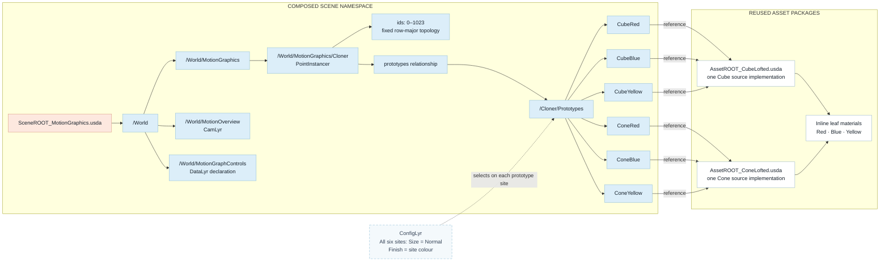

# Motion Graphics quickstart and operation guide

Use this guide to open the **Motion Graphics Controls** panel in Omniverse Composer and steer the animation. No Python installation or extension installation is needed for this route; the small startup snippet runs inside Composer.

## In this guide

- [Open the scene](#1-open-the-scene)
- [Open the controls](#2-open-the-controls)
- [Make it move](#3-make-it-move)
- [Steer the motion](#4-steer-the-motion)
- [Troubleshooting](#if-something-is-missing-or-stuck)
- [Detailed controls and runtime status](#detailed-controls-and-runtime-status)
- [How the motion scene works](#how-the-motion-scene-works)
- [Save a new animation clip](#save-a-new-animation-clip)
- [Drive the instancing scenes with Python](#drive-the-instancing-scenes-with-python)

## 1. Open the scene

In Composer, open **SceneROOT_MotionGraphics.usda** from this folder. Let the scene finish loading. For the overview, select **/World/MotionOverview** in the viewport camera selector.

Opening the scene alone gives you the saved animation. The control panel needs the following startup step.

## 2. Open the controls

Open **Window > Script Editor** (its menu location can vary between Kit applications). Paste this entire snippet into the editor and click its **Run** button:

```python
from pathlib import Path
import runpy
import omni.usd

package = Path(omni.usd.get_context().get_stage().GetRootLayer().realPath).parent
runpy.run_path(str(package / "_workflows/kit/motion_graphics.py"))
```

Run this with **SceneROOT_MotionGraphics.usda** open, inside Composer's Script Editor. Keep the supplied `_workflows` folder next to the scene.

The floating **Motion Graphics Controls** window should appear. You can dock it alongside the viewport. Wait until it has loaded the controls instead of showing “CONNECTING”.

## 3. Make it move

1. Click **Visible wave preset** to fill in a noticeable starting setup.
2. Make sure **Live preview** is checked.
3. Click **Apply & Save JSON**.
4. Click **Play** in the panel.

Look for **LIVE** and **PLAYING** at the top. Timeline seconds and the update counter should increase, and the shapes should visibly move. Click **Pause** to hold the pose.

## 4. Steer the motion

Change a few controls, then click **Apply & Save JSON** again to use your changes.

| Control | What it changes |
|---|---|
| Layout | Arrange shapes as a grid, rings or spiral. |
| Wave Mode | Choose a plane, radial or swirling wave. |
| `amplitude_cm` | Height of the wave. |
| `speed_hz` | Wave speed; 0.5 means half a cycle per second. |
| `wavelength_cm` | Distance between wave crests. |
| `scale_wave` | How strongly the shapes grow and shrink. |
| `rotation_degrees` | How strongly the shapes tilt. |
| `color_cycle_hz` | Speed of colour changes; zero stops cycling. |

Each control includes its range and explanation. **DRAFT ONLY** means your changes have not been applied yet. **JSON ACCEPTED** confirms the settings loaded; also check that the viewport actually moves.

## What gets saved?

**Apply & Save JSON** saves the settings in [motion_graphics.json](040_DATA_LYR/Controls/motion_graphics.json), with a backup of the previous file. Live motion is a temporary preview; the button does not rewrite the saved USD animation. On your next visit, open the scene and run the startup snippet again to use the saved controls.

Uncheck **Live preview** and apply to return to the previously saved animation. See [Save a new animation clip](#save-a-new-animation-clip) below to bake your changes into the saved animation.

## If something is missing or stuck

- **Panel closed:** closing it only hides it; the controller continues. Run this in the Script Editor to show it again:

  ```python
  import builtins
  builtins.cc_motion_graphics.show_panel()
  ```

  If the controller no longer exists, use the full startup snippet from step 2.
- **Buttons remain disabled:** confirm the correct scene is open and inspect the message at the top of the panel.
- **NOT APPLIED:** read the displayed reason. Correct the controls and apply again. **Reload JSON** discards unapplied panel edits and loads valid saved settings.
- **Need to reconnect:** **Reconnect** rebuilds this helper's temporary preview from saved settings; unapplied edits are discarded.
- **Counters change but the picture stays still:** viewport refresh is a known unresolved issue in this experimental example. Save your controls and any wanted scene edits, reload the scene, and run the startup snippet again. If needed, restart Composer and repeat. This is a workaround, not a guaranteed fix.
- **Scripts were updated:** run the full startup snippet again to refresh the controller and panel.

## Optional: launch a new Composer window with controls

If you prefer the supplied launcher, open PowerShell in this folder and run:

```powershell
.\Open_In_Kit.ps1 -Scene MotionGraphics
```

The launcher can discover the application from an already running Kit process. Otherwise it requires `-KitExe` and `-AppConfig` paths. The Script Editor route above uses your existing Composer window and needs no launcher configuration.

**Status:** experimental example. This guide follows the supplied controller and panel code; no new viewport acceptance run was performed while writing it.

## Detailed controls and runtime status

- Every slider shows its JSON key, allowed range and explanation. Dropdowns list valid words.
- **DRAFT ONLY** means edits are waiting for **Apply & Save JSON**. This button saves only the DATA control file and retains the previous bytes under `_pipeline_reports/motion_graphics/`.
- **JSON ACCEPTED** means the controller loaded the values. **NOT APPLIED** gives the reason and keeps the last valid motion; syntax errors include line, column and nearby text. One invalid value rejects the entire input.
- **Reload JSON** discards an unapplied panel draft in favour of valid disk values. If the disk file is invalid, the panel keeps its displayed values so an explicit Save can repair it, with a backup. Concurrent external edits block stale panel saves until Reload.
- **Visible wave preset** fills a noticeable rings/wave setup; click **Apply & Save JSON**, then **Play**. **Pause** stops timeline progression.
- The top line shows **LIVE / BAKED**, **PLAYING / PAUSED**, timeline seconds and a runtime-update counter. In live playback, time and updates should both increase. **JSON ACCEPTED** alone only confirms the input loaded.
- **Play** targets this USD context's timeline, uses the scene's frame range and enables automatic advancement if needed (restored on disconnect). A controlling timeline director, stopped worker, empty range or stalled clock is reported. Play clicks and state changes are also logged.
- **Reconnect** reloads saved controls and recreates only this helper's temporary preview, discarding unsaved panel edits. It does not unmute scene layers or remove other opinions. Muted/detached runtime layers, missing geometry, invisible cloners and stronger opinions masking the generated arrays are reported in the top line.
  - **Playback read-back** automatically collects three snapshots after Play and reports whether sampled USD and Fabric positions change. It waits for advancing playback for up to 60 seconds; paused snapshots cannot establish animation. Detailed positions, sources and viewport time/freeze state go to the Kit log. The same read-only report can be run separately with [_workflows/kit/diagnose_motion_graphics.py](_workflows/kit/diagnose_motion_graphics.py). Moving data still needs visible viewport confirmation.
  - The runtime status shows whether RTX scene partitioning is off, on, or temporarily disabled for this preview. This scene does not author partitions. NVIDIA documents partitioning as off by default; Kit 110.3 release notes also list an FSD bug where instanced-scene transforms could remain visually stale while Fabric world transforms were correct. The helper disables partitioning only if the host reports it enabled, then restores it on disconnect ([release notes](https://docs.omniverse.nvidia.com/dev-guide/latest/release-notes/110_3.html), [partition docs](https://docs.omniverse.nvidia.com/materials-and-rendering/latest/cameras.html)).

Closing the panel hides it; motion continues. To show it again without restarting:
`import builtins; builtins.cc_motion_graphics.show_panel()`.

The JSON has a `_comment_<name>` string immediately above every value: range,
units, examples and effects. These strings are documentation, ignored by the
motion model. Keep the file valid JSON: quoted text, commas between entries,
no `//` comments or line breaks inside a quoted string. The adjacent schema
also supplies IDE hints. Values such as `speed_hz: 0.5` mean **half a cycle per
second**, not 50%; `500` is outside its **−2 to 2** range.

| Control | Allowed values | Meaning |
|---|---|---|
| `live_preview` | `true` / `false` | False shows the saved clip; other JSON controls are then inactive. |
| `layout` / `wave_mode` | `grid`, `rings`, `spiral` / `plane`, `radial`, `swirl` | Arrangement / wave shape. |
| `strength` | 0–1 | Overall animated effect strength. |
| `spacing_cm` | 50–500 | Clone spacing in centimetres. |
| `amplitude_cm` | 0–1500 | Wave height in centimetres. |
| `wavelength_cm` | 100–10000 | Distance between crests; try 1800. |
| `speed_hz` | −2–2 | Wave cycles/second; negative reverses travel. |
| `phase_degrees` / `direction_degrees` | −360–360 / −180–180 | Phase offset / direction (plane wave only). |
| `base_scale` / `scale_wave` | 0.1–3 / 0–0.9 | Base size multiplier / pulsation amount. |
| `rotation_degrees` | 0–180 | Wave-driven tilt. |
| `spin_degrees_per_second` | −360–360 | Continuous rotation. |
| `noise_cm` / `noise_speed_hz` | 0–500 / 0–2 | Bobbing height / cycles per second. |
| `falloff_radius_cm` | 100–20000 | Motion fades to zero at this distance from the centre; try 12000. |
| `color_cycle_hz` | 0–2 | Colour steps per second; 0 stops cycling. |

Keep the fixed 32 × 32 topology: IDs 0–1023 persist as layouts change. Large amplitudes can cross the ground; this is visual animation without collisions.

For an obvious response, try rings with `amplitude_cm: 600`, `wavelength_cm: 1800`,
`speed_hz: 0.5`, `scale_wave: 0.8` and `falloff_radius_cm: 12000`. Falloff reduces
motion away from the centre: a small radius can leave most of the field nearly
still. These are JSON values to edit in the control file, not Python statements
to paste into Kit's Script Editor. The Script Editor only needs the startup code.

Very short wavelengths near/below clone spacing can look irregular. Larger
spacing can extend beyond the overview camera; select
`/World/MotionGraphics/Cloner` and frame the selection.

**How it is composed:**

| Owner | Contribution |
|---|---|
| DATA | `DataLyr_MotionGraphics.usda` declares the JSON asset path, profile and `/World/MotionGraphics/Cloner` target. |
| BASE Geo / Config | One PointInstancer, stable IDs and six prototype references; Size=Normal and Finish=Red/Blue/Yellow on each shape type. |
| BASE Trans / Cam | Place the whole cloner; provide the overview camera. |
| BASE Anim | `AnimLyr_MotionGraphics.usdc` stores sampled position, orientation, scale, prototype index and bounds. |
| RUNTIME | The optional Python helper writes those five arrays as a two-sample window at current time and one time code ahead, in its own anonymous Session sublayer. Old samples are removed; this is a live preview, not an accumulated recording. It never saves USD files. |
| OPINION | Independent Opinion remains the user's default authoring layer. Work/source layers are protected by the launcher. |

### How the motion scene works

The JSON file is a **local mock data source**: it lets us develop and evaluate the data-to-scene path before a real publisher is connected. It is not a server and does not stream on its own. The Kit helper polls it, validates a complete snapshot, and maps accepted controls into USD values. A future adapter could obtain the same normalized controls from a simulation feed, robotics middleware, OPC UA, a service/API or another publisher. The data schema and mapping should remain stable while only the input adapter changes.

```mermaid
%%{init: {"htmlLabels": true, "flowchart": {"htmlLabels": true, "wrappingWidth": 260, "nodeSpacing": 28, "rankSpacing": 36}}}%%
flowchart LR
    accTitle: MotionGraphics data and playback path
    accDescr: A local JSON mock source or future publisher feeds a validated Kit controller. The controller evaluates controls against timeline time and writes a temporary Session overlay over the saved animation. USD composes point-instancer arrays which pass through Fabric to the renderer. A manual reload currently restores visible motion when the viewport becomes stale.

    subgraph INPUT["1 · INPUT DATA"]
        direction TB
        JSON["motion_graphics.json<br/>Local editable mock source<br/>Controls, units, ranges and comments"]
        FUTURE["Future data publisher<br/>Simulation · robot · OPC UA · API"]
        JSON -->|file snapshot| VALIDATE
        FUTURE -.->|same normalized schema| VALIDATE
    end

    subgraph KIT["2 · KIT CONTROL LOOP"]
        direction TB
        WATCH["motion_graphics.py<br/>Polls JSON about every 250 ms"]
        VALIDATE["motion_graphics_core.py<br/>Parse · validate · reject whole bad snapshot<br/>Keep last valid controls on error"]
        PANEL["Motion Graphics Controls<br/>Edit draft · Apply & Save · status"]
        TIME["USD-context Kit timeline<br/>seconds → stage time code"]
        EVAL["Pure motion model<br/>Controls + timeline time → 1,024 values"]
        WATCH --> VALIDATE --> EVAL
        PANEL -->|explicit save| JSON
        TIME --> EVAL
    end

    subgraph USD["3 · USD COMPOSITION"]
        direction TB
        ROOT["SceneROOT_MotionGraphics.usda<br/>Stage settings · 0–480 tc · 60 fps"]
        STACK["Direct scene sublayers<br/>Opinion · Data · Anim · Cam · Trans · Config · Geo"]
        GEOMETRY["GeoLyr<br/>One PointInstancer · fixed IDs 0–1023<br/>six references: Cube/Cone × Red/Blue/Yellow"]
        VARI["ConfigLyr<br/>Select Size=Normal and Finish per prototype"]
        BAKE["AnimLyr_MotionGraphics.usdc<br/>Saved 8-second clip · 241 samples<br/>positions · orientations · scales · protoIndices · extent"]
        DATA["DataLyr<br/>Declares controls asset · profile · target · ID scope"]
        SESSION["Temporary anonymous Session sublayer<br/>Runtime arrays at current tc and next tc<br/>Removed on stop / disconnect; never saved"]
        ROOT --> STACK
        STACK --> GEOMETRY
        STACK --> VARI
        STACK --> BAKE
        STACK --> DATA
        EVAL -->|five runtime arrays| SESSION
        DATA -.->|declares target and input| EVAL
        SESSION -->|stronger opinions while live| COMPOSE
        BAKE -->|fallback when live is off| COMPOSE
        GEOMETRY --> COMPOSE["Composed PointInstancer<br/>resolved arrays + prototypes"]
        VARI --> COMPOSE
    end

    subgraph VIEW["4 · VIEWPORT"]
        direction TB
        FABRIC["Fabric / scene delegate<br/>receives composed USD changes"]
        RENDER["Hydra / RTX viewport<br/>draws points using shared prototypes"]
        STALE["Observed recovery<br/>Manual scene reload / Kit restart<br/>can restore visible motion"]
        FABRIC --> RENDER
        RENDER -.->|if stale| STALE
        STALE -.->|rebuild stage/render connection| FABRIC
    end

    COMPOSE --> FABRIC

    classDef source fill:#fff7d6,stroke:#c9a227,color:#17212b
    classDef kit fill:#e7f3fc,stroke:#76a9cc,color:#17212b
    classDef usd fill:#e9f5e9,stroke:#73a873,color:#17212b
    classDef view fill:#f1eafd,stroke:#9875bd,color:#17212b
    class JSON,FUTURE source
    class WATCH,VALIDATE,PANEL,TIME,EVAL kit
    class ROOT,STACK,GEOMETRY,VARI,BAKE,DATA,SESSION,COMPOSE usd
    class FABRIC,RENDER,STALE view
```



#### Reading the USD scene

The root is a thin scene entrypoint, not a nested starter root. It directly composes its role layers; GeoLyr supplies the instancer topology and prototype reference sites, while the other layers contribute values to those same composed prims. `AnimLyr` is the authored fallback. When live preview is active, an anonymous layer is inserted into Session and writes only `positions`, `orientations`, `scales`, `protoIndices` and `extent`. Those runtime values are stronger than the saved animation for the same attributes. Turning off live preview or stopping the helper removes its layer so the saved clip is visible again. The persistent Opinion layer is still the default user authoring destination; the runtime layer is temporary machinery.

The next diagram is the **composed prim namespace**, not a layer stack. The scene root composes layer files; those layers author opinions on prims in this namespace. Each of the six prototype sites references one of two asset roots, with its Finish choice set by ConfigLyr. Materials are inline in the corresponding leaf assets, reached through the lofted payloads.



There are **six prototype configurations**, but only **two source assets** and **three finish colours**. Each of the 1,024 points is an element in PointInstancer arrays, not an individually editable prim. `protoIndices` selects among the six referenced prototype sites; the per-point transform arrays control their motion. The camera, whole-cloner placement, prototype choices, data declaration, baked animation and geometry therefore have separate owners.

#### What each part contributes

| Part | Role in this example | Reusable idea |
|---|---|---|
| `motion_graphics.json` | Human-editable mock input with documented ranges, units and choices. | Keep an explicit, versionable input contract that can be authored by people or published by a service. |
| `DataLyr_MotionGraphics.usda` | Records the input asset, profile, target prim and stable-ID scope. USD metadata declares the relationship; it does not run a watcher. | Put the data contract and allowed target in the scene, separate from its execution adapter. |
| `motion_graphics_core.py` | Parses, validates and deterministically maps controls plus time to arrays. Bad input is rejected as a whole; the last valid state is retained. | Reuse one mapping/validation core for a UI, file, API or live-data adapter. |
| `motion_graphics.py` | Kit-specific lifecycle, file polling, USD-context timeline access, temporary layer writing and cleanup. | Keep host integration at the boundary; do not mix it into data validation or asset definitions. |
| `GeoLyr` and `ConfigLyr` | Define one instancer and six referenced public configurations. | Keep topology and published asset choices distinct from generated per-point values. |
| `AnimLyr_MotionGraphics.usdc` | Stores a bounded eight-second animation clip sampled every two time codes. | Preserve an inspectable/fallback result when the external driver is absent. |
| Session runtime overlay | Temporarily overrides the five animated arrays; it does not persist into the project. | Keep live operational state separate from authored and saved scene content. |
| Fabric / renderer | Consume the composed USD and display it. | Validate data, composition, delegate synchronization and visible output as separate boundaries. |

#### Runtime and lifecycle flow

```mermaid
%%{init: {"htmlLabels": true, "flowchart": {"htmlLabels": true, "wrappingWidth": 260, "nodeSpacing": 24, "rankSpacing": 32}}}%%
flowchart LR
    accTitle: MotionGraphics runtime lifecycle and failure boundaries
    accDescr: The helper attaches to the target stage, validates the DATA declaration and JSON file, evaluates controls at timeline time, writes a temporary Session sublayer and checks the composed USD and Fabric values. Invalid input retains prior valid data. Current limitation: the values can change while the viewport remains stale until the stage or application is reloaded.

    START["Run Kit bootstrap<br/>or launcher"] --> ATTACH["Attach to matching root<br/>validate DATA declaration<br/>check IDs and prototypes"]
    ATTACH --> WATCH["Poll local JSON<br/>or receive normalized input"]
    WATCH --> PARSE["Parse + range-check"]
    PARSE -->|valid| MODEL["Evaluate controls at timeline seconds"]
    PARSE -->|invalid| HOLD["Keep last valid controls<br/>show/log reason"]
    HOLD --> WATCH
    MODEL --> LAYER["Write five arrays into owned<br/>anonymous Session sublayer<br/>two time samples; prune old samples"]
    LAYER --> READBACK["Read back composed USD<br/>and Fabric arrays"]
    READBACK --> IMAGE["Viewport renders animation"]
    READBACK -.->|values change, image still stale| RELOAD["Known workaround observed:<br/>restart Kit and reload scene"]
    RELOAD -.->|reattach and rebuild stage/render state| ATTACH
    IMAGE --> STOP["Stop / disconnect / stage closes"]
    STOP --> CLEAN["Cancel watcher and remove only<br/>owned runtime overlay; restore host setting"]
    CLEAN --> BAKE["Saved AnimLyr remains<br/>available as fallback"]

    classDef active fill:#e7f3fc,stroke:#76a9cc,color:#17212b
    classDef issue fill:#fde8df,stroke:#d99b84,color:#17212b
    classDef output fill:#e9f5e9,stroke:#73a873,color:#17212b
    class START,ATTACH,WATCH,PARSE,MODEL,LAYER,READBACK,CLEAN active
    class HOLD,RELOAD issue
    class IMAGE,STOP,BAKE output
```



The reload observation narrows the unfinished work: a data snapshot is accepted, and diagnostics have shown changing values in USD and Fabric, yet the viewport did not always refresh until Kit rebuilt/reopened the scene. The exact cause is not established. The chart shows the observed boundary and workaround, not a proven renderer defect. Until the automatic refresh lifecycle is reliable across start, pause, JSON edits, stage replacement and stop, treat this as an experiment.

#### Extending the mock source to incoming data

The intended extension point is before the shared validation/model boundary. A future connector should translate its incoming message into the same normalized controls (or a separately versioned input schema), attach source identity, timestamp/sequence and freshness, and then use the same deterministic mapping and declared USD target. Define stale-data, reconnect, out-of-order message, unit conversion, conflicting writer and persistence policies before connecting a real source. The current JSON watcher implements none of those transport guarantees: it is a convenient local stand-in for exercising the pipeline end to end.

There are **1,024 point instances, six prototype configurations, two source assets and three finish colours**. Colour cycling changes `protoIndices`; it does not rebuild geometry or author 1,024 variant selections every frame. Individual points have IDs and array entries, not their own prim paths. The existing Instanced scenes demonstrate native prim instancing when individual occurrence hierarchy is useful.

The live contribution deliberately overrides the baked arrays and Opinion edits on those same properties. Disable it before inspecting or changing their saved values. Direct Session opinions can still mask it. Invalid, partial or missing JSON retains the last accepted controls and continues with timeline time; before the first valid input, the saved clip stays visible. Errors remain visible in the panel and are logged in Kit's console. Stage close/replacement removes the owned overlay and watcher and rebinds the panel. Rerunning the helper also destroys the previous panel. To stop it manually in Kit's Script Editor: `import builtins; builtins.cc_motion_graphics.stop()`.

## Save a new animation clip

Save the JSON, then explicitly rebake while the scene is closed:

```powershell
python _workflows/build_motion_graphics.py --rebake
```

Requires Python with `pxr` (repository option: `uv run --with usd-core==26.8 python ...`). It replaces only the generated animation and keeps the previous clip, input and provenance under `_pipeline_reports/motion_graphics/`. Reopen the scene to see the new bake. Plain invocation prints the plan; `--apply` is the initial authoring operation and refuses existing outputs. Binary USDC keeps the sampled clip compact; role and root files remain readable USDA.

The shared [motion model](_workflows/motion_graphics_core.py) drives baking, validation, JSON guidance and the [Kit adapter](_workflows/kit/motion_graphics.py). Its [native panel](_workflows/kit/motion_graphics_panel.py) edits the DATA JSON through the same model; runtime arrays still have one writer. No extension installation is required. Panel startup, control saves and changing USD/Fabric values have been observed in Kit. The user reported that visible motion appeared after restarting Kit and reloading the scene; automatic viewport refresh and the full lifecycle remain under development. This is a proof of concept, not a production-ready connector, with no frame-rate claim.

## Drive the instancing scenes with Python

**Start with Instanced_Wave for the varied demonstration.** The base Instanced grid uses matching Blue/Normal selections. Wave, Spiral and Rings use the same two shape sources with **18 configurations**: Cube/Cone × Normal/Large/Tall × Red/Blue/Yellow. Each has 1,024 generated occurrences plus the five teaching objects. Select `/World/InstanceGrid` and frame the selection in Kit; these layouts extend beyond the standard camera and ground.

The bundled [_workflows/arrange_instances.py](_workflows/arrange_instances.py) reads [instance_signal.json](_workflows/inputs/instance_signal.json): exactly 1,024 finite values between 0 and 1, in row-major order. The bundled signal is synthetic. Replace it with normalized measurements or other input to steer the scene.

- Nine equal value bands select the Size/Finish combination; value 1 belongs to the last band.
- Values control height and heading; `wave`, `spiral` or `rings` sets the horizontal arrangement.
- Placement is authored in the scene's TransLyr, selections in ConfigLyr. The geometry remains shared. These are saved snapshots, not a live connection or time-sampled animation.

With Python and `pxr` available, run from this project folder:

```powershell
python _workflows/arrange_instances.py --shape wave
python _workflows/arrange_instances.py --shape wave --input _workflows/inputs/instance_signal.json --apply
```

The first command shows the plan. `--apply` writes `SceneROOT_Instanced_Wave.usda`, its TransLyr/ConfigLyr and Opinion file; existing Opinion contents are preserved. Use `--shape spiral` or `--shape rings` for the other independent scenes. Existing outputs and input/plan records are backed up in `_pipeline_reports/instance_driver/`. The script does not launch Kit. Save or discard pending Kit edits before applying, then reopen/reload the named scene. It uses the declared mappings; invalid input stops the run. It is not a general cleanup or ownership-inference tool.

For a repository development environment with `uv`, the equivalent prefix is `uv run --with usd-core==26.8 python`. The driver requires that USD dependency; opening the already-generated scenes does not require Python.

