# Layered scene examples

**Version 0.1.1 · centimetres · Z-up · 60 fps.** Reusable assets, layered scene edits and variant scenarios for Omniverse.

## Start with a scene

This folder is ready to use. Choose **USD Essentials Minimal** for a first lesson with one cube and one cone, **STARTER** for a new project, **Example/Manual** for individual asset choices, **Scenarios** for coordinated layouts, **Lofted** for payload interfaces, the **Instanced** scenes for extensive reuse and code-driven layouts, **MotionGraphics** for animation with live JSON controls, or either **Masked** scene to explore a composition conflict. [Choose a scene](#choose-a-scene) jumps to its explanation and diagrams.

## Open an existing scene

```powershell
.\Open_In_Kit.ps1 -Scene STARTER
```

Requires a compatible Omniverse Kit installation. The launcher detects a running Kit application; otherwise provide `-KitExe` and `-AppConfig`.

**What does the PowerShell launcher do?** [Open_In_Kit.ps1](Open_In_Kit.ps1) starts a **new Kit process** using your installed application and opens the selected scene. It runs the bundled [startup helper](_workflows/kit/session_defaults.py), which selects Opinion for authoring and protects the persistent work/source layers in memory. It also shows Session and disables automatic authoring/spec linking; the helper restores those settings when the stage closes normally. These are Kit settings, not Windows file permissions.

The launcher does not install software, change Windows execution policy, edit the application's `.kit` file, or automatically save USD layers. Kit itself may write its usual logs, caches and preferences. You can inspect both scripts before running them, or open `SceneROOT_STARTER.usda` directly in Kit without executing the helper; the full startup protection policy then is not applied.

**Root settings exception:** Kit writes its camera and authoring-target settings
into the active root during Save. The helper therefore keeps that root writable;
Opinion remains the authoring target and persistent work/source layers are locked.
This is not a metadata-only permission: the root can still be edited deliberately.
Hard-locking it causes Kit's `SETTINGS_SAVING` callbacks to fail.

Open your chosen `SceneROOT_<Purpose>.usda` through Kit's **File > Open**, or use the launcher above for the full authoring policy. The links in the scene table navigate this README; they do not launch the scene.

Developed with AI assistance, including OpenAI Codex. Human review and verification remain required.

## Choose a scene

| Scene | Purpose |
|---|---|
| [USD Essentials Minimal](#usd-essentials-minimal) | One cube, one cone and two materials: trace sublayers, references, placement and bindings from USDA text to the viewport. |
| [STARTER](#sceneroot_starterusda) | Generous preset with demo assets, independent work layers and optional role slots. Remove or mute what you do not need. |
| [Example](#sceneroot_exampleusda) | Two cubes, a cone and a nested Cube/Cone assembly with independent selections. |
| [Manual](#sceneroot_manualusda) | Same setup as Example through a separate root. |
| [Scenarios](#sceneroot_scenariosusda) | Switch `/World` Layout between Normal and Exploded. |
| [MaskedSize](#sceneroot_maskedsizeusda) | Deliberate conflict: a local scale masks Cube02's Tall variant. |
| [MaskedSelection](#sceneroot_maskedselectionusda) | Deliberate conflict: a local Finish selection keeps Cube01 blue across Layout changes. |
| [Lofted](#sceneroot_loftedusda) | Public variant interfaces above payloads; five shapes. |
| [Instanced](#sceneroot_instancedusda) | 1,029 instanceable shape occurrences; simple matching-configuration grid. |
| [Instanced Wave](#sceneroot_instanced_waveusda) | Signal-driven height and nine Size/Finish combinations on each shape type. |
| [Instanced Spiral](#sceneroot_instanced_spiralusda) | The same signal arranged in a spiral. |
| [Instanced Rings](#sceneroot_instanced_ringsusda) | The same signal arranged in concentric rings. |
| [MotionGraphics](#sceneroot_motiongraphicsusda) | **Experimental proof of concept under development**: 1,024 point instances, saved animation and optional JSON-driven live preview. |

## USD Essentials Minimal

Open [USDEssentials_Minimal/SceneROOT_USDEssentials.usda](USDEssentials_Minimal/SceneROOT_USDEssentials.usda)
through **File > Open** in USD Composer. Frame `/World` to see one red cube and
one blue cone. Open the same folder's USDA files in your text editor alongside
Composer. The [short tutorial](USDEssentials_Minimal/README.md) walks through the
Stage tree, Layer panel and viewport and explains which authored opinion creates
each result.

**Goal:** learn how one composed scene emerges from small, readable files.
GeoLyr references the two reusable shapes; TransLyr positions their occurrences;
MatLyr references a two-color palette and binds its materials. The root assembles
those three sibling layers, strongest first. A material binding is a relationship;
the palette and geometry imports are reference arcs.

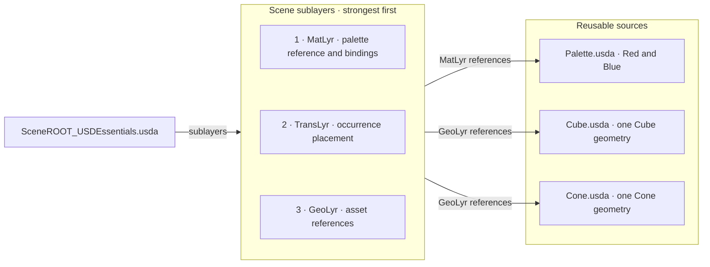

Use a copy to experiment: explicitly select TransLyr before moving a shape, or
MatLyr before changing a binding, then inspect the saved USDA. This teaching
profile uses **Y-up, centimetres and 24 fps** and has no Opinion layer, locking
helper, environment, variants or animation. Open it directly as its own stage;
the parent `Open_In_Kit.ps1 -Scene ...` menu is for the larger examples. Keep the
minimal folder together when copying it. Its simplified layer and folder choices
are documented in its README; it is an introductory subset of the contracts.

## Play and control the MoGraph scene

> **Under development — proof of concept.** This scene explores how a compact, editable data source can drive a large USD point-instancer through a clearly owned runtime contribution. It is not a production motion-graphics system, live telemetry connector, or verified performance result. The UI, JSON acceptance and USD/Fabric value updates have been observed, but viewport refresh is still being investigated: the user reported that visible animation began only after restarting Kit and reloading the scene. A reload is currently a workaround, not an accepted fix.

**Saved animation:** open `SceneROOT_MotionGraphics.usda` in Kit and press **Play**. The file includes an eight-second clip. Use `/World/MotionOverview` as the viewport camera if it is not selected automatically. Enable timeline looping to repeat; other JSON settings may produce a discontinuity at the loop boundary.

**Live JSON controls:** launch with:

```powershell
.\Open_In_Kit.ps1 -Scene MotionGraphics
```

This opens the **Motion Graphics Controls** panel and starts the JSON watcher. Change controls, click **Apply & Save JSON**, then **Play**. Or edit [motion_graphics.json](040_DATA_LYRs/Controls/motion_graphics.json) in your IDE and save. The helper checks the file about every 250 ms; accepted changes also update the pose while paused. Opening the USDA alone plays the bake without starting the panel or watcher. If the preview values update but the viewport stays visually still, reload the scene (or restart Kit and reopen it); that currently observed recovery means the render refresh/rebind path is still under development.

**Already opened the scene in Kit?** Enable live controls in that existing window:
open **Window > Script Editor** (the menu location may vary by app), and run this
once while `SceneROOT_MotionGraphics.usda` is open:

```python
from pathlib import Path
import runpy
import omni.usd
package = Path(omni.usd.get_context().get_stage().GetRootLayer().realPath).parent
runpy.run_path(str(package / "_workflows/kit/motion_graphics.py"))
```

**Rerun this startup code once after updating these Python files.** The old
background controller cannot display the new panel or read the new comment fields.
The panel is a floating, dockable window titled **Motion Graphics Controls**.
The bootstrap reads the model and panel directly from their current Python source
and checks the model's required functions before starting. Rerunning it refreshes
both files without deleting caches or restarting Kit. Keep the `_workflows`
folder together when copying updates.
Restart cleanup skips expired layers and restores permissions only on surviving
layer instances. It also handles the older helper already in memory; rerun the
same bootstrap after updating, without manually clearing helper objects.

- Every slider shows its JSON key, allowed range and explanation. Dropdowns list valid words.
- **DRAFT ONLY** means edits are waiting for **Apply & Save JSON**. This button saves only the DATA control file and retains the previous bytes under `_pipeline_reports/motion_graphics/`.
- **JSON ACCEPTED** means the controller loaded the values. **NOT APPLIED** gives the reason and keeps the last valid motion; syntax errors include line, column and nearby text. One invalid value rejects the entire input.
- **Reload JSON** discards an unapplied panel draft in favour of valid disk values. If the disk file is invalid, the panel keeps its displayed values so an explicit Save can repair it, with a backup. Concurrent external edits block stale panel saves until Reload.
- **Visible wave preset** fills a noticeable rings/wave setup; click **Apply & Save JSON**, then **Play**. **Pause** stops timeline progression.
- The top line shows **LIVE / BAKED**, **PLAYING / PAUSED**, timeline seconds and a runtime-update counter. In live playback, time and updates should both increase. **JSON ACCEPTED** alone only confirms the input loaded.
- **Play** targets this USD context's timeline, uses the scene's frame range and enables automatic advancement if needed (restored on disconnect). A controlling timeline director, stopped worker, empty range or stalled clock is reported. Play clicks and state changes are also logged.
- **Reconnect** reloads saved controls and recreates only this helper's temporary preview, discarding unsaved panel edits. It does not unmute scene layers or remove other opinions. Muted/detached runtime layers, missing geometry, invisible cloners and stronger opinions masking the generated arrays are reported in the top line.
  - **Playback read-back** automatically collects three snapshots after Play and reports whether sampled USD and Fabric positions change. It waits for advancing playback for up to 60 seconds; paused snapshots cannot establish animation. Detailed positions, sources and viewport time/freeze state go to the Kit log. The same read-only report can be run separately with [_workflows/kit/diagnose_motion_graphics.py](_workflows/kit/diagnose_motion_graphics.py). Moving data still needs visible viewport confirmation.
  - The runtime status shows whether RTX scene partitioning is off, on, or temporarily disabled for this preview. This scene does not author partitions. NVIDIA documents partitioning as off by default; Kit 110.3 release notes also list an FSD bug where instanced-scene transforms could remain visually stale while Fabric world transforms were correct. The helper disables partitioning only if the host reports it enabled, then restores it on disconnect ([release notes](https://docs.omniverse.nvidia.com/dev-guide/latest/release-notes/110_3.html), [partition docs](https://docs.omniverse.nvidia.com/materials-and-rendering/latest/cameras.html)).

Closing the panel hides it; motion continues. To show it again without restarting:
`import builtins; builtins.cc_motion_graphics.show_panel()`.

The JSON has a `_comment_<name>` string immediately above every value: range,
units, examples and effects. These strings are documentation, ignored by the
motion model. Keep the file valid JSON: quoted text, commas between entries,
no `//` comments or line breaks inside a quoted string. The adjacent schema
also supplies IDE hints. Values such as `speed_hz: 0.5` mean **half a cycle per
second**, not 50%; `500` is outside its **−2 to 2** range.

| Control | Allowed values | Meaning |
|---|---|---|
| `live_preview` | `true` / `false` | False shows the saved clip; other JSON controls are then inactive. |
| `layout` / `wave_mode` | `grid`, `rings`, `spiral` / `plane`, `radial`, `swirl` | Arrangement / wave shape. |
| `strength` | 0–1 | Overall animated effect strength. |
| `spacing_cm` | 50–500 | Clone spacing in centimetres. |
| `amplitude_cm` | 0–1500 | Wave height in centimetres. |
| `wavelength_cm` | 100–10000 | Distance between crests; try 1800. |
| `speed_hz` | −2–2 | Wave cycles/second; negative reverses travel. |
| `phase_degrees` / `direction_degrees` | −360–360 / −180–180 | Phase offset / direction (plane wave only). |
| `base_scale` / `scale_wave` | 0.1–3 / 0–0.9 | Base size multiplier / pulsation amount. |
| `rotation_degrees` | 0–180 | Wave-driven tilt. |
| `spin_degrees_per_second` | −360–360 | Continuous rotation. |
| `noise_cm` / `noise_speed_hz` | 0–500 / 0–2 | Bobbing height / cycles per second. |
| `falloff_radius_cm` | 100–20000 | Motion fades to zero at this distance from the centre; try 12000. |
| `color_cycle_hz` | 0–2 | Colour steps per second; 0 stops cycling. |

Keep the fixed 32 × 32 topology: IDs 0–1023 persist as layouts change. Large amplitudes can cross the ground; this is visual animation without collisions.

For an obvious response, try rings with `amplitude_cm: 600`, `wavelength_cm: 1800`,
`speed_hz: 0.5`, `scale_wave: 0.8` and `falloff_radius_cm: 12000`. Falloff reduces
motion away from the centre: a small radius can leave most of the field nearly
still. These are JSON values to edit in the control file, not Python statements
to paste into Kit's Script Editor. The Script Editor only needs the startup code.

Very short wavelengths near/below clone spacing can look irregular. Larger
spacing can extend beyond the overview camera; select
`/World/MotionGraphics/Cloner` and frame the selection.

**How it is composed:**

| Owner | Contribution |
|---|---|
| DATA | `DataLyr_MotionGraphics.usda` declares the JSON asset path, profile and `/World/MotionGraphics/Cloner` target. |
| BASE Geo / Vari | One PointInstancer, stable IDs and six prototype references; Size=Normal and Finish=Red/Blue/Yellow on each shape type. |
| BASE Trans / Cam | Place the whole cloner; provide the overview camera. |
| BASE Anim | `AnimLyr_MotionGraphics.usdc` stores sampled position, orientation, scale, prototype index and bounds. |
| RUNTIME | The optional Python helper writes those five arrays as a two-sample window at current time and one time code ahead, in its own anonymous Session sublayer. Old samples are removed; this is a live preview, not an accumulated recording. It never saves USD files. |
| REVIEW | Independent Opinion remains the user's default authoring layer. Work/source layers are protected by the launcher. |

### How the motion scene works

The JSON file is a **local mock data source**: it lets us develop and evaluate the data-to-scene path before a real publisher is connected. It is not a server and does not stream on its own. The Kit helper polls it, validates a complete snapshot, and maps accepted controls into USD values. A future adapter could obtain the same normalized controls from a simulation feed, robotics middleware, OPC UA, a service/API or another publisher. The data schema and mapping should remain stable while only the input adapter changes.

```mermaid
%%{init: {"flowchart": {"htmlLabels": false, "wrappingWidth": 260, "nodeSpacing": 28, "rankSpacing": 36}}}%%
flowchart LR
    accTitle: MotionGraphics data and playback path
    accDescr: A local JSON mock source or future publisher feeds a validated Kit controller. The controller evaluates controls against timeline time and writes a temporary Session overlay over the saved animation. USD composes point-instancer arrays which pass through Fabric to the renderer. A manual reload currently restores visible motion when the viewport becomes stale.

    subgraph INPUT["1 · INPUT DATA"]
        direction TB
        JSON["motion_graphics.json<br/>Local editable mock source<br/>Controls, units, ranges and comments"]
        FUTURE["Future data publisher<br/>Simulation · robot · OPC UA · API"]
        JSON -->|file snapshot| VALIDATE
        FUTURE -.->|same normalized schema| VALIDATE
    end

    subgraph KIT["2 · KIT CONTROL LOOP"]
        direction TB
        WATCH["motion_graphics.py<br/>Polls JSON about every 250 ms"]
        VALIDATE["motion_graphics_core.py<br/>Parse · validate · reject whole bad snapshot<br/>Keep last valid controls on error"]
        PANEL["Motion Graphics Controls<br/>Edit draft · Apply & Save · status"]
        TIME["USD-context Kit timeline<br/>seconds → stage time code"]
        EVAL["Pure motion model<br/>Controls + timeline time → 1,024 values"]
        WATCH --> VALIDATE --> EVAL
        PANEL -->|explicit save| JSON
        TIME --> EVAL
    end

    subgraph USD["3 · USD COMPOSITION"]
        direction TB
        ROOT["SceneROOT_MotionGraphics.usda<br/>Stage settings · 0–480 tc · 60 fps"]
        STACK["Direct scene sublayers<br/>Opinion · Data · Anim · Cam · Trans · Vari · Geo"]
        GEOMETRY["GeoLyr<br/>One PointInstancer · fixed IDs 0–1023<br/>six references: Cube/Cone × Red/Blue/Yellow"]
        VARI["VariLyr<br/>Select Size=Normal and Finish per prototype"]
        BAKE["AnimLyr_MotionGraphics.usdc<br/>Saved 8-second clip · 241 samples<br/>positions · orientations · scales · protoIndices · extent"]
        DATA["DataLyr<br/>Declares controls asset · profile · target · ID scope"]
        SESSION["Temporary anonymous Session sublayer<br/>Runtime arrays at current tc and next tc<br/>Removed on stop / disconnect; never saved"]
        ROOT --> STACK
        STACK --> GEOMETRY
        STACK --> VARI
        STACK --> BAKE
        STACK --> DATA
        EVAL -->|five runtime arrays| SESSION
        DATA -.->|declares target and input| EVAL
        SESSION -->|stronger opinions while live| COMPOSE
        BAKE -->|fallback when live is off| COMPOSE
        GEOMETRY --> COMPOSE["Composed PointInstancer<br/>resolved arrays + prototypes"]
        VARI --> COMPOSE
    end

    subgraph VIEW["4 · VIEWPORT"]
        direction TB
        FABRIC["Fabric / scene delegate<br/>receives composed USD changes"]
        RENDER["Hydra / RTX viewport<br/>draws points using shared prototypes"]
        STALE["Observed recovery<br/>Manual scene reload / Kit restart<br/>can restore visible motion"]
        FABRIC --> RENDER
        RENDER -.->|if stale| STALE
        STALE -.->|rebuild stage/render connection| FABRIC
    end

    COMPOSE --> FABRIC

    classDef source fill:#fff7d6,stroke:#c9a227,color:#17212b
    classDef kit fill:#e7f3fc,stroke:#76a9cc,color:#17212b
    classDef usd fill:#e9f5e9,stroke:#73a873,color:#17212b
    classDef view fill:#f1eafd,stroke:#9875bd,color:#17212b
    class JSON,FUTURE source
    class WATCH,VALIDATE,PANEL,TIME,EVAL kit
    class ROOT,STACK,GEOMETRY,VARI,BAKE,DATA,SESSION,COMPOSE usd
    class FABRIC,RENDER,STALE view
```

#### Reading the USD scene

The root is a thin scene entrypoint, not a nested starter root. It directly composes its role layers; GeoLyr supplies the instancer topology and prototype reference sites, while the other layers contribute values to those same composed prims. `AnimLyr` is the authored fallback. When live preview is active, an anonymous layer is inserted into Session and writes only `positions`, `orientations`, `scales`, `protoIndices` and `extent`. Those runtime values are stronger than the saved animation for the same attributes. Turning off live preview or stopping the helper removes its layer so the saved clip is visible again. The persistent Opinion layer is still the default user authoring destination; the runtime layer is temporary machinery.

The next diagram is the **composed prim namespace**, not a layer stack. The scene root composes layer files; those layers author opinions on prims in this namespace. Each of the six prototype sites references one of two asset roots, with its Finish choice set by VariLyr. Shared materials remain inside/referenced by those asset packages.

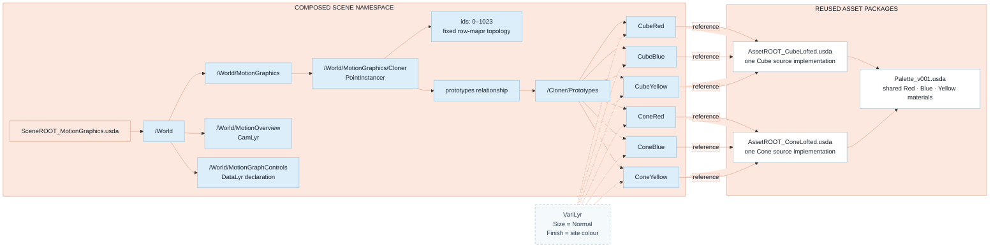

There are **six prototype configurations**, but only **two source assets** and **three shared finish materials**. Each of the 1,024 points is an element in PointInstancer arrays, not an individually editable prim. `protoIndices` selects among the six referenced prototype sites; the per-point transform arrays control their motion. The camera, whole-cloner placement, prototype choices, data declaration, baked animation and geometry therefore have separate owners.

#### What each part contributes

| Part | Role in this example | Reusable idea |
|---|---|---|
| `motion_graphics.json` | Human-editable mock input with documented ranges, units and choices. | Keep an explicit, versionable input contract that can be authored by people or published by a service. |
| `DataLyr_MotionGraphics.usda` | Records the input asset, profile, target prim and stable-ID scope. USD metadata declares the relationship; it does not run a watcher. | Put the data contract and allowed target in the scene, separate from its execution adapter. |
| `motion_graphics_core.py` | Parses, validates and deterministically maps controls plus time to arrays. Bad input is rejected as a whole; the last valid state is retained. | Reuse one mapping/validation core for a UI, file, API or live-data adapter. |
| `motion_graphics.py` | Kit-specific lifecycle, file polling, USD-context timeline access, temporary layer writing and cleanup. | Keep host integration at the boundary; do not mix it into data validation or asset definitions. |
| `GeoLyr` and `VariLyr` | Define one instancer and six referenced public configurations. | Keep topology and published asset choices distinct from generated per-point values. |
| `AnimLyr_MotionGraphics.usdc` | Stores a bounded eight-second animation clip sampled every two time codes. | Preserve an inspectable/fallback result when the external driver is absent. |
| Session runtime overlay | Temporarily overrides the five animated arrays; it does not persist into the project. | Keep live operational state separate from authored and saved scene content. |
| Fabric / renderer | Consume the composed USD and display it. | Validate data, composition, delegate synchronization and visible output as separate boundaries. |

#### Runtime and lifecycle flow

```mermaid
%%{init: {"flowchart": {"htmlLabels": false, "wrappingWidth": 260, "nodeSpacing": 24, "rankSpacing": 32}}}%%
flowchart LR
    accTitle: MotionGraphics runtime lifecycle and failure boundaries
    accDescr: The helper attaches to the target stage, validates the DATA declaration and JSON file, evaluates controls at timeline time, writes a temporary Session sublayer and checks the composed USD and Fabric values. Invalid input retains prior valid data. Current limitation: the values can change while the viewport remains stale until the stage or application is reloaded.

    START["Run Kit bootstrap<br/>or launcher"] --> ATTACH["Attach to matching root<br/>validate DATA declaration<br/>check IDs and prototypes"]
    ATTACH --> WATCH["Poll local JSON<br/>or receive normalized input"]
    WATCH --> PARSE["Parse + range-check"]
    PARSE -->|valid| MODEL["Evaluate controls at timeline seconds"]
    PARSE -->|invalid| HOLD["Keep last valid controls<br/>show/log reason"]
    HOLD --> WATCH
    MODEL --> LAYER["Write five arrays into owned<br/>anonymous Session sublayer<br/>two time samples; prune old samples"]
    LAYER --> READBACK["Read back composed USD<br/>and Fabric arrays"]
    READBACK --> IMAGE["Viewport renders animation"]
    READBACK -.->|values change, image still stale| RELOAD["Known workaround observed:<br/>restart Kit and reload scene"]
    RELOAD -.->|reattach and rebuild stage/render state| ATTACH
    IMAGE --> STOP["Stop / disconnect / stage closes"]
    STOP --> CLEAN["Cancel watcher and remove only<br/>owned runtime overlay; restore host setting"]
    CLEAN --> BAKE["Saved AnimLyr remains<br/>available as fallback"]

    classDef active fill:#e7f3fc,stroke:#76a9cc,color:#17212b
    classDef issue fill:#fde8df,stroke:#d99b84,color:#17212b
    classDef output fill:#e9f5e9,stroke:#73a873,color:#17212b
    class START,ATTACH,WATCH,PARSE,MODEL,LAYER,READBACK,CLEAN active
    class HOLD,RELOAD issue
    class IMAGE,STOP,BAKE output
```

The reload observation narrows the unfinished work: a data snapshot is accepted, and diagnostics have shown changing values in USD and Fabric, yet the viewport did not always refresh until Kit rebuilt/reopened the scene. The exact cause is not established. The chart shows the observed boundary and workaround, not a proven renderer defect. Until the automatic refresh lifecycle is reliable across start, pause, JSON edits, stage replacement and stop, treat this as an experiment.

#### Extending the mock source to incoming data

The intended extension point is before the shared validation/model boundary. A future connector should translate its incoming message into the same normalized controls (or a separately versioned input schema), attach source identity, timestamp/sequence and freshness, and then use the same deterministic mapping and declared USD target. Define stale-data, reconnect, out-of-order message, unit conversion, conflicting writer and persistence policies before connecting a real source. The current JSON watcher implements none of those transport guarantees: it is a convenient local stand-in for exercising the pipeline end to end.

There are **1,024 point instances, six prototype configurations, two source assets and three shared colour materials**. Colour cycling changes `protoIndices`; it does not rebuild geometry or author 1,024 variant selections every frame. Individual points have IDs and array entries, not their own prim paths. The existing Instanced scenes demonstrate native prim instancing when individual occurrence hierarchy is useful.

The live contribution deliberately overrides the baked arrays and Opinion edits on those same properties. Disable it before inspecting or changing their saved values. Direct Session opinions can still mask it. Invalid, partial or missing JSON retains the last accepted controls and continues with timeline time; before the first valid input, the saved clip stays visible. Errors remain visible in the panel and are logged in Kit's console. Stage close/replacement removes the owned overlay and watcher and rebinds the panel. Rerunning the helper also destroys the previous panel. To stop it manually in Kit's Script Editor: `import builtins; builtins.cc_motion_graphics.stop()`.

**Keep a changed motion:** save the JSON, then explicitly rebake while the scene is closed:

```powershell
python _workflows/build_motion_graphics.py --rebake
```

Requires Python with `pxr` (repository option: `uv run --with usd-core==26.8 python ...`). It replaces only the generated animation and keeps the previous clip, input and provenance under `_pipeline_reports/motion_graphics/`. Reopen the scene to see the new bake. Plain invocation prints the plan; `--apply` is the initial authoring operation and refuses existing outputs. Binary USDC keeps the sampled clip compact; role and root files remain readable USDA.

The shared [motion model](_workflows/motion_graphics_core.py) drives baking, validation, JSON guidance and the [Kit adapter](_workflows/kit/motion_graphics.py). Its [native panel](_workflows/kit/motion_graphics_panel.py) edits the DATA JSON through the same model; runtime arrays still have one writer. No extension installation is required. Panel startup, control saves and changing USD/Fabric values have been observed in Kit. The user reported that visible motion appeared after restarting Kit and reloading the scene; automatic viewport refresh and the full lifecycle remain under development. This is a proof of concept, not a production-ready connector, with no frame-rate claim.

## Drive the instancing scenes with Python

**Start with Instanced_Wave for the varied demonstration.** The base Instanced grid uses matching Blue/Normal selections. Wave, Spiral and Rings use the same two shape sources with **18 configurations**: Cube/Cone × Normal/Large/Tall × Red/Blue/Yellow. Each has 1,024 generated occurrences plus the five teaching objects. Select `/World/InstanceGrid` and frame the selection in Kit; these layouts extend beyond the standard camera and ground.

The bundled [_workflows/arrange_instances.py](_workflows/arrange_instances.py) reads [instance_signal.json](_workflows/inputs/instance_signal.json): exactly 1,024 finite values between 0 and 1, in row-major order. The bundled signal is synthetic. Replace it with normalized measurements or other input to steer the scene.

- Nine equal value bands select the Size/Finish combination; value 1 belongs to the last band.
- Values control height and heading; `wave`, `spiral` or `rings` sets the horizontal arrangement.
- Placement is authored in the scene's TransLyr, selections in VariLyr. The geometry remains shared. These are saved snapshots, not a live connection or time-sampled animation.

With Python and `pxr` available, run from this project folder:

```powershell
python _workflows/arrange_instances.py --shape wave
python _workflows/arrange_instances.py --shape wave --input _workflows/inputs/instance_signal.json --apply
```

The first command shows the plan. `--apply` writes `SceneROOT_Instanced_Wave.usda`, its TransLyr/VariLyr and Opinion file; existing Opinion contents are preserved. Use `--shape spiral` or `--shape rings` for the other independent scenes. Existing outputs and input/plan records are backed up in `_pipeline_reports/instance_driver/`. The script does not launch Kit. Save or discard pending Kit edits before applying, then reopen/reload the named scene. It uses the declared mappings; invalid input stops the run. It is not a general cleanup or ownership-inference tool.

For a repository development environment with `uv`, the equivalent prefix is `uv run --with usd-core==26.8 python`. The driver requires that USD dependency; opening the already-generated scenes does not require Python.

## Authoring

**Opinion is editable by default; persistent work/source layers are protected.** Use the launcher for the full startup policy.

- Saving Opinion retains experiments. Promote accepted edits to their owning layer and variant branch, then remove superseded opinions.
- The five original demo scenes share one Opinion file. STARTER and each scalability scene have their own Opinion. The Instanced formations share geometry and data but own their generated placement and selections.
- Place objects on occurrence parents such as `/World/Cube02` using TransLyr. Scenario-relative changes belong on `Adjustment` inside the Layout branch.
- Cube/Cone controls live on `/World/<Occurrence>/Adjustment/Asset`: **Size** = Normal / Large / Tall; **Finish** = Red / Blue / Yellow.
- DisplayPair exposes **Palette** = Cool / Warm. Scene VariLyr selects these published controls.
- Session is available for temporary previews; stronger Session opinions can mask saved work. Promotion and saving are manual.

## Folder and layer pattern

```text
Project/
|-- SceneROOT_STARTER.usda       # starter entrypoint
|-- SceneROOT_<Purpose>.usda     # other scene entrypoints
|-- Open_In_Kit.ps1              # optional Kit launcher
|-- README.md                   # this scene guide
|-- 000_SOURCE/                 # original inputs
|-- 010_ASS_USD/                 # reusable sources
|   |-- USD_Wrappers/            # Cube and Cone asset packages
|   |-- Assemblies/              # DisplayPair assembly
|   |-- MatLib/                  # shared material definitions
|   `-- Envs/                    # environment resources
|-- 020_BASE_LYR/                # GeoLyr, TransLyr, VariLyr, etc.
|                               # flat files; purpose suffixes per scene
|-- 030_SIM_LYR/                 # simulation contributions
|-- 035_RUNTIME_LYR/             # runtime contributions
|-- 040_DATA_LYRs/               # identity, context and input declarations
|   `-- Controls/               # live MoGraph JSON and IDE schema
|-- 050_REVIEW/                  # Opinion and conflict demonstrations
|-- _contracts/                 # ownership and expected outcomes
|-- _workflows/                 # Kit helper, instance driver and JSON inputs
|-- _pipeline_reports/          # evidence and inventory notes
`-- diagrams/                   # SVGs and editable Mermaid sources
```

This is a folder map, not layer strength order; the root's sublayer list defines that order.

Each root directly composes its work layers, with **GeoLyr at the bottom**. Assets repeat this folder pattern and use `AssetROOT_<Name>.usda`; working scenes use `SceneROOT_<Purpose>.usda`.

Asset-level edits affect every consumer. For an independent project, copy the whole package and its dependencies, not just a root file.

STARTER includes empty slots for materials, environment, lighting, cameras, rendering, animation, rigging, physics, simulation and runtime work. These slots do not activate those systems. The visible environment, lights, cameras and render baseline are authored in the root; muting an empty slot does not remove them.

## Scope

Textures and USD assets are bundled; the ground's OmniPBR shader and viewport features require Omniverse. Updated Kit startup, rendering and full acceptance remain pending. See [baseline outcomes](_contracts/expected.json), [scalability profile](_contracts/scalability.json), [motion profile](_contracts/motion_graphics.json) and [evidence notes](_pipeline_reports/README.md).

<!-- BEGIN EXACT SCENE GRAPHS -->

## Exact composition diagrams for every scene

Read from the saved USD files. **Layout: root left, ordered scene layers middle, reusable sources right.** Solid incoming arrows show composition dependencies; dashed arrows describe control selection or baseline resources. Internal stack order is numbered strongest first; invisible layout links do not create sublayer nesting. Asset boxes list their own exact sublayers. DataLyr boxes list their nested data contributions.

The reuse views draw each source definition once: one Cube, one Cone and one shared definition each for Red, Blue and Yellow. The teaching layout has five shapes (three cubes, two cones); each Instanced scene adds 1,024 occurrences, shown as two counted groups. MotionGraphics instead has one PointInstancer with 1,024 points and six prototype configurations. Reference arrows are composition arcs, not copies. Saved selections appear on reference sites.

These are source/dependency views, not expanded stage trees or rendered results. The Instanced scenes enable native instancing. Lofted and Instanced introduce payload boundaries and public interface declarations while sharing the original role files. Palette also contains an unused Ground definition; the visible ground uses its separate Grid material. Rendered outcomes remain deferred.

### SceneROOT_Example.usda

Manual published asset selections; the standard demonstration.

**Goal:** understand the basic ownership pattern. Start on the right with Cube, Cone and DisplayPair; GeoLyr references them into the scene. In the middle, TransLyr places occurrences and VariLyr selects their published Size, Finish and Palette controls. The root on the left composes these sibling layers. In the reuse graph, follow several occurrence arrows back to one source: reuse preserves a single authored implementation.

```mermaid
%%{init: {"htmlLabels": false, "themeVariables": {"fontFamily": "Arial, sans-serif"}, "flowchart": {"htmlLabels": false, "padding": 20, "nodeSpacing": 200, "rankSpacing": 35, "diagramPadding": 20}}}%%
flowchart LR
    subgraph ENTRY["ROOT · left"]
        direction TB
        R["SceneROOT_Example.usda<br/>/World · cm · Z-up · 60 fps"]
        B["Authored in this root<br/>/Environment: Sky, DistantLight, Looks/Grid, ground, groundCollider<br/>/Render: viewport product, settings and LdrColor<br/>/OmniverseKit_Persp, Front, Right, Top"]
        R ~~~ B
    end
    subgraph STACK["DIRECT SCENE SUBLAYERS · strongest at top"]
        direction TB
        L0["1. 050_REVIEW/OpinLYR_default.usda<br/>Default authoring target · empty initially"]
        L1["2. 040_DATA_LYRs/DataLyr.usda<br/>Own sublayers, strongest first:<br/>1. ./Data/IdentityLyr.usda<br/>2. ./Data/ContextLyr.usda"]
        L0 ~~~ L1
        L2["3. 020_BASE_LYR/TransLyr.usda"]
        L1 ~~~ L2
        L3["4. 020_BASE_LYR/VariLyr.usda"]
        L2 ~~~ L3
        L4["5. 020_BASE_LYR/GeoLyr.usda<br/>BOTTOM / WEAKEST"]
        L3 ~~~ L4
    end
    subgraph SOURCES["REFERENCED PACKAGES · right"]
        direction TB
        PAIR["010_ASS_USD/Assemblies/DisplayPair/AssetROOT_DisplayPair.usda<br/>Own sublayers, strongest first:<br/>1. ./050_REVIEW/OpinLYR_default.usda<br/>2. ./020_BASE_LYR/VariLyr.usda<br/>3. ./020_BASE_LYR/TransLyr.usda<br/>4. ./020_BASE_LYR/GeoLyr.usda<br/>Public controls: Palette: Warm / Cool"]
        CUBE["010_ASS_USD/USD_Wrappers/Cube/AssetROOT_Cube.usda<br/>Own sublayers, strongest first:<br/>1. ./050_REVIEW/OpinLYR_default.usda<br/>2. ./020_BASE_LYR/VariLyr.usda<br/>3. ./020_BASE_LYR/MatLyr.usda<br/>4. ./020_BASE_LYR/TransLyr.usda<br/>5. ./020_BASE_LYR/GeoLyr.usda<br/>Public controls: Size: Normal / Large / Tall · Finish: Red / Blue / Yellow"]
        CONE["010_ASS_USD/USD_Wrappers/Cone/AssetROOT_Cone.usda<br/>Own sublayers, strongest first:<br/>1. ./050_REVIEW/OpinLYR_default.usda<br/>2. ./020_BASE_LYR/VariLyr.usda<br/>3. ./020_BASE_LYR/MatLyr.usda<br/>4. ./020_BASE_LYR/TransLyr.usda<br/>5. ./020_BASE_LYR/GeoLyr.usda<br/>Public controls: Size: Normal / Large / Tall · Finish: Red / Blue / Yellow"]
        MAT["010_ASS_USD/MatLib/Palette_v001.usda<br/>/Materials/Red, Blue, Yellow, Ground<br/>Each material owns Surface shader"]
        RES["Baseline resources<br/>010_ASS_USD/Envs/OmniverseStandard/Resources/<br/>CarLight_512x256.hdr · ov_uv_grids_basecolor_1024.png<br/>OmniPBR.mdl: external MDL search identifier"]
        PAIR -->|"GeoLyr: CubePart/Adjustment/Asset"| CUBE
        PAIR -->|"GeoLyr: ConePart/Adjustment/Asset"| CONE
        CUBE -->|"MatLyr references Red, Blue, Yellow"| MAT
        CONE -->|"MatLyr references Red, Blue, Yellow"| MAT
        MAT ~~~ RES
    end
    ENTRY <--|"root subLayers list; sibling layers"| STACK
    STACK <--|"GeoLyr: Cube01 and Cube02 → Cube; Cone01 → Cone; Pair01 → DisplayPair"| SOURCES
    STACK -.->|"VariLyr selects public controls; definitions stay in packages"| SOURCES
    ENTRY -.->|"root Sky/Grid resource dependencies"| SOURCES
    classDef root fill:#fde8df,stroke:#d99b84,color:#17212b
    classDef layer fill:#dceef9,stroke:#91bfd8,color:#17212b
    classDef asset fill:#ffffff,stroke:#9db9c8,color:#17212b
    class R,B root
    class L0,L1,L2,L3,L4 layer
    class PAIR,CUBE,CONE,MAT,RES asset
```

<details>
<summary>USD source reuse — each definition shown once</summary>



[Open full-size SVG](diagrams/SceneROOT_Example_reuse.svg) · [Mermaid source](diagrams/SceneROOT_Example_reuse.mmd)


</details>

### SceneROOT_Manual.usda

Same stack and defaults as Example, with its own direct root. No nested scene root.

**Goal:** work with explicit choices for individual occurrences. Follow the same source-to-GeoLyr-to-root route as Example; this separate entrypoint uses the same work layers and saved defaults, so it is not an independent project copy. Change selections through the rightful scene layer rather than editing reusable source definitions. There is no scene Layout switch here.

```mermaid
%%{init: {"htmlLabels": false, "themeVariables": {"fontFamily": "Arial, sans-serif"}, "flowchart": {"htmlLabels": false, "padding": 20, "nodeSpacing": 200, "rankSpacing": 35, "diagramPadding": 20}}}%%
flowchart LR
    subgraph ENTRY["ROOT · left"]
        direction TB
        R["SceneROOT_Manual.usda<br/>/World · cm · Z-up · 60 fps"]
        B["Authored in this root<br/>/Environment: Sky, DistantLight, Looks/Grid, ground, groundCollider<br/>/Render: viewport product, settings and LdrColor<br/>/OmniverseKit_Persp, Front, Right, Top"]
        R ~~~ B
    end
    subgraph STACK["DIRECT SCENE SUBLAYERS · strongest at top"]
        direction TB
        L0["1. 050_REVIEW/OpinLYR_default.usda<br/>Default authoring target · empty initially"]
        L1["2. 040_DATA_LYRs/DataLyr.usda<br/>Own sublayers, strongest first:<br/>1. ./Data/IdentityLyr.usda<br/>2. ./Data/ContextLyr.usda"]
        L0 ~~~ L1
        L2["3. 020_BASE_LYR/TransLyr.usda"]
        L1 ~~~ L2
        L3["4. 020_BASE_LYR/VariLyr.usda"]
        L2 ~~~ L3
        L4["5. 020_BASE_LYR/GeoLyr.usda<br/>BOTTOM / WEAKEST"]
        L3 ~~~ L4
    end
    subgraph SOURCES["REFERENCED PACKAGES · right"]
        direction TB
        PAIR["010_ASS_USD/Assemblies/DisplayPair/AssetROOT_DisplayPair.usda<br/>Own sublayers, strongest first:<br/>1. ./050_REVIEW/OpinLYR_default.usda<br/>2. ./020_BASE_LYR/VariLyr.usda<br/>3. ./020_BASE_LYR/TransLyr.usda<br/>4. ./020_BASE_LYR/GeoLyr.usda<br/>Public controls: Palette: Warm / Cool"]
        CUBE["010_ASS_USD/USD_Wrappers/Cube/AssetROOT_Cube.usda<br/>Own sublayers, strongest first:<br/>1. ./050_REVIEW/OpinLYR_default.usda<br/>2. ./020_BASE_LYR/VariLyr.usda<br/>3. ./020_BASE_LYR/MatLyr.usda<br/>4. ./020_BASE_LYR/TransLyr.usda<br/>5. ./020_BASE_LYR/GeoLyr.usda<br/>Public controls: Size: Normal / Large / Tall · Finish: Red / Blue / Yellow"]
        CONE["010_ASS_USD/USD_Wrappers/Cone/AssetROOT_Cone.usda<br/>Own sublayers, strongest first:<br/>1. ./050_REVIEW/OpinLYR_default.usda<br/>2. ./020_BASE_LYR/VariLyr.usda<br/>3. ./020_BASE_LYR/MatLyr.usda<br/>4. ./020_BASE_LYR/TransLyr.usda<br/>5. ./020_BASE_LYR/GeoLyr.usda<br/>Public controls: Size: Normal / Large / Tall · Finish: Red / Blue / Yellow"]
        MAT["010_ASS_USD/MatLib/Palette_v001.usda<br/>/Materials/Red, Blue, Yellow, Ground<br/>Each material owns Surface shader"]
        RES["Baseline resources<br/>010_ASS_USD/Envs/OmniverseStandard/Resources/<br/>CarLight_512x256.hdr · ov_uv_grids_basecolor_1024.png<br/>OmniPBR.mdl: external MDL search identifier"]
        PAIR -->|"GeoLyr: CubePart/Adjustment/Asset"| CUBE
        PAIR -->|"GeoLyr: ConePart/Adjustment/Asset"| CONE
        CUBE -->|"MatLyr references Red, Blue, Yellow"| MAT
        CONE -->|"MatLyr references Red, Blue, Yellow"| MAT
        MAT ~~~ RES
    end
    ENTRY <--|"root subLayers list; sibling layers"| STACK
    STACK <--|"GeoLyr: Cube01 and Cube02 → Cube; Cone01 → Cone; Pair01 → DisplayPair"| SOURCES
    STACK -.->|"VariLyr selects public controls; definitions stay in packages"| SOURCES
    ENTRY -.->|"root Sky/Grid resource dependencies"| SOURCES
    classDef root fill:#fde8df,stroke:#d99b84,color:#17212b
    classDef layer fill:#dceef9,stroke:#91bfd8,color:#17212b
    classDef asset fill:#ffffff,stroke:#9db9c8,color:#17212b
    class R,B root
    class L0,L1,L2,L3,L4 layer
    class PAIR,CUBE,CONE,MAT,RES asset
```

<details>
<summary>USD source reuse — each definition shown once</summary>



[Open full-size SVG](diagrams/SceneROOT_Manual_reuse.svg) · [Mermaid source](diagrams/SceneROOT_Manual_reuse.mmd)


</details>

### SceneROOT_Scenarios.usda

VariLyr_Scenarios owns /World Layout: Normal or Exploded. Scenario adjustments stay on Adjustment prims; ordinary placement stays on occurrence parents.

**Goal:** switch coordinated scene arrangements. Follow GeoLyr to the shared assets, then locate VariLyr_Scenarios in the middle stack. Its /World Layout branches select asset controls and author scenario-relative adjustments on Adjustment prims; TransLyr retains ordinary placement on their parents. The paradigm is to keep conditional edits inside their owning branch while reusing the same asset packages.

```mermaid
%%{init: {"htmlLabels": false, "themeVariables": {"fontFamily": "Arial, sans-serif"}, "flowchart": {"htmlLabels": false, "padding": 20, "nodeSpacing": 200, "rankSpacing": 35, "diagramPadding": 20}}}%%
flowchart LR
    subgraph ENTRY["ROOT · left"]
        direction TB
        R["SceneROOT_Scenarios.usda<br/>/World · cm · Z-up · 60 fps"]
        B["Authored in this root<br/>/Environment: Sky, DistantLight, Looks/Grid, ground, groundCollider<br/>/Render: viewport product, settings and LdrColor<br/>/OmniverseKit_Persp, Front, Right, Top"]
        R ~~~ B
    end
    subgraph STACK["DIRECT SCENE SUBLAYERS · strongest at top"]
        direction TB
        L0["1. 050_REVIEW/OpinLYR_default.usda<br/>Default authoring target · empty initially"]
        L1["2. 040_DATA_LYRs/DataLyr.usda<br/>Own sublayers, strongest first:<br/>1. ./Data/IdentityLyr.usda<br/>2. ./Data/ContextLyr.usda"]
        L0 ~~~ L1
        L2["3. 020_BASE_LYR/TransLyr.usda"]
        L1 ~~~ L2
        L3["4. 020_BASE_LYR/VariLyr_Scenarios.usda"]
        L2 ~~~ L3
        L4["5. 020_BASE_LYR/GeoLyr.usda<br/>BOTTOM / WEAKEST"]
        L3 ~~~ L4
    end
    subgraph SOURCES["REFERENCED PACKAGES · right"]
        direction TB
        PAIR["010_ASS_USD/Assemblies/DisplayPair/AssetROOT_DisplayPair.usda<br/>Own sublayers, strongest first:<br/>1. ./050_REVIEW/OpinLYR_default.usda<br/>2. ./020_BASE_LYR/VariLyr.usda<br/>3. ./020_BASE_LYR/TransLyr.usda<br/>4. ./020_BASE_LYR/GeoLyr.usda<br/>Public controls: Palette: Warm / Cool"]
        CUBE["010_ASS_USD/USD_Wrappers/Cube/AssetROOT_Cube.usda<br/>Own sublayers, strongest first:<br/>1. ./050_REVIEW/OpinLYR_default.usda<br/>2. ./020_BASE_LYR/VariLyr.usda<br/>3. ./020_BASE_LYR/MatLyr.usda<br/>4. ./020_BASE_LYR/TransLyr.usda<br/>5. ./020_BASE_LYR/GeoLyr.usda<br/>Public controls: Size: Normal / Large / Tall · Finish: Red / Blue / Yellow"]
        CONE["010_ASS_USD/USD_Wrappers/Cone/AssetROOT_Cone.usda<br/>Own sublayers, strongest first:<br/>1. ./050_REVIEW/OpinLYR_default.usda<br/>2. ./020_BASE_LYR/VariLyr.usda<br/>3. ./020_BASE_LYR/MatLyr.usda<br/>4. ./020_BASE_LYR/TransLyr.usda<br/>5. ./020_BASE_LYR/GeoLyr.usda<br/>Public controls: Size: Normal / Large / Tall · Finish: Red / Blue / Yellow"]
        MAT["010_ASS_USD/MatLib/Palette_v001.usda<br/>/Materials/Red, Blue, Yellow, Ground<br/>Each material owns Surface shader"]
        RES["Baseline resources<br/>010_ASS_USD/Envs/OmniverseStandard/Resources/<br/>CarLight_512x256.hdr · ov_uv_grids_basecolor_1024.png<br/>OmniPBR.mdl: external MDL search identifier"]
        PAIR -->|"GeoLyr: CubePart/Adjustment/Asset"| CUBE
        PAIR -->|"GeoLyr: ConePart/Adjustment/Asset"| CONE
        CUBE -->|"MatLyr references Red, Blue, Yellow"| MAT
        CONE -->|"MatLyr references Red, Blue, Yellow"| MAT
        MAT ~~~ RES
    end
    ENTRY <--|"root subLayers list; sibling layers"| STACK
    STACK <--|"GeoLyr: Cube01 and Cube02 → Cube; Cone01 → Cone; Pair01 → DisplayPair"| SOURCES
    STACK -.->|"VariLyr selects public controls; definitions stay in packages"| SOURCES
    ENTRY -.->|"root Sky/Grid resource dependencies"| SOURCES
    classDef root fill:#fde8df,stroke:#d99b84,color:#17212b
    classDef layer fill:#dceef9,stroke:#91bfd8,color:#17212b
    classDef asset fill:#ffffff,stroke:#9db9c8,color:#17212b
    class R,B root
    class L0,L1,L2,L3,L4 layer
    class PAIR,CUBE,CONE,MAT,RES asset
```

<details>
<summary>USD source reuse — each definition shown once</summary>



[Open full-size SVG](diagrams/SceneROOT_Scenarios_reuse.svg) · [Mermaid source](diagrams/SceneROOT_Scenarios_reuse.mmd)


</details>

### SceneROOT_MaskedSize.usda

ReviewLyr authors local Cube02/Adjustment/Asset scale=(1,1,1), masking the asset Size variant value even when Size=Tall. This is a deliberate conflict.

**Goal:** recognise a deliberately broken variant result. Follow Cube02 to its shared Cube source, where Size=Tall defines scale. Then look at ReviewLyr in the scene stack: its unconditional scale on the same asset prim masks that variant value. Tall may remain selected while the cube resolves to unit scale. This demonstrates why layer order alone cannot resolve local-versus-variant conflicts.

```mermaid
%%{init: {"htmlLabels": false, "themeVariables": {"fontFamily": "Arial, sans-serif"}, "flowchart": {"htmlLabels": false, "padding": 20, "nodeSpacing": 200, "rankSpacing": 35, "diagramPadding": 20}}}%%
flowchart LR
    subgraph ENTRY["ROOT · left"]
        direction TB
        R["SceneROOT_MaskedSize.usda<br/>/World · cm · Z-up · 60 fps"]
        B["Authored in this root<br/>/Environment: Sky, DistantLight, Looks/Grid, ground, groundCollider<br/>/Render: viewport product, settings and LdrColor<br/>/OmniverseKit_Persp, Front, Right, Top"]
        R ~~~ B
    end
    subgraph STACK["DIRECT SCENE SUBLAYERS · strongest at top"]
        direction TB
        L0["1. 050_REVIEW/OpinLYR_default.usda<br/>Default authoring target · empty initially"]
        L1["2. 050_REVIEW/MaskedSize/ReviewLyr.usda"]
        L0 ~~~ L1
        L2["3. 040_DATA_LYRs/DataLyr.usda<br/>Own sublayers, strongest first:<br/>1. ./Data/IdentityLyr.usda<br/>2. ./Data/ContextLyr.usda"]
        L1 ~~~ L2
        L3["4. 020_BASE_LYR/TransLyr.usda"]
        L2 ~~~ L3
        L4["5. 020_BASE_LYR/VariLyr.usda"]
        L3 ~~~ L4
        L5["6. 020_BASE_LYR/GeoLyr.usda<br/>BOTTOM / WEAKEST"]
        L4 ~~~ L5
    end
    subgraph SOURCES["REFERENCED PACKAGES · right"]
        direction TB
        PAIR["010_ASS_USD/Assemblies/DisplayPair/AssetROOT_DisplayPair.usda<br/>Own sublayers, strongest first:<br/>1. ./050_REVIEW/OpinLYR_default.usda<br/>2. ./020_BASE_LYR/VariLyr.usda<br/>3. ./020_BASE_LYR/TransLyr.usda<br/>4. ./020_BASE_LYR/GeoLyr.usda<br/>Public controls: Palette: Warm / Cool"]
        CUBE["010_ASS_USD/USD_Wrappers/Cube/AssetROOT_Cube.usda<br/>Own sublayers, strongest first:<br/>1. ./050_REVIEW/OpinLYR_default.usda<br/>2. ./020_BASE_LYR/VariLyr.usda<br/>3. ./020_BASE_LYR/MatLyr.usda<br/>4. ./020_BASE_LYR/TransLyr.usda<br/>5. ./020_BASE_LYR/GeoLyr.usda<br/>Public controls: Size: Normal / Large / Tall · Finish: Red / Blue / Yellow"]
        CONE["010_ASS_USD/USD_Wrappers/Cone/AssetROOT_Cone.usda<br/>Own sublayers, strongest first:<br/>1. ./050_REVIEW/OpinLYR_default.usda<br/>2. ./020_BASE_LYR/VariLyr.usda<br/>3. ./020_BASE_LYR/MatLyr.usda<br/>4. ./020_BASE_LYR/TransLyr.usda<br/>5. ./020_BASE_LYR/GeoLyr.usda<br/>Public controls: Size: Normal / Large / Tall · Finish: Red / Blue / Yellow"]
        MAT["010_ASS_USD/MatLib/Palette_v001.usda<br/>/Materials/Red, Blue, Yellow, Ground<br/>Each material owns Surface shader"]
        RES["Baseline resources<br/>010_ASS_USD/Envs/OmniverseStandard/Resources/<br/>CarLight_512x256.hdr · ov_uv_grids_basecolor_1024.png<br/>OmniPBR.mdl: external MDL search identifier"]
        PAIR -->|"GeoLyr: CubePart/Adjustment/Asset"| CUBE
        PAIR -->|"GeoLyr: ConePart/Adjustment/Asset"| CONE
        CUBE -->|"MatLyr references Red, Blue, Yellow"| MAT
        CONE -->|"MatLyr references Red, Blue, Yellow"| MAT
        MAT ~~~ RES
    end
    ENTRY <--|"root subLayers list; sibling layers"| STACK
    STACK <--|"GeoLyr: Cube01 and Cube02 → Cube; Cone01 → Cone; Pair01 → DisplayPair"| SOURCES
    STACK -.->|"VariLyr selects public controls; definitions stay in packages"| SOURCES
    ENTRY -.->|"root Sky/Grid resource dependencies"| SOURCES
    classDef root fill:#fde8df,stroke:#d99b84,color:#17212b
    classDef layer fill:#dceef9,stroke:#91bfd8,color:#17212b
    classDef asset fill:#ffffff,stroke:#9db9c8,color:#17212b
    class R,B root
    class L0,L1,L2,L3,L4,L5 layer
    class PAIR,CUBE,CONE,MAT,RES asset
```

<details>
<summary>USD source reuse — each definition shown once</summary>


[Open full-size SVG](diagrams/SceneROOT_MaskedSize_reuse.svg) · [Mermaid source](diagrams/SceneROOT_MaskedSize_reuse.mmd)


</details>

### SceneROOT_MaskedSelection.usda

ReviewLyr authors Cube01/Adjustment/Asset Finish=Blue locally, masking the selection inside either scene Layout branch. This is a deliberate conflict.

**Goal:** distinguish a variant selection from the branch that tries to drive it. Follow the scene Layout controls in VariLyr_Scenarios, then the stronger local Finish=Blue selection in ReviewLyr at Cube01/Adjustment/Asset. The local selection masks the branch selection, so the intended Layout-driven colour does not win. The asset material definitions remain shared; the conflict concerns who controls the selection.

```mermaid
%%{init: {"htmlLabels": false, "themeVariables": {"fontFamily": "Arial, sans-serif"}, "flowchart": {"htmlLabels": false, "padding": 20, "nodeSpacing": 200, "rankSpacing": 35, "diagramPadding": 20}}}%%
flowchart LR
    subgraph ENTRY["ROOT · left"]
        direction TB
        R["SceneROOT_MaskedSelection.usda<br/>/World · cm · Z-up · 60 fps"]
        B["Authored in this root<br/>/Environment: Sky, DistantLight, Looks/Grid, ground, groundCollider<br/>/Render: viewport product, settings and LdrColor<br/>/OmniverseKit_Persp, Front, Right, Top"]
        R ~~~ B
    end
    subgraph STACK["DIRECT SCENE SUBLAYERS · strongest at top"]
        direction TB
        L0["1. 050_REVIEW/OpinLYR_default.usda<br/>Default authoring target · empty initially"]
        L1["2. 050_REVIEW/MaskedSelection/ReviewLyr.usda"]
        L0 ~~~ L1
        L2["3. 040_DATA_LYRs/DataLyr.usda<br/>Own sublayers, strongest first:<br/>1. ./Data/IdentityLyr.usda<br/>2. ./Data/ContextLyr.usda"]
        L1 ~~~ L2
        L3["4. 020_BASE_LYR/TransLyr.usda"]
        L2 ~~~ L3
        L4["5. 020_BASE_LYR/VariLyr_Scenarios.usda"]
        L3 ~~~ L4
        L5["6. 020_BASE_LYR/GeoLyr.usda<br/>BOTTOM / WEAKEST"]
        L4 ~~~ L5
    end
    subgraph SOURCES["REFERENCED PACKAGES · right"]
        direction TB
        PAIR["010_ASS_USD/Assemblies/DisplayPair/AssetROOT_DisplayPair.usda<br/>Own sublayers, strongest first:<br/>1. ./050_REVIEW/OpinLYR_default.usda<br/>2. ./020_BASE_LYR/VariLyr.usda<br/>3. ./020_BASE_LYR/TransLyr.usda<br/>4. ./020_BASE_LYR/GeoLyr.usda<br/>Public controls: Palette: Warm / Cool"]
        CUBE["010_ASS_USD/USD_Wrappers/Cube/AssetROOT_Cube.usda<br/>Own sublayers, strongest first:<br/>1. ./050_REVIEW/OpinLYR_default.usda<br/>2. ./020_BASE_LYR/VariLyr.usda<br/>3. ./020_BASE_LYR/MatLyr.usda<br/>4. ./020_BASE_LYR/TransLyr.usda<br/>5. ./020_BASE_LYR/GeoLyr.usda<br/>Public controls: Size: Normal / Large / Tall · Finish: Red / Blue / Yellow"]
        CONE["010_ASS_USD/USD_Wrappers/Cone/AssetROOT_Cone.usda<br/>Own sublayers, strongest first:<br/>1. ./050_REVIEW/OpinLYR_default.usda<br/>2. ./020_BASE_LYR/VariLyr.usda<br/>3. ./020_BASE_LYR/MatLyr.usda<br/>4. ./020_BASE_LYR/TransLyr.usda<br/>5. ./020_BASE_LYR/GeoLyr.usda<br/>Public controls: Size: Normal / Large / Tall · Finish: Red / Blue / Yellow"]
        MAT["010_ASS_USD/MatLib/Palette_v001.usda<br/>/Materials/Red, Blue, Yellow, Ground<br/>Each material owns Surface shader"]
        RES["Baseline resources<br/>010_ASS_USD/Envs/OmniverseStandard/Resources/<br/>CarLight_512x256.hdr · ov_uv_grids_basecolor_1024.png<br/>OmniPBR.mdl: external MDL search identifier"]
        PAIR -->|"GeoLyr: CubePart/Adjustment/Asset"| CUBE
        PAIR -->|"GeoLyr: ConePart/Adjustment/Asset"| CONE
        CUBE -->|"MatLyr references Red, Blue, Yellow"| MAT
        CONE -->|"MatLyr references Red, Blue, Yellow"| MAT
        MAT ~~~ RES
    end
    ENTRY <--|"root subLayers list; sibling layers"| STACK
    STACK <--|"GeoLyr: Cube01 and Cube02 → Cube; Cone01 → Cone; Pair01 → DisplayPair"| SOURCES
    STACK -.->|"VariLyr selects public controls; definitions stay in packages"| SOURCES
    ENTRY -.->|"root Sky/Grid resource dependencies"| SOURCES
    classDef root fill:#fde8df,stroke:#d99b84,color:#17212b
    classDef layer fill:#dceef9,stroke:#91bfd8,color:#17212b
    classDef asset fill:#ffffff,stroke:#9db9c8,color:#17212b
    class R,B root
    class L0,L1,L2,L3,L4,L5 layer
    class PAIR,CUBE,CONE,MAT,RES asset
```

<details>
<summary>USD source reuse — each definition shown once</summary>



[Open full-size SVG](diagrams/SceneROOT_MaskedSelection_reuse.svg) · [Mermaid source](diagrams/SceneROOT_MaskedSelection_reuse.mmd)


</details>

### SceneROOT_STARTER.usda

Independent starter Opinion, placement, variant and data layers; shared reusable source assets. Extra BASE, SIM and RUNTIME slots are empty and optional. Baseline environment/render/cameras still live in the root.

**Goal:** begin a project with useful roles already available. Follow the shared assets on the right into the starter GeoLyr, then upward through its placement, variants, data and Opinion work layers. Extra role slots reserve places for later work; empty slots do not activate simulation or other systems. The root also supplies the visible environment and render baseline. Keep the roles you need and remove or disable the rest; the starter work layers are independent of the demo layers, while asset sources are still shared.

```mermaid
%%{init: {"htmlLabels": false, "themeVariables": {"fontFamily": "Arial, sans-serif"}, "flowchart": {"htmlLabels": false, "padding": 20, "nodeSpacing": 200, "rankSpacing": 35, "diagramPadding": 20}}}%%
flowchart LR
    subgraph ENTRY["ROOT · left"]
        direction TB
        R["SceneROOT_STARTER.usda<br/>/World · cm · Z-up · 60 fps"]
        B["Authored in this root<br/>/Environment: Sky, DistantLight, Looks/Grid, ground, groundCollider<br/>/Render: viewport product, settings and LdrColor<br/>/OmniverseKit_Persp, Front, Right, Top"]
        R ~~~ B
    end
    subgraph STACK["DIRECT SCENE SUBLAYERS · strongest at top"]
        direction TB
        L0["1. 050_REVIEW/Starter/OpinLYR_default.usda<br/>Default authoring target · empty initially"]
        L1["2. 035_RUNTIME_LYR/Starter/RuntimeLyr.usda"]
        L0 ~~~ L1
        L2["3. 030_SIM_LYR/Starter/SimLyr.usda"]
        L1 ~~~ L2
        L3["4. 040_DATA_LYRs/Starter/DataLyr.usda<br/>Own sublayers, strongest first:<br/>1. ./IdentityLyr.usda<br/>2. ./ContextLyr.usda"]
        L2 ~~~ L3
        L4["5. 020_BASE_LYR/EnvLyr_Starter.usda<br/>Empty optional slot"]
        L3 ~~~ L4
        L5["6. 020_BASE_LYR/LightLyr_Starter.usda<br/>Empty optional slot"]
        L4 ~~~ L5
        L6["7. 020_BASE_LYR/CamLyr_Starter.usda<br/>Empty optional slot"]
        L5 ~~~ L6
        L7["8. 020_BASE_LYR/RenderLyr_Starter.usda<br/>Empty optional slot"]
        L6 ~~~ L7
        L8["9. 020_BASE_LYR/AnimLyr_Starter.usda<br/>Empty optional slot"]
        L7 ~~~ L8
        L9["10. 020_BASE_LYR/PhysicsLyr_Starter.usda<br/>Empty optional slot"]
        L8 ~~~ L9
        L10["11. 020_BASE_LYR/RigLyr_Starter.usda<br/>Empty optional slot"]
        L9 ~~~ L10
        L11["12. 020_BASE_LYR/MatLyr_Starter.usda<br/>Empty optional slot"]
        L10 ~~~ L11
        L12["13. 020_BASE_LYR/TransLyr_Starter.usda"]
        L11 ~~~ L12
        L13["14. 020_BASE_LYR/VariLyr_Starter.usda"]
        L12 ~~~ L13
        L14["15. 020_BASE_LYR/GeoLyr_Starter.usda<br/>BOTTOM / WEAKEST"]
        L13 ~~~ L14
    end
    subgraph SOURCES["REFERENCED PACKAGES · right"]
        direction TB
        PAIR["010_ASS_USD/Assemblies/DisplayPair/AssetROOT_DisplayPair.usda<br/>Own sublayers, strongest first:<br/>1. ./050_REVIEW/OpinLYR_default.usda<br/>2. ./020_BASE_LYR/VariLyr.usda<br/>3. ./020_BASE_LYR/TransLyr.usda<br/>4. ./020_BASE_LYR/GeoLyr.usda<br/>Public controls: Palette: Warm / Cool"]
        CUBE["010_ASS_USD/USD_Wrappers/Cube/AssetROOT_Cube.usda<br/>Own sublayers, strongest first:<br/>1. ./050_REVIEW/OpinLYR_default.usda<br/>2. ./020_BASE_LYR/VariLyr.usda<br/>3. ./020_BASE_LYR/MatLyr.usda<br/>4. ./020_BASE_LYR/TransLyr.usda<br/>5. ./020_BASE_LYR/GeoLyr.usda<br/>Public controls: Size: Normal / Large / Tall · Finish: Red / Blue / Yellow"]
        CONE["010_ASS_USD/USD_Wrappers/Cone/AssetROOT_Cone.usda<br/>Own sublayers, strongest first:<br/>1. ./050_REVIEW/OpinLYR_default.usda<br/>2. ./020_BASE_LYR/VariLyr.usda<br/>3. ./020_BASE_LYR/MatLyr.usda<br/>4. ./020_BASE_LYR/TransLyr.usda<br/>5. ./020_BASE_LYR/GeoLyr.usda<br/>Public controls: Size: Normal / Large / Tall · Finish: Red / Blue / Yellow"]
        MAT["010_ASS_USD/MatLib/Palette_v001.usda<br/>/Materials/Red, Blue, Yellow, Ground<br/>Each material owns Surface shader"]
        RES["Baseline resources<br/>010_ASS_USD/Envs/OmniverseStandard/Resources/<br/>CarLight_512x256.hdr · ov_uv_grids_basecolor_1024.png<br/>OmniPBR.mdl: external MDL search identifier"]
        PAIR -->|"GeoLyr: CubePart/Adjustment/Asset"| CUBE
        PAIR -->|"GeoLyr: ConePart/Adjustment/Asset"| CONE
        CUBE -->|"MatLyr references Red, Blue, Yellow"| MAT
        CONE -->|"MatLyr references Red, Blue, Yellow"| MAT
        MAT ~~~ RES
    end
    ENTRY <--|"root subLayers list; sibling layers"| STACK
    STACK <--|"GeoLyr: Cube01 and Cube02 → Cube; Cone01 → Cone; Pair01 → DisplayPair"| SOURCES
    STACK -.->|"VariLyr selects public controls; definitions stay in packages"| SOURCES
    ENTRY -.->|"root Sky/Grid resource dependencies"| SOURCES
    classDef root fill:#fde8df,stroke:#d99b84,color:#17212b
    classDef layer fill:#dceef9,stroke:#91bfd8,color:#17212b
    classDef asset fill:#ffffff,stroke:#9db9c8,color:#17212b
    class R,B root
    class L0,L1,L2,L3,L4,L5,L6,L7,L8,L9,L10,L11,L12,L13,L14 layer
    class PAIR,CUBE,CONE,MAT,RES asset
```

<details>
<summary>USD source reuse — each definition shown once</summary>


[Open full-size SVG](diagrams/SceneROOT_STARTER_reuse.svg) · [Mermaid source](diagrams/SceneROOT_STARTER_reuse.mmd)


</details>

### SceneROOT_Lofted.usda

Five shapes with lightweight public variant declarations above asset and assembly payloads.

**Goal:** inspect asset controls without loading their implementation. Follow GeoLyr to the CubeLofted, ConeLofted and DisplayPairLofted interfaces. Each interface lists variant names and defaults; a payload leads to ContentsLyr, which composes the original role files. Empty interface branches advertise choices; values stay in the source VariLyr. Unloading Pair also hides its child occurrences, while its own Palette remains discoverable. This scene keeps the five-shape layout, with all shapes Blue/Normal for a simple comparison. It adds independent Opinion/Trans/Vari/Geo layers, and shares the original data and asset implementations.

```mermaid
%%{init: {"htmlLabels": false, "themeVariables": {"fontFamily": "Arial, sans-serif"}, "flowchart": {"htmlLabels": false, "padding": 20, "nodeSpacing": 200, "rankSpacing": 35, "diagramPadding": 20}}}%%
flowchart LR
    subgraph ENTRY["ROOT · left"]
        direction TB
        R["SceneROOT_Lofted.usda<br/>/World · cm · Z-up · 60 fps"]
        B["Authored in this root<br/>/Environment: Sky, DistantLight, Looks/Grid, ground, groundCollider<br/>/Render: viewport product, settings and LdrColor<br/>/OmniverseKit_Persp, Front, Right, Top"]
        R ~~~ B
    end
    subgraph STACK["DIRECT SCENE SUBLAYERS · strongest at top"]
        direction TB
        L0["1. 050_REVIEW/Lofted/OpinLYR_default.usda<br/>Default authoring target · empty initially"]
        L1["2. 040_DATA_LYRs/DataLyr.usda<br/>Own sublayers, strongest first:<br/>1. ./Data/IdentityLyr.usda<br/>2. ./Data/ContextLyr.usda"]
        L0 ~~~ L1
        L2["3. 020_BASE_LYR/TransLyr_Lofted.usda"]
        L1 ~~~ L2
        L3["4. 020_BASE_LYR/VariLyr_Lofted.usda"]
        L2 ~~~ L3
        L4["5. 020_BASE_LYR/GeoLyr_Lofted.usda<br/>BOTTOM / WEAKEST"]
        L3 ~~~ L4
    end
    subgraph SOURCES["REFERENCED PACKAGES · right"]
        direction TB
        PAIR["010_ASS_USD/Assemblies/DisplayPairLofted/AssetROOT_DisplayPairLofted.usda<br/>Own sublayers, strongest first:<br/>1. ./050_REVIEW/OpinLYR_default.usda<br/>Public controls: Palette: Warm / Cool"]
        PAIRC["010_ASS_USD/Assemblies/DisplayPairLofted/020_BASE_LYR/ContentsLyr.usda<br/>Own sublayers, strongest first:<br/>1. ./../../DisplayPair/020_BASE_LYR/VariLyr.usda<br/>2. ./../../DisplayPair/020_BASE_LYR/TransLyr.usda<br/>3. ./GeoLyr.usda"]
        PAIR -->|"payload; empty interface variants above this boundary"| PAIRC
        CUBE["010_ASS_USD/USD_Wrappers/CubeLofted/AssetROOT_CubeLofted.usda<br/>Own sublayers, strongest first:<br/>1. ./050_REVIEW/OpinLYR_default.usda<br/>Public controls: Size: Normal / Large / Tall · Finish: Red / Blue / Yellow"]
        CUBEC["010_ASS_USD/USD_Wrappers/CubeLofted/020_BASE_LYR/ContentsLyr.usda<br/>Own sublayers, strongest first:<br/>1. ./../../Cube/020_BASE_LYR/VariLyr.usda<br/>2. ./../../Cube/020_BASE_LYR/MatLyr.usda<br/>3. ./../../Cube/020_BASE_LYR/TransLyr.usda<br/>4. ./../../Cube/020_BASE_LYR/GeoLyr.usda"]
        CUBE -->|"payload; empty interface variants above this boundary"| CUBEC
        CONE["010_ASS_USD/USD_Wrappers/ConeLofted/AssetROOT_ConeLofted.usda<br/>Own sublayers, strongest first:<br/>1. ./050_REVIEW/OpinLYR_default.usda<br/>Public controls: Size: Normal / Large / Tall · Finish: Red / Blue / Yellow"]
        CONEC["010_ASS_USD/USD_Wrappers/ConeLofted/020_BASE_LYR/ContentsLyr.usda<br/>Own sublayers, strongest first:<br/>1. ./../../Cone/020_BASE_LYR/VariLyr.usda<br/>2. ./../../Cone/020_BASE_LYR/MatLyr.usda<br/>3. ./../../Cone/020_BASE_LYR/TransLyr.usda<br/>4. ./../../Cone/020_BASE_LYR/GeoLyr.usda"]
        CONE -->|"payload; empty interface variants above this boundary"| CONEC
        MAT["010_ASS_USD/MatLib/Palette_v001.usda<br/>/Materials/Red, Blue, Yellow, Ground<br/>Each material owns Surface shader"]
        RES["Baseline resources<br/>010_ASS_USD/Envs/OmniverseStandard/Resources/<br/>CarLight_512x256.hdr · ov_uv_grids_basecolor_1024.png<br/>OmniPBR.mdl: external MDL search identifier"]
        PAIRC -->|"GeoLyr: CubePart/Adjustment/Asset"| CUBE
        PAIRC -->|"GeoLyr: ConePart/Adjustment/Asset"| CONE
        CUBEC -->|"MatLyr references Red, Blue, Yellow"| MAT
        CONEC -->|"MatLyr references Red, Blue, Yellow"| MAT
        MAT ~~~ RES
    end
    ENTRY <--|"root subLayers list; sibling layers"| STACK
    STACK <--|"GeoLyr: Cube01 and Cube02 → Cube; Cone01 → Cone; Pair01 → DisplayPair"| SOURCES
    STACK -.->|"VariLyr selects public controls; definitions stay in packages"| SOURCES
    ENTRY -.->|"root Sky/Grid resource dependencies"| SOURCES
    classDef root fill:#fde8df,stroke:#d99b84,color:#17212b
    classDef layer fill:#dceef9,stroke:#91bfd8,color:#17212b
    classDef asset fill:#ffffff,stroke:#9db9c8,color:#17212b
    class R,B root
    class L0,L1,L2,L3,L4 layer
    class PAIR,CUBE,CONE,MAT,RES asset
```

<details>
<summary>USD source reuse — each definition shown once</summary>



[Open full-size SVG](diagrams/SceneROOT_Lofted_reuse.svg) · [Mermaid source](diagrams/SceneROOT_Lofted_reuse.mmd)


</details>

### SceneROOT_Instanced.usda

Native-instancing stress scene: 1,024 extra grid shapes plus the five teaching shapes, all shape Asset sites instanceable.

**Goal:** exercise extensive native reuse. Start at /World/InstanceGrid: a 32 by 32 grid adds 512 cubes and 512 cones. Including the teaching objects, there are 515 cube and 514 cone occurrence sites, each marked instanceable. GeoLyr links the same lofted packages; TransLyr positions occurrence parents, and VariLyr chooses matching Blue/Normal configurations. Compatible occurrences can share USD prototypes. DisplayPair stays non-instanceable so its child placement hierarchy remains editable. Select InstanceGrid and frame the selection in the viewport to see the full grid; the standard startup camera and ground cover only the original example area. No speed or memory gain has been benchmarked. To edit inside a shared shape, change its source, use its published variants, or deliberately make that occurrence non-instanceable first.

```mermaid
%%{init: {"htmlLabels": false, "themeVariables": {"fontFamily": "Arial, sans-serif"}, "flowchart": {"htmlLabels": false, "padding": 20, "nodeSpacing": 200, "rankSpacing": 35, "diagramPadding": 20}}}%%
flowchart LR
    subgraph ENTRY["ROOT · left"]
        direction TB
        R["SceneROOT_Instanced.usda<br/>/World · cm · Z-up · 60 fps"]
        B["Authored in this root<br/>/Environment: Sky, DistantLight, Looks/Grid, ground, groundCollider<br/>/Render: viewport product, settings and LdrColor<br/>/OmniverseKit_Persp, Front, Right, Top"]
        R ~~~ B
    end
    subgraph STACK["DIRECT SCENE SUBLAYERS · strongest at top"]
        direction TB
        L0["1. 050_REVIEW/Instanced/OpinLYR_default.usda<br/>Default authoring target · empty initially"]
        L1["2. 040_DATA_LYRs/DataLyr.usda<br/>Own sublayers, strongest first:<br/>1. ./Data/IdentityLyr.usda<br/>2. ./Data/ContextLyr.usda"]
        L0 ~~~ L1
        L2["3. 020_BASE_LYR/TransLyr_Instanced.usda"]
        L1 ~~~ L2
        L3["4. 020_BASE_LYR/VariLyr_Instanced.usda"]
        L2 ~~~ L3
        L4["5. 020_BASE_LYR/GeoLyr_Instanced.usda<br/>BOTTOM / WEAKEST"]
        L3 ~~~ L4
    end
    subgraph SOURCES["REFERENCED PACKAGES · right"]
        direction TB
        PAIR["010_ASS_USD/Assemblies/DisplayPairLofted/AssetROOT_DisplayPairLofted.usda<br/>Own sublayers, strongest first:<br/>1. ./050_REVIEW/OpinLYR_default.usda<br/>Public controls: Palette: Warm / Cool"]
        PAIRC["010_ASS_USD/Assemblies/DisplayPairLofted/020_BASE_LYR/ContentsLyr.usda<br/>Own sublayers, strongest first:<br/>1. ./../../DisplayPair/020_BASE_LYR/VariLyr.usda<br/>2. ./../../DisplayPair/020_BASE_LYR/TransLyr.usda<br/>3. ./GeoLyr.usda"]
        PAIR -->|"payload; empty interface variants above this boundary"| PAIRC
        CUBE["010_ASS_USD/USD_Wrappers/CubeLofted/AssetROOT_CubeLofted.usda<br/>Own sublayers, strongest first:<br/>1. ./050_REVIEW/OpinLYR_default.usda<br/>Public controls: Size: Normal / Large / Tall · Finish: Red / Blue / Yellow"]
        CUBEC["010_ASS_USD/USD_Wrappers/CubeLofted/020_BASE_LYR/ContentsLyr.usda<br/>Own sublayers, strongest first:<br/>1. ./../../Cube/020_BASE_LYR/VariLyr.usda<br/>2. ./../../Cube/020_BASE_LYR/MatLyr.usda<br/>3. ./../../Cube/020_BASE_LYR/TransLyr.usda<br/>4. ./../../Cube/020_BASE_LYR/GeoLyr.usda"]
        CUBE -->|"payload; empty interface variants above this boundary"| CUBEC
        CONE["010_ASS_USD/USD_Wrappers/ConeLofted/AssetROOT_ConeLofted.usda<br/>Own sublayers, strongest first:<br/>1. ./050_REVIEW/OpinLYR_default.usda<br/>Public controls: Size: Normal / Large / Tall · Finish: Red / Blue / Yellow"]
        CONEC["010_ASS_USD/USD_Wrappers/ConeLofted/020_BASE_LYR/ContentsLyr.usda<br/>Own sublayers, strongest first:<br/>1. ./../../Cone/020_BASE_LYR/VariLyr.usda<br/>2. ./../../Cone/020_BASE_LYR/MatLyr.usda<br/>3. ./../../Cone/020_BASE_LYR/TransLyr.usda<br/>4. ./../../Cone/020_BASE_LYR/GeoLyr.usda"]
        CONE -->|"payload; empty interface variants above this boundary"| CONEC
        MAT["010_ASS_USD/MatLib/Palette_v001.usda<br/>/Materials/Red, Blue, Yellow, Ground<br/>Each material owns Surface shader"]
        RES["Baseline resources<br/>010_ASS_USD/Envs/OmniverseStandard/Resources/<br/>CarLight_512x256.hdr · ov_uv_grids_basecolor_1024.png<br/>OmniPBR.mdl: external MDL search identifier"]
        PAIRC -->|"GeoLyr: CubePart/Adjustment/Asset"| CUBE
        PAIRC -->|"GeoLyr: ConePart/Adjustment/Asset"| CONE
        CUBEC -->|"MatLyr references Red, Blue, Yellow"| MAT
        CONEC -->|"MatLyr references Red, Blue, Yellow"| MAT
        MAT ~~~ RES
    end
    ENTRY <--|"root subLayers list; sibling layers"| STACK
    STACK <--|"GeoLyr: teaching objects + InstanceGrid (512 Cube + 512 Cone); shape sites instanceable"| SOURCES
    STACK -.->|"VariLyr selects public controls; definitions stay in packages"| SOURCES
    ENTRY -.->|"root Sky/Grid resource dependencies"| SOURCES
    classDef root fill:#fde8df,stroke:#d99b84,color:#17212b
    classDef layer fill:#dceef9,stroke:#91bfd8,color:#17212b
    classDef asset fill:#ffffff,stroke:#9db9c8,color:#17212b
    class R,B root
    class L0,L1,L2,L3,L4 layer
    class PAIR,CUBE,CONE,MAT,RES asset
```

<details>
<summary>USD source reuse — each definition shown once</summary>



[Open full-size SVG](diagrams/SceneROOT_Instanced_reuse.svg) · [Mermaid source](diagrams/SceneROOT_Instanced_reuse.mmd)


</details>

### SceneROOT_Instanced_Wave.usda

A signal-driven wave using all nine Size/Finish combinations on two shared shape sources.

**Goal:** use incoming information to steer a wave formation without copying geometry. The driver reads 1,024 normalized JSON values. Each value selects one of nine Size/Finish combinations and controls height and heading; the selected formation determines horizontal placement. Follow the signal into TransLyr for placement and VariLyr for selections, then through the shared GeoLyr to payloaded instanceable assets. There are 512 grid cubes and 512 grid cones, plus the five teaching objects. This scene owns its generated role layers and Opinion; other formations are unchanged. Select /World/InstanceGrid and frame it to see the layout. These are deterministic static snapshots, not live telemetry, animation, physics or a performance benchmark. The reuse graph groups the 1,024 sites by source; each group contains mixed Size/Finish selections. Run the Python command in the driver section to change the input or regenerate this formation.

```mermaid
%%{init: {"htmlLabels": false, "themeVariables": {"fontFamily": "Arial, sans-serif"}, "flowchart": {"htmlLabels": false, "padding": 20, "nodeSpacing": 200, "rankSpacing": 35, "diagramPadding": 20}}}%%
flowchart LR
    subgraph ENTRY["ROOT · left"]
        direction TB
        R["SceneROOT_Instanced_Wave.usda<br/>/World · cm · Z-up · 60 fps"]
        B["Authored in this root<br/>/Environment: Sky, DistantLight, Looks/Grid, ground, groundCollider<br/>/Render: viewport product, settings and LdrColor<br/>/OmniverseKit_Persp, Front, Right, Top"]
        R ~~~ B
    end
    subgraph STACK["DIRECT SCENE SUBLAYERS · strongest at top"]
        direction TB
        L0["1. 050_REVIEW/Instanced_Wave/OpinLYR_default.usda<br/>Default authoring target · empty initially"]
        L1["2. 040_DATA_LYRs/DataLyr.usda<br/>Own sublayers, strongest first:<br/>1. ./Data/IdentityLyr.usda<br/>2. ./Data/ContextLyr.usda"]
        L0 ~~~ L1
        L2["3. 020_BASE_LYR/TransLyr_Instanced_Wave.usda"]
        L1 ~~~ L2
        L3["4. 020_BASE_LYR/VariLyr_Instanced_Wave.usda"]
        L2 ~~~ L3
        L4["5. 020_BASE_LYR/GeoLyr_Instanced.usda<br/>BOTTOM / WEAKEST"]
        L3 ~~~ L4
    end
    subgraph SOURCES["REFERENCED PACKAGES · right"]
        direction TB
        PAIR["010_ASS_USD/Assemblies/DisplayPairLofted/AssetROOT_DisplayPairLofted.usda<br/>Own sublayers, strongest first:<br/>1. ./050_REVIEW/OpinLYR_default.usda<br/>Public controls: Palette: Warm / Cool"]
        PAIRC["010_ASS_USD/Assemblies/DisplayPairLofted/020_BASE_LYR/ContentsLyr.usda<br/>Own sublayers, strongest first:<br/>1. ./../../DisplayPair/020_BASE_LYR/VariLyr.usda<br/>2. ./../../DisplayPair/020_BASE_LYR/TransLyr.usda<br/>3. ./GeoLyr.usda"]
        PAIR -->|"payload; empty interface variants above this boundary"| PAIRC
        CUBE["010_ASS_USD/USD_Wrappers/CubeLofted/AssetROOT_CubeLofted.usda<br/>Own sublayers, strongest first:<br/>1. ./050_REVIEW/OpinLYR_default.usda<br/>Public controls: Size: Normal / Large / Tall · Finish: Red / Blue / Yellow"]
        CUBEC["010_ASS_USD/USD_Wrappers/CubeLofted/020_BASE_LYR/ContentsLyr.usda<br/>Own sublayers, strongest first:<br/>1. ./../../Cube/020_BASE_LYR/VariLyr.usda<br/>2. ./../../Cube/020_BASE_LYR/MatLyr.usda<br/>3. ./../../Cube/020_BASE_LYR/TransLyr.usda<br/>4. ./../../Cube/020_BASE_LYR/GeoLyr.usda"]
        CUBE -->|"payload; empty interface variants above this boundary"| CUBEC
        CONE["010_ASS_USD/USD_Wrappers/ConeLofted/AssetROOT_ConeLofted.usda<br/>Own sublayers, strongest first:<br/>1. ./050_REVIEW/OpinLYR_default.usda<br/>Public controls: Size: Normal / Large / Tall · Finish: Red / Blue / Yellow"]
        CONEC["010_ASS_USD/USD_Wrappers/ConeLofted/020_BASE_LYR/ContentsLyr.usda<br/>Own sublayers, strongest first:<br/>1. ./../../Cone/020_BASE_LYR/VariLyr.usda<br/>2. ./../../Cone/020_BASE_LYR/MatLyr.usda<br/>3. ./../../Cone/020_BASE_LYR/TransLyr.usda<br/>4. ./../../Cone/020_BASE_LYR/GeoLyr.usda"]
        CONE -->|"payload; empty interface variants above this boundary"| CONEC
        MAT["010_ASS_USD/MatLib/Palette_v001.usda<br/>/Materials/Red, Blue, Yellow, Ground<br/>Each material owns Surface shader"]
        RES["Baseline resources<br/>010_ASS_USD/Envs/OmniverseStandard/Resources/<br/>CarLight_512x256.hdr · ov_uv_grids_basecolor_1024.png<br/>OmniPBR.mdl: external MDL search identifier"]
        PAIRC -->|"GeoLyr: CubePart/Adjustment/Asset"| CUBE
        PAIRC -->|"GeoLyr: ConePart/Adjustment/Asset"| CONE
        CUBEC -->|"MatLyr references Red, Blue, Yellow"| MAT
        CONEC -->|"MatLyr references Red, Blue, Yellow"| MAT
        MAT ~~~ RES
    end
    ENTRY <--|"root subLayers list; sibling layers"| STACK
    STACK <--|"GeoLyr: teaching objects + InstanceGrid (512 Cube + 512 Cone); shape sites instanceable"| SOURCES
    STACK -.->|"VariLyr selects public controls; definitions stay in packages"| SOURCES
    ENTRY -.->|"root Sky/Grid resource dependencies"| SOURCES
    classDef root fill:#fde8df,stroke:#d99b84,color:#17212b
    classDef layer fill:#dceef9,stroke:#91bfd8,color:#17212b
    classDef asset fill:#ffffff,stroke:#9db9c8,color:#17212b
    class R,B root
    class L0,L1,L2,L3,L4 layer
    class PAIR,CUBE,CONE,MAT,RES asset
```

<details>
<summary>USD source reuse — each definition shown once</summary>



[Open full-size SVG](diagrams/SceneROOT_Instanced_Wave_reuse.svg) · [Mermaid source](diagrams/SceneROOT_Instanced_Wave_reuse.mmd)


</details>

### SceneROOT_Instanced_Spiral.usda

The same signal and shared sources arranged along a rising spiral.

**Goal:** use incoming information to steer a spiral formation without copying geometry. The driver reads 1,024 normalized JSON values. Each value selects one of nine Size/Finish combinations and controls height and heading; the selected formation determines horizontal placement. Follow the signal into TransLyr for placement and VariLyr for selections, then through the shared GeoLyr to payloaded instanceable assets. There are 512 grid cubes and 512 grid cones, plus the five teaching objects. This scene owns its generated role layers and Opinion; other formations are unchanged. Select /World/InstanceGrid and frame it to see the layout. These are deterministic static snapshots, not live telemetry, animation, physics or a performance benchmark. The reuse graph groups the 1,024 sites by source; each group contains mixed Size/Finish selections. Run the Python command in the driver section to change the input or regenerate this formation.

```mermaid
%%{init: {"htmlLabels": false, "themeVariables": {"fontFamily": "Arial, sans-serif"}, "flowchart": {"htmlLabels": false, "padding": 20, "nodeSpacing": 200, "rankSpacing": 35, "diagramPadding": 20}}}%%
flowchart LR
    subgraph ENTRY["ROOT · left"]
        direction TB
        R["SceneROOT_Instanced_Spiral.usda<br/>/World · cm · Z-up · 60 fps"]
        B["Authored in this root<br/>/Environment: Sky, DistantLight, Looks/Grid, ground, groundCollider<br/>/Render: viewport product, settings and LdrColor<br/>/OmniverseKit_Persp, Front, Right, Top"]
        R ~~~ B
    end
    subgraph STACK["DIRECT SCENE SUBLAYERS · strongest at top"]
        direction TB
        L0["1. 050_REVIEW/Instanced_Spiral/OpinLYR_default.usda<br/>Default authoring target · empty initially"]
        L1["2. 040_DATA_LYRs/DataLyr.usda<br/>Own sublayers, strongest first:<br/>1. ./Data/IdentityLyr.usda<br/>2. ./Data/ContextLyr.usda"]
        L0 ~~~ L1
        L2["3. 020_BASE_LYR/TransLyr_Instanced_Spiral.usda"]
        L1 ~~~ L2
        L3["4. 020_BASE_LYR/VariLyr_Instanced_Spiral.usda"]
        L2 ~~~ L3
        L4["5. 020_BASE_LYR/GeoLyr_Instanced.usda<br/>BOTTOM / WEAKEST"]
        L3 ~~~ L4
    end
    subgraph SOURCES["REFERENCED PACKAGES · right"]
        direction TB
        PAIR["010_ASS_USD/Assemblies/DisplayPairLofted/AssetROOT_DisplayPairLofted.usda<br/>Own sublayers, strongest first:<br/>1. ./050_REVIEW/OpinLYR_default.usda<br/>Public controls: Palette: Warm / Cool"]
        PAIRC["010_ASS_USD/Assemblies/DisplayPairLofted/020_BASE_LYR/ContentsLyr.usda<br/>Own sublayers, strongest first:<br/>1. ./../../DisplayPair/020_BASE_LYR/VariLyr.usda<br/>2. ./../../DisplayPair/020_BASE_LYR/TransLyr.usda<br/>3. ./GeoLyr.usda"]
        PAIR -->|"payload; empty interface variants above this boundary"| PAIRC
        CUBE["010_ASS_USD/USD_Wrappers/CubeLofted/AssetROOT_CubeLofted.usda<br/>Own sublayers, strongest first:<br/>1. ./050_REVIEW/OpinLYR_default.usda<br/>Public controls: Size: Normal / Large / Tall · Finish: Red / Blue / Yellow"]
        CUBEC["010_ASS_USD/USD_Wrappers/CubeLofted/020_BASE_LYR/ContentsLyr.usda<br/>Own sublayers, strongest first:<br/>1. ./../../Cube/020_BASE_LYR/VariLyr.usda<br/>2. ./../../Cube/020_BASE_LYR/MatLyr.usda<br/>3. ./../../Cube/020_BASE_LYR/TransLyr.usda<br/>4. ./../../Cube/020_BASE_LYR/GeoLyr.usda"]
        CUBE -->|"payload; empty interface variants above this boundary"| CUBEC
        CONE["010_ASS_USD/USD_Wrappers/ConeLofted/AssetROOT_ConeLofted.usda<br/>Own sublayers, strongest first:<br/>1. ./050_REVIEW/OpinLYR_default.usda<br/>Public controls: Size: Normal / Large / Tall · Finish: Red / Blue / Yellow"]
        CONEC["010_ASS_USD/USD_Wrappers/ConeLofted/020_BASE_LYR/ContentsLyr.usda<br/>Own sublayers, strongest first:<br/>1. ./../../Cone/020_BASE_LYR/VariLyr.usda<br/>2. ./../../Cone/020_BASE_LYR/MatLyr.usda<br/>3. ./../../Cone/020_BASE_LYR/TransLyr.usda<br/>4. ./../../Cone/020_BASE_LYR/GeoLyr.usda"]
        CONE -->|"payload; empty interface variants above this boundary"| CONEC
        MAT["010_ASS_USD/MatLib/Palette_v001.usda<br/>/Materials/Red, Blue, Yellow, Ground<br/>Each material owns Surface shader"]
        RES["Baseline resources<br/>010_ASS_USD/Envs/OmniverseStandard/Resources/<br/>CarLight_512x256.hdr · ov_uv_grids_basecolor_1024.png<br/>OmniPBR.mdl: external MDL search identifier"]
        PAIRC -->|"GeoLyr: CubePart/Adjustment/Asset"| CUBE
        PAIRC -->|"GeoLyr: ConePart/Adjustment/Asset"| CONE
        CUBEC -->|"MatLyr references Red, Blue, Yellow"| MAT
        CONEC -->|"MatLyr references Red, Blue, Yellow"| MAT
        MAT ~~~ RES
    end
    ENTRY <--|"root subLayers list; sibling layers"| STACK
    STACK <--|"GeoLyr: teaching objects + InstanceGrid (512 Cube + 512 Cone); shape sites instanceable"| SOURCES
    STACK -.->|"VariLyr selects public controls; definitions stay in packages"| SOURCES
    ENTRY -.->|"root Sky/Grid resource dependencies"| SOURCES
    classDef root fill:#fde8df,stroke:#d99b84,color:#17212b
    classDef layer fill:#dceef9,stroke:#91bfd8,color:#17212b
    classDef asset fill:#ffffff,stroke:#9db9c8,color:#17212b
    class R,B root
    class L0,L1,L2,L3,L4 layer
    class PAIR,CUBE,CONE,MAT,RES asset
```

<details>
<summary>USD source reuse — each definition shown once</summary>



[Open full-size SVG](diagrams/SceneROOT_Instanced_Spiral_reuse.svg) · [Mermaid source](diagrams/SceneROOT_Instanced_Spiral_reuse.mmd)


</details>

### SceneROOT_Instanced_Rings.usda

The same signal and shared sources distributed across concentric rings.

**Goal:** use incoming information to steer a rings formation without copying geometry. The driver reads 1,024 normalized JSON values. Each value selects one of nine Size/Finish combinations and controls height and heading; the selected formation determines horizontal placement. Follow the signal into TransLyr for placement and VariLyr for selections, then through the shared GeoLyr to payloaded instanceable assets. There are 512 grid cubes and 512 grid cones, plus the five teaching objects. This scene owns its generated role layers and Opinion; other formations are unchanged. Select /World/InstanceGrid and frame it to see the layout. These are deterministic static snapshots, not live telemetry, animation, physics or a performance benchmark. The reuse graph groups the 1,024 sites by source; each group contains mixed Size/Finish selections. Run the Python command in the driver section to change the input or regenerate this formation.

```mermaid
%%{init: {"htmlLabels": false, "themeVariables": {"fontFamily": "Arial, sans-serif"}, "flowchart": {"htmlLabels": false, "padding": 20, "nodeSpacing": 200, "rankSpacing": 35, "diagramPadding": 20}}}%%
flowchart LR
    subgraph ENTRY["ROOT · left"]
        direction TB
        R["SceneROOT_Instanced_Rings.usda<br/>/World · cm · Z-up · 60 fps"]
        B["Authored in this root<br/>/Environment: Sky, DistantLight, Looks/Grid, ground, groundCollider<br/>/Render: viewport product, settings and LdrColor<br/>/OmniverseKit_Persp, Front, Right, Top"]
        R ~~~ B
    end
    subgraph STACK["DIRECT SCENE SUBLAYERS · strongest at top"]
        direction TB
        L0["1. 050_REVIEW/Instanced_Rings/OpinLYR_default.usda<br/>Default authoring target · empty initially"]
        L1["2. 040_DATA_LYRs/DataLyr.usda<br/>Own sublayers, strongest first:<br/>1. ./Data/IdentityLyr.usda<br/>2. ./Data/ContextLyr.usda"]
        L0 ~~~ L1
        L2["3. 020_BASE_LYR/TransLyr_Instanced_Rings.usda"]
        L1 ~~~ L2
        L3["4. 020_BASE_LYR/VariLyr_Instanced_Rings.usda"]
        L2 ~~~ L3
        L4["5. 020_BASE_LYR/GeoLyr_Instanced.usda<br/>BOTTOM / WEAKEST"]
        L3 ~~~ L4
    end
    subgraph SOURCES["REFERENCED PACKAGES · right"]
        direction TB
        PAIR["010_ASS_USD/Assemblies/DisplayPairLofted/AssetROOT_DisplayPairLofted.usda<br/>Own sublayers, strongest first:<br/>1. ./050_REVIEW/OpinLYR_default.usda<br/>Public controls: Palette: Warm / Cool"]
        PAIRC["010_ASS_USD/Assemblies/DisplayPairLofted/020_BASE_LYR/ContentsLyr.usda<br/>Own sublayers, strongest first:<br/>1. ./../../DisplayPair/020_BASE_LYR/VariLyr.usda<br/>2. ./../../DisplayPair/020_BASE_LYR/TransLyr.usda<br/>3. ./GeoLyr.usda"]
        PAIR -->|"payload; empty interface variants above this boundary"| PAIRC
        CUBE["010_ASS_USD/USD_Wrappers/CubeLofted/AssetROOT_CubeLofted.usda<br/>Own sublayers, strongest first:<br/>1. ./050_REVIEW/OpinLYR_default.usda<br/>Public controls: Size: Normal / Large / Tall · Finish: Red / Blue / Yellow"]
        CUBEC["010_ASS_USD/USD_Wrappers/CubeLofted/020_BASE_LYR/ContentsLyr.usda<br/>Own sublayers, strongest first:<br/>1. ./../../Cube/020_BASE_LYR/VariLyr.usda<br/>2. ./../../Cube/020_BASE_LYR/MatLyr.usda<br/>3. ./../../Cube/020_BASE_LYR/TransLyr.usda<br/>4. ./../../Cube/020_BASE_LYR/GeoLyr.usda"]
        CUBE -->|"payload; empty interface variants above this boundary"| CUBEC
        CONE["010_ASS_USD/USD_Wrappers/ConeLofted/AssetROOT_ConeLofted.usda<br/>Own sublayers, strongest first:<br/>1. ./050_REVIEW/OpinLYR_default.usda<br/>Public controls: Size: Normal / Large / Tall · Finish: Red / Blue / Yellow"]
        CONEC["010_ASS_USD/USD_Wrappers/ConeLofted/020_BASE_LYR/ContentsLyr.usda<br/>Own sublayers, strongest first:<br/>1. ./../../Cone/020_BASE_LYR/VariLyr.usda<br/>2. ./../../Cone/020_BASE_LYR/MatLyr.usda<br/>3. ./../../Cone/020_BASE_LYR/TransLyr.usda<br/>4. ./../../Cone/020_BASE_LYR/GeoLyr.usda"]
        CONE -->|"payload; empty interface variants above this boundary"| CONEC
        MAT["010_ASS_USD/MatLib/Palette_v001.usda<br/>/Materials/Red, Blue, Yellow, Ground<br/>Each material owns Surface shader"]
        RES["Baseline resources<br/>010_ASS_USD/Envs/OmniverseStandard/Resources/<br/>CarLight_512x256.hdr · ov_uv_grids_basecolor_1024.png<br/>OmniPBR.mdl: external MDL search identifier"]
        PAIRC -->|"GeoLyr: CubePart/Adjustment/Asset"| CUBE
        PAIRC -->|"GeoLyr: ConePart/Adjustment/Asset"| CONE
        CUBEC -->|"MatLyr references Red, Blue, Yellow"| MAT
        CONEC -->|"MatLyr references Red, Blue, Yellow"| MAT
        MAT ~~~ RES
    end
    ENTRY <--|"root subLayers list; sibling layers"| STACK
    STACK <--|"GeoLyr: teaching objects + InstanceGrid (512 Cube + 512 Cone); shape sites instanceable"| SOURCES
    STACK -.->|"VariLyr selects public controls; definitions stay in packages"| SOURCES
    ENTRY -.->|"root Sky/Grid resource dependencies"| SOURCES
    classDef root fill:#fde8df,stroke:#d99b84,color:#17212b
    classDef layer fill:#dceef9,stroke:#91bfd8,color:#17212b
    classDef asset fill:#ffffff,stroke:#9db9c8,color:#17212b
    class R,B root
    class L0,L1,L2,L3,L4 layer
    class PAIR,CUBE,CONE,MAT,RES asset
```

<details>
<summary>USD source reuse — each definition shown once</summary>



[Open full-size SVG](diagrams/SceneROOT_Instanced_Rings_reuse.svg) · [Mermaid source](diagrams/SceneROOT_Instanced_Rings_reuse.mmd)


</details>

### SceneROOT_MotionGraphics.usda

Animated MoGraph-style cloner: 1,024 points, six configurations and live JSON controls.

**Goal:** animate a large clone field from a small, explicit control surface. Follow the two sources on the right through six prototype reference sites (Cube/Cone × Red/Blue/Yellow, Size=Normal) into one PointInstancer. GeoLyr owns its topology and stable IDs; VariLyr configures the prototypes. AnimLyr stores an eight-second clip of positions, rotations, scales and prototype indices, so Play works from the saved scene. DataLyr declares the JSON input and target. With the MotionGraphics launcher, a Python model reads that declaration and writes a temporary RUNTIME layer under Session; it overrides the baked arrays while keeping Opinion as the user authoring target. Saving JSON changes updates the live result. Turning live_preview off removes that contribution and reveals the baked clip. The lower graph shows six configurations converging on only two source assets and three shared materials. Point instances are array elements, not 1,024 individually editable prims; their colours switch through protoIndices, not per-point variant edits. Choose /World/MotionOverview as the viewport camera if the host does not restore it automatically.

```mermaid
%%{init: {"htmlLabels": false, "themeVariables": {"fontFamily": "Arial, sans-serif"}, "flowchart": {"htmlLabels": false, "padding": 20, "nodeSpacing": 200, "rankSpacing": 35, "diagramPadding": 20}}}%%
flowchart LR
    subgraph ENTRY["ROOT · left"]
        direction TB
        SESSION["Optional Session sublayer<br/>CC_MotionGraphics_Runtime · anonymous<br/>Generated arrays override saved animation<br/>Not the user authoring target"]
        R["SceneROOT_MotionGraphics.usda<br/>Z-up · cm · 60 fps · time codes 0–480<br/>Standard environment/render baseline"]
        SESSION ~~~ R
    end
    subgraph STACK["DIRECT SUBLAYERS · strongest at top"]
        direction TB
        L0["1. 050_REVIEW/MotionGraphics/OpinLYR_default.usda<br/>Default authoring target"]
        L1["2. 040_DATA_LYRs/DataLyr_MotionGraphics.usda<br/>/World/MotionGraphControls · input and target declaration"]
        L0 ~~~ L1
        L2["3. 020_BASE_LYR/AnimLyr_MotionGraphics.usdc<br/>241 samples · positions / orientations / scales / protoIndices / extent"]
        L1 ~~~ L2
        L3["4. 020_BASE_LYR/CamLyr_MotionGraphics.usda<br/>/World/MotionOverview"]
        L2 ~~~ L3
        L4["5. 020_BASE_LYR/TransLyr_MotionGraphics.usda<br/>Placement of the whole cloner"]
        L3 ~~~ L4
        L5["6. 020_BASE_LYR/VariLyr_MotionGraphics.usda<br/>Six prototype Finish choices · Size=Normal"]
        L4 ~~~ L5
        L6["7. 020_BASE_LYR/GeoLyr_MotionGraphics.usda<br/>PointInstancer · IDs 0–1023 · six references · BOTTOM"]
        L5 ~~~ L6
    end
    subgraph SRC["REUSABLE SOURCES + CONTROL INPUT · right"]
        direction TB
        Cube["010_ASS_USD/USD_Wrappers/CubeLofted/AssetROOT_CubeLofted.usda<br/>Own sublayers, strongest first:<br/>1. ./050_REVIEW/OpinLYR_default.usda<br/>Public Size / Finish interface"]
        CubeC["010_ASS_USD/USD_Wrappers/CubeLofted/020_BASE_LYR/ContentsLyr.usda<br/>Own sublayers, strongest first:<br/>1. ./../../Cube/020_BASE_LYR/VariLyr.usda<br/>2. ./../../Cube/020_BASE_LYR/MatLyr.usda<br/>3. ./../../Cube/020_BASE_LYR/TransLyr.usda<br/>4. ./../../Cube/020_BASE_LYR/GeoLyr.usda"]
        Cube -->|payload| CubeC
        Cone["010_ASS_USD/USD_Wrappers/ConeLofted/AssetROOT_ConeLofted.usda<br/>Own sublayers, strongest first:<br/>1. ./050_REVIEW/OpinLYR_default.usda<br/>Public Size / Finish interface"]
        ConeC["010_ASS_USD/USD_Wrappers/ConeLofted/020_BASE_LYR/ContentsLyr.usda<br/>Own sublayers, strongest first:<br/>1. ./../../Cone/020_BASE_LYR/VariLyr.usda<br/>2. ./../../Cone/020_BASE_LYR/MatLyr.usda<br/>3. ./../../Cone/020_BASE_LYR/TransLyr.usda<br/>4. ./../../Cone/020_BASE_LYR/GeoLyr.usda"]
        Cone -->|payload| ConeC
        MAT["010_ASS_USD/MatLib/Palette_v001.usda<br/>One definition each: Red / Blue / Yellow<br/>Ground unused by these sources"]
        CubeC -->|MatLyr references| MAT
        ConeC -->|MatLyr references| MAT
        JSON["040_DATA_LYRs/Controls/motion_graphics.json<br/>layout · wave · scale · rotation · falloff · colour"]
        RES["Baseline: bundled HDR and grid texture<br/>OmniPBR.mdl from Kit"]
        MAT ~~~ JSON
        JSON ~~~ RES
    end
    ENTRY <--|root sublayers| STACK
    STACK <--|GeoLyr references three configurations of each shape| SRC
    STACK -.->|DATA declares JSON; VariLyr selects public controls| SRC
    SRC -.->|optional Python model writes Session runtime arrays| ENTRY
    classDef root fill:#fde8df,stroke:#d99b84,color:#17212b
    classDef layer fill:#dceef9,stroke:#91bfd8,color:#17212b
    class R root
    class L0,L1,L2,L3,L4,L5,L6 layer
```

<details>
<summary>USD source reuse — each definition shown once</summary>



[Open full-size SVG](diagrams/SceneROOT_MotionGraphics_reuse.svg) · [Mermaid source](diagrams/SceneROOT_MotionGraphics_reuse.mmd)


</details>

<!-- END EXACT SCENE GRAPHS -->


## Rebuild

The command below creates the base fixture. To add the scalability examples to an existing compatible package, use `tools/add_scalable_examples.py --package <folder>`, then run the packaged driver for each formation. The additions reuse that package's role files; they do not copy the external Kitchen Set. Rebuilding changed generated files requires an explicit `--replace-generated`, which replaces those named outputs including edits.

From the repository root, with `uv` installed:

```powershell
uv run --no-project --with usd-core==26.8 python tools/build_example.py --output examples/MyLayeredScene
```

The destination must be new or empty. See the [composition contracts](../../CompositionContracts.md) for ownership and authoring rules.
