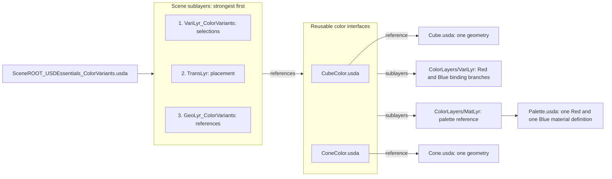

# USD Essentials: color variants

Open [SceneROOT_USDEssentials_ColorVariants.usda](SceneROOT_USDEssentials_ColorVariants.usda)
in Composer using **File > Open**, then frame `/World`. Start with one red cube
and one blue cone. This is the second lesson after the [minimal scene](README.md).
It shares that scene's geometry, placement and two material definitions.

## Try it

1. Select `Layers/VariLyr_ColorVariants.usda` as the authoring layer explicitly.
2. Select `/World/Cube01` in the Stage tree. In the app's variant controls
   (Properties or Variant Presenter, depending on the app), change `Color` from
   `Red` to `Blue`. The cone's choice remains independent.
3. Select `/World/Cone01` and change its `Color` to `Red`.
4. Save the selection layer. Open it in a text editor: it contains the two
   `Color` selections, not copies of the geometry or shaders.
5. Alternatively, edit the quoted selection values in that USDA file, save,
   and reload the stage after saving or discarding any pending Composer edits.

To reset, select Cube01 = Red and Cone01 = Blue. UI locations differ by Kit build;
the file-edit/reload route exposes exactly the same variant selection metadata.

## Follow the composition

The color interfaces reference the original shape assets. Both reuse the same
asset-owned MatLyr and VariLyr files under `/Asset`; reference composition maps
that namespace and its binding targets into each scene occurrence. MatLyr
imports the palette under `Looks`. Each `Color` branch binds `Geometry` to the
matching material. The scene VariLyr selects the branch. Changing a selection
changes a binding, without editing a shader or creating another geometry source.

| Owner | File | Contents |
|---|---|---|
| Scene | `Layers/VariLyr_ColorVariants.usda` | Independent Color choices on Cube01 and Cone01 |
| Asset interface | `Assets/CubeColor.usda`, `Assets/ConeColor.usda` | Shared role sublayers and reference to the original shape |
| Asset variant | `Assets/ColorLayers/VariLyr.usda` | Red/Blue definitions and conditional material bindings |
| Asset materials | `Assets/ColorLayers/MatLyr.usda` | Reference to the shared palette |
| Material library | `Assets/Palette.usda` | The two shader/material definitions |

## Why the first scene's MatLyr is absent

The first lesson assigns fixed scene bindings in `Layers/MatLyr.usda`. This root
omits that layer because those same bindings would mask the referenced asset's
variant bindings on the same geometry prims. Its bytes remain available to the
first lesson. Putting the selection layer higher would not resolve that conflict:
a selection activates a branch but does not remove a competing local binding.

Compare the two roots to see how ownership changes: fixed scene assignments in
lesson one; reusable asset alternatives plus scene selections in lesson two.
Only the second root consumes the color interfaces. No geometry was copied.

## Teaching profile

Centimetres, Y-up, 24 fps; one cube, one cone, two colors. Open as an independent
stage. Use host preview lighting if needed. As in lesson one, edit targets are
manual, with no automatic locks or Opinion helper. For readability, the small
asset interfaces author their shape reference directly rather than adding an
extra asset GeoLyr file. This is a declared introductory profile exception, not
full contract conformance. Continue with the [larger examples](../README.md) for
complete role packaging, Opinion authoring, payloads and instancing.
