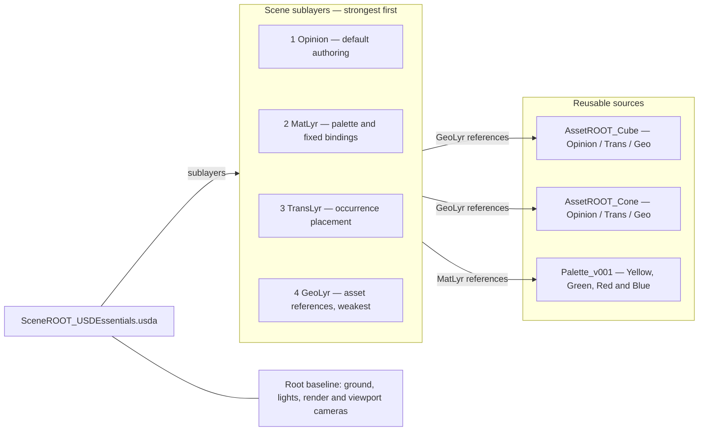

# USD Essentials — one cube, one cone, two colors

## Saved selections

The ColorVariants scene composes Opinion, TransLyr and GeoLyr only. Its existing
`050_OPINION_LYR/OpinLYR_SceneColorVariants.usda` stores saved Color choices. Asset
files define the alternatives. No separate VariLyr or ConfigLyr is needed here;
Session remains available for temporary previews.


## Current leaf preview reference

The four AssetROOT leaves now use the Environment, Render and viewport-camera
setup from `010_ASS_USD/geoANDenvEXAMPLE.usda`, authored directly in each file
outside `/Asset`. Existing geometry, Color variants and default asset paths remain.
This replaces the earlier texture-free preview described below. The supplied
preview uses installed Kit HDR/grid textures and OmniPBR; there are no USD
sublayers, but these are not dependency-free portable files. The reference file
is preserved. Kit visual matching remains pending.


## Self-contained leaves

The four files directly in `010_ASS_USD` are independent leaf assets: geometry,
optional inline Color materials/variants, and an inline `/Environment` beside the
`/Asset` default prim. There are no leaf sublayers, external textures or material
library dependencies. The MatLib and Envs folders have been removed. Fixed-scene
materials live directly in scene MatLyr. The scene roots and leaves now use basic
texture-free dome/key lighting and a plain ground material; the previous HDR/grid
preview is intentionally replaced. Earlier shared-preview folder descriptions
below are historical and superseded by this layout. No Kit visual evaluation
has been performed for the new lighting.


## Current structure — contract 0.2.3

Cube and Cone are self-contained leaf assets. Their entrypoints contain geometry,
intrinsic centering, and (where offered) inline materials and variants. They have
no internal role stack, external palette dependency or Opinion layer. Each entrypoint loads shared preview lighting outside the default asset prim.
Edit a leaf file directly; scene-level experiments still belong in scene Opinion.
The scene retains its environment and layered composition. Assemblies use only
needed work layers. Lofted wrappers in the layered example retain their payload
boundary and load the standalone leaf implementation through ContentsLyr.

The complete numbered folder catalogue at scene scope is a teaching scaffold.
Unused folders/roles may be removed in a real project after removing dependencies.
Leaf packages have no redundant scaffold. Older walkthroughs of leaf role stacks
below describe the previous version and are superseded by this structure.
No new Omniverse runtime acceptance is claimed for this update.


**Folder convention:** layer classes use singular `_LYR`, including `040_DATA_LYR` and `050_OPINION_LYR`, at scene and asset scope. Role filenames retain their existing casing (`DataLyr.usda`, `OpinLYR_SceneDefault.usda`). Folder numbering does not set composition strength.

Two small scenes use the same folder, ownership and naming rules as the composition contracts. **Z-up · centimetres · 60 fps.** Keep this entire folder together when copying it.

## Coordinates and environment ownership

Both `SceneROOT_` entrypoints and all four Cube/Cone asset entrypoints declare
Z-up and nominal centimetre units (`metersPerUnit = 0.01`). The composed Cone
also declares its geometric axis as Z. The two scene roots contain the supplied
Omniverse `Environment` (ground, lighting, render settings and viewport cameras)
under the CC-01 template exception.

The four leaf entrypoints load shared preview lighting from `Envs/OmniverseStandard/Environment.usda`. `/Environment` is outside `/Asset`, so scene references bring in only the asset content.

## Choose a lesson

1. **[Fixed materials](#fixed-materials):** open `SceneROOT_USDEssentials.usda`. Learn sublayers, references, transforms and material bindings.
2. **[Color variants](README_ColorVariants.md):** open `SceneROOT_USDEssentials_ColorVariants.usda`. Change each shape independently between Red and Blue.

## Open and author

Open either root with **File > Open** in Composer and frame `/World`. Both roots use the supplied `defaultscene.usda` Omniverse baseline: ground, sky and distant light, render settings and viewport cameras. Its contents are authored directly in each root; `defaultscene.usda` is a preserved template input, not a nested scene layer.

For the full Opinion-authoring policy, launch your installed Kit application with:

```powershell
.\Open_In_Kit.ps1 -Scene USDEssentials
# Second lesson:
.\Open_In_Kit.ps1 -Scene USDEssentials_ColorVariants
```

Each scene root stores its own Opinion authoring target and `omni_layer.locked` map. The map locks every composed persistent layer except that root's declared Opinion layer. The Kit root remains writable for Kit's camera and authoring metadata, as required by CC-01. The launcher starts a new Kit process, detects an installed application's paths or accepts `-KitExe` and `-AppConfig`, then runs `_workflows/kit/session_defaults.py` to select the scene's Opinion layer, disable automatic authoring and enforce the persistent-layer locks in memory. It installs nothing, changes no Windows permissions or execution policy, and does not save USD files. Kit may write its normal logs, caches and preferences.

If you already opened the scene, run this in Kit's Script Editor, substituting your copied folder's path:

```python
import runpy
runpy.run_path(r"E:/your/project/02_USDEssentials_Minimal/_workflows/kit/session_defaults.py")
```

Directly opening a USDA does not execute Python. Its root metadata declares the authoring target and saved lock map; run the helper in Kit to select Opinion, disable automatic authoring and enforce the lock policy for the current session. Experiment in Opinion. To deliberately teach a saved role edit, unlock that layer and select it explicitly, then return to Opinion. Promote accepted edits to their rightful owner and remove the superseded Opinion values.

## Folder and layer plan

```text
02_USDEssentials_Minimal/
|-- defaultscene.usda                   supplied baseline template (unchanged)
|-- SceneROOT_USDEssentials.usda
|-- SceneROOT_USDEssentials_ColorVariants.usda
|-- 000_SOURCE/                         retained inputs (unused)
|-- 010_ASS_USD/
|   |-- Envs/OmniverseStandard/
|   |   |-- Environment.usda           shared direct-open preview lighting
|   |   `-- Resources/                 portable HDR and grid texture
|   |-- MatLib/Palette_v001.usda         shared Yellow, Green, Red and Blue
|   |-- AssetROOT_Cube.usda
|   |-- AssetROOT_Cube_ColorVariants.usda
|   |-- AssetROOT_Cone.usda
|   `-- AssetROOT_Cone_ColorVariants.usda
|-- 020_BASE_LYR/
|       |   |   |-- GeoLyr.usda         one Cube geometry
|       |   |   |-- TransLyr.usda       intrinsic centering
|       |   |   |-- MatLyr.usda         palette reference
|       |   |   `-- VariLyr.usda        Color binding definitions
|       |   |-- 030_SIM_LYR/            reserved
|       |   |-- 035_RUNTIME_LYR/        reserved
|       |   |-- 040_DATA_LYR/          reserved
|       |   `-- 050_OPINION_LYR/             separate Opinion per entrypoint
|       `-- Cone/                      repeats the Cube package structure
|-- 020_BASE_LYR/
|   |-- GeoLyr.usda                     plain asset references
|   |-- GeoLyr_ColorVariants.usda       color asset references
|   |-- TransLyr.usda                   occurrence placement, shared
|   |-- MatLyr.usda                     fixed lesson bindings
|-- 030_SIM_LYR/                        reserved
|-- 035_RUNTIME_LYR/                    reserved
|-- 040_DATA_LYR/                      reserved
|-- 050_OPINION_LYR/
|   |-- OpinLYR_SceneDefault.usda
|   `-- OpinLYR_SceneColorVariants.usda
|-- _contracts/profile.json             ownership + exact stack order
|-- _pipeline_reports/                  inspection evidence location
|-- _workflows/kit/session_defaults.py
`-- Open_In_Kit.ps1
```

The numbered folders classify roles; **the root's `subLayers` list sets strength**. Unused categories contain notes, not empty composed layers. Scene and asset roots repeat the same organization. A plain asset root composes Opinion → Trans → Geo; its color entrypoint composes Opinion → Vari → Mat → Trans → Geo. Both reuse the same geometry and intrinsic transform files.

## Fixed materials

**Goal:** trace readable USDA opinions into one composed result. Start on the right: GeoLyr references the Cube and Cone packages. Scene TransLyr places their occurrence parents; inline intrinsic transforms centers each shape above its local base. Scene MatLyr references the shared palette and binds the Cube yellow and Cone green. The root combines these sibling layers, with GeoLyr weakest. Opinion is the strongest experimental layer.



### Same USD data, different views

| View | What it shows |
|---|---|
| USDA text | Opinions authored in one layer: prims, attributes, relationships and composition arcs |
| Layer panel | Root and role files contributing opinions, plus the selected authoring destination |
| Stage tree | The composed prim namespace after resolving the layers and references |
| Viewport | The rendered result of the composed data |

```text
/World
|-- Cube01                     scene placement (TransLyr)
|   `-- Adjustment             reserved contextual adjustment boundary
|       `-- Asset              reference to AssetROOT_Cube
|           `-- Geometry       Cube (leaf geometry + intrinsic TransLyr)
|-- Cone01
|   `-- Adjustment
|       `-- Asset              reference to AssetROOT_Cone
|           `-- Geometry       Cone
`-- Looks                      palette reference (scene MatLyr)
    |-- Yellow
    |-- Green
    |-- Red
    `-- Blue
```

A sublayer combines opinions in the same namespace. A reference brings an asset's default prim under a scene reference site. A material binding is a **relationship**, not another composition arc. The scene root contains stage metadata, its sublayer list and the supplied Omniverse environment/render/camera baseline under the CC-01 template exception. It does not nest another scene root. Each asset root has a separate direct-open `/Environment` preview sibling; referencing its `/Asset` default prim does not bring that sibling into the scene. The two teaching shapes remain in their role layers. The baseline ground has its own Grid material; the fixed-material lesson uses Yellow and Green, while the Color variant lesson keeps Red and Blue.

### Small exercises

- Move `/World/Cube01` in Opinion and inspect the resulting translate opinion. Its saved placement belongs in scene TransLyr; intrinsic centering belongs in the asset's TransLyr.
- Deliberately mute scene MatLyr to see what the bindings contribute; restore it afterwards.
- Open GeoLyr and follow its relative asset paths. Each asset root then lists its own sibling role layers.
- Continue with [Color variants](README_ColorVariants.md): the material owner changes, while geometry and placement stay shared.

No simulation, data mappings, payloads, instancing or animation are needed here. This is an introductory contract profile, not a claim of complete contract conformance or Kit acceptance. Developed with AI assistance; human review remains required.

The bundled HDR and grid texture use relative paths. `OmniPBR.mdl` remains an Omniverse-provided shader dependency. Other USD viewers may not reproduce that ground material. `defaultscene.usda` retains its original resource paths as source evidence; open the `SceneROOT_` files for the portable lessons.

