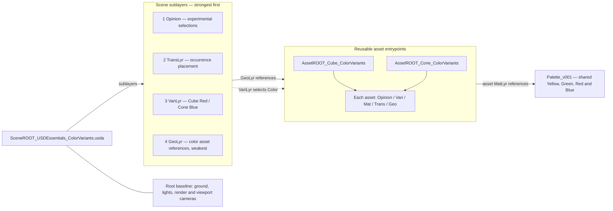

# USD Essentials — asset Color variants

Open `SceneROOT_USDEssentials_ColorVariants.usda`, or use the [launcher and authoring instructions](README.md#open-and-author). One cube and one cone choose between the shared **Red** and **Blue** material definitions. The scene starts with Cube **Red** and Cone **Blue**.

## Try it

1. Keep `050_REVIEW_LYR/OpinLYR_ColorVariants.usda` as the authoring target.
2. Select `/World/Cube01/Adjustment/Asset` or `/World/Cone01/Adjustment/Asset` in the Stage tree.
3. In the variant UI, switch **Color** between **Red** and **Blue**. Each shape is independent. The UI discovers the published variants; it does not define them.
4. Inspect Opinion in a text editor after saving that layer: it contains your selection. The saved baseline selections belong in `020_BASE_LYR/VariLyr_ColorVariants.usda`. Promote accepted selections there deliberately, then remove superseded selections from Opinion.

## Follow the graph

Read left to right: the root composes its four sibling layers. Scene GeoLyr references each color-capable asset entrypoint. Those roots share the plain lesson's asset GeoLyr and TransLyr, and add MatLyr (palette reference) and VariLyr (Color definitions). Scene VariLyr selects the published control. There are still only **two geometry definitions**. The shared palette now has four materials: Yellow and Green serve the fixed-material lesson; these variants use Red and Blue.

Within each asset, `/Asset/Looks` references the palette. Its Color variant branches bind `/Asset/Geometry` to the selected material. USD remaps these paths beneath the scene's reference site.

**Why the first lesson's scene MatLyr is absent:** its unconditional bindings would override the referenced asset's variant bindings. This root uses the asset as binding owner and composes no competing scene binding. Layer ordering alone would not fix that ownership conflict. Geometry, intrinsic transforms, scene placement and palette remain shared; no source geometry is copied for a color choice.

**Paradigm:** define alternatives with the asset that owns them; select them at the scene reference site. Variant-dependent values stay in their branch. Opinion temporarily overrides choices and has an explicit promotion/removal route.

See [folder plan and USD views](README.md#folder-and-layer-plan) and [_contracts/profile.json](_contracts/profile.json) for the exact ownership and stack declarations. Z-up, centimetres, 60 fps; no animation or instancing.

Both roots contain the supplied `defaultscene.usda` baseline directly, including its separate ground Grid material and Omniverse cameras/render settings. The two teaching colors remain Red and Blue.
