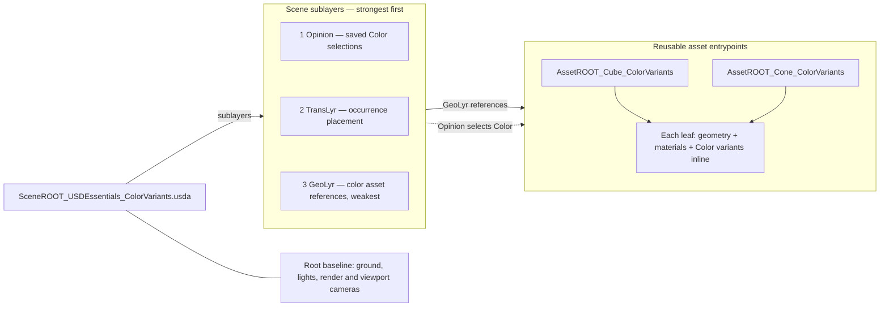

# USD Essentials — asset Color variants

## Self-contained leaves

The four files directly in `010_ASS_USD` are independent leaf assets: geometry,
optional inline Color materials/variants, and an inline `/Environment` beside the
`/Asset` default prim. There are no leaf sublayers, external textures or material
library dependencies. The MatLib and Envs folders have been removed. Fixed-scene
materials live directly in scene MatLyr. The scene roots and leaves now use basic
texture-free dome/key lighting and a plain ground material; the previous HDR/grid
preview is intentionally replaced. Earlier shared-preview folder descriptions
below are historical and superseded by this layout. No Kit visual evaluation
has been performed for the new lighting.

Open `SceneROOT_USDEssentials_ColorVariants.usda`, or use the [launcher and authoring instructions](README.md#open-and-author). One cube and one cone choose between the inline **Red** and **Blue** material definitions. The scene starts with Cube **Red** and Cone **Blue**.

## Try it

1. Keep `050_OPINION_LYR/OpinLYR_SceneColorVariants.usda` as the authoring target.
2. Select `/World/Cube01/Adjustment/Asset` or `/World/Cone01/Adjustment/Asset` in the Stage tree.
3. In the variant UI, switch **Color** between **Red** and **Blue**. Each shape is independent. The UI discovers the published variants; it does not define them.
4. Inspect Opinion in a text editor after saving that layer: it contains your selection. Opinion is the persistent home for these selections; no promotion or extra selection layer is required.

## Follow the graph

The scene root composes three sibling layers. GeoLyr references standalone Cube/Cone color assets; each file contains geometry, intrinsic centering, materials and Color variants. Scene Opinion stores the selected choices. The plain and color entrypoints intentionally repeat the small shape definition to remain self-contained.

Within each asset, `/Asset/Looks` defines the materials inline. Its Color variant branches bind `/Asset/Geometry` to the selected material. USD remaps these paths beneath the scene's reference site.

**Why the first lesson's scene MatLyr is absent:** its unconditional bindings would override the referenced asset's variant bindings. This root uses the asset as binding owner and composes no competing scene binding. Layer ordering alone would not fix that ownership conflict. Each Color choice changes only the binding; geometry is defined once within each standalone variant asset.

**Paradigm:** define alternatives with the asset that owns them; select them at the scene reference site. Variant-dependent values stay in their branch. Opinion persists the scene choices. Add ConfigLyr only for independently managed configurations.

See [folder plan and USD views](README.md#folder-and-layer-plan) and [_contracts/profile.json](_contracts/profile.json) for the exact ownership and stack declarations. Z-up, centimetres, 60 fps; no animation or instancing.

Both roots contain the supplied `defaultscene.usda` baseline directly, including its separate ground Grid material and Omniverse cameras/render settings. The two teaching colors remain Red and Blue.
